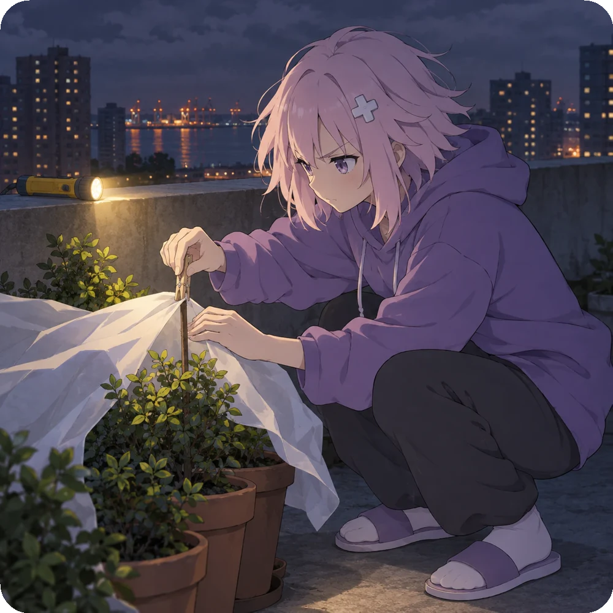

  <picture>
    <source media="(prefers-color-scheme: dark)" srcset=".github/assets/banner-dark.png">
    
  </picture>

  
  
  
  
  
  
  

---

A fully vibe-coded harness for building unique neuropersonas in different chat interfaces (Discord, Telegram, Twitter, etc.) with near-unlimited memory. Recall works by full-text search over learned word stems and trigrams in one SQLite database, int8 embedding vectors for meaning, time windows around each hit, reciprocal-rank fusion across all of these, and audience-scoped visibility.

All built-in tools focus on making a believable human-like companion. Out of the box, the persona can write and later edit or delete its own messages, react with emoji, see images and videos, search the web, read pages behind links, find information, images and files on the internet through an errand agent, send GIFs, stickers and custom server emoji, record voice messages, and draw itself in different outfits while keeping a consistent look and a consistent world. It remembers people and keeps its own attitude to each of them, keeps a diary, sets its own intentions and wakes on its own heartbeat to keep promises, and talks in private messages with a separate private memory. Think of [Hermes Agent](https://github.com/NousResearch/hermes-agent) meets [SillyTavern](https://github.com/SillyTavern/SillyTavern) with [OpenViking](https://github.com/volcengine/OpenViking)'s modified memory.

