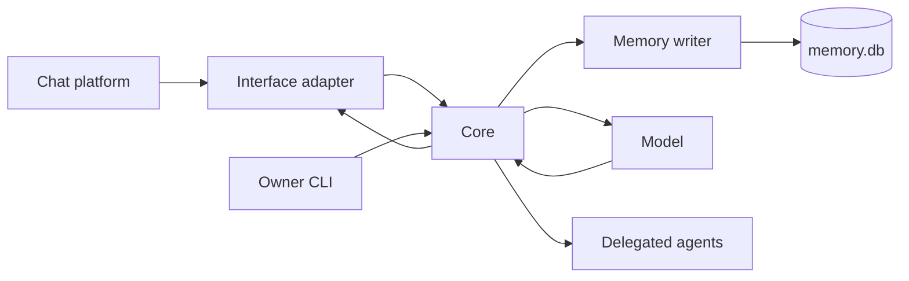

# Core

The core is the process that owns one persona's turns, memory and work. Interfaces translate platform activity into its protocol, and a platform's own words stop there: a core function takes a `placeId`, never a server beside it, and the core serves whatever communities its interfaces say hello with, or none. The owner CLI and agent clients connect to the same Unix socket with separate authenticated identities.

## A turn

The interface supplies a message and its conversation, author and audience. The event door validates the event and rejects duplicates. The pipeline decides whether it calls for a reply and collects nearby messages, relevant memory and available abilities.

The request builder combines that context with the persona's prompts. The model can call tools before answering. Tool results return to the same turn; final output tags describe messages, reactions or silence. The interface executes supported actions and reports what happened.

A line of the owner's CLI reaches the door when it arrives, as on any interface, and `src/turn/control.ts` tracks only what its client shows. The runner reads a cancel signal only for such a line (`cancelOf`, `src/behavior/turn.ts`), and it ends `cancelled` with nothing out. [CLI](cli.md#turns-the-queue-and-cancelling) explains the queue.

An answer whose `<think>` is broken is never sent: the same request runs once more, and a second such answer ends the turn with the outcome `skip` and the reason `think-leaked`. [The prompt contract](prompt-contract.md#standards-of-output-and-stored-text) holds the standards of her output and of stored text.

A heartbeat or completed errand can also cause a turn. It uses the same persona and memory rather than a separate conversational agent. [Inner life](inner-life.md) explains those triggers.

## Time in the chat

`<chat>` lists its lines in strict time order. `orderedHistory` in `src/turn/history.ts` sorts the window once, after the reply parents, the deleted placeholders and the lines of a continued turn are in. Each of her call marks stands among the lines as a line of hers at the call's time, after a message of the same instant. A mark takes no number and is dropped when it is older than the window. `formatTranscript` in `src/format.ts` gives each line one clock and no age, opens each new day with a date marker and marks a silence of 20 minutes. The tempo lines close the block. The previous think survives a restart: the journal's `turn` records of yesterday and today seed the store at start, and its 30-minute window stays the rule.

## The turn frame

`buildTurnRequest` in `src/turn/phases/request/build.ts` builds a `Frame` with `frameOf` in `src/turn/request/frame.ts` before any block of the request, and `buildRequest` reads the turn's kind, her place and her counterpart from it. A request built without a frame, as a replay builds one, reads the kind off `mode`, `triggerKind` and `wakeKind` through `turnKindOf`.

| Field | What it holds |
|---|---|
| `kind` | The `TurnKind`: `reply`, `heartbeat`, `selfimprovement`, `intention`, `feedback`, `errand_result`, `selfreflection_plan` or `selfreflection`. |
| `place` | A `FramePlace` with `id`, `name`, `kind` and `path`, or null when she is nowhere. |
| `root` | The top of the place's tree as a `FramePlace`, null in a one-to-one chat, with no place and for a place with no stored parent. |
| `chain` | The stored chain of the place, the place first, which `<spatial_awareness>` renders link by link. |
| `interface` | The interface's id. |
| `scope` | `group`, `dm` or `internal`, the last when she is nowhere. |
| `counterpart` | The partner of a one-to-one chat, else the author of the trigger, else null. |
| `answers` | The `messageId` and `authorId` of the message the turn answers, or null. |
| `now`, `timezone` | The present moment and the zone it reads in. |
| `awake` | The `AwakeReason`: `message`, `wake`, `errand` or `selfreflection`. |
| `wakeKind` | The wake beside `awake`, null on any other turn. |
| `blocks` | The tags of the kind from `blocksOf`, listed in [the prompt contract](prompt-contract.md#blocks-per-kind). |

`reply`, `interject`, `initiate`, `elsewhere` and `auto` make a `reply`, and a trigger of kind `errand` makes an `errand_result`. An inner turn takes its wake's kind, with `intention_due`, `attend`, `errand_deadline` and `review` making an `intention`. A `heartbeat`, a `selfimprovement` and both `selfreflection` kinds are nowhere, whatever place their turn rides in on. The path of a place runs from the interface down by names, and a one-to-one chat's path is the interface, the interface's word for the chat and the partner's native id, with no name. `frameOf` throws `FrameError` with the code `PLACE_REQUIRED` for a `reply` with no place.

## The request on the frame

A `reply` and an `errand_result` are built on the frame by `framedBuild` in `src/turn/request/framed.ts`, which hands the rendered parts to `readerRequest` in `src/turn/request/reader.ts`. The other kinds keep the older emission of `assembleUser` in `src/turn/request/tail.ts`. Each block of the frame has one producer.

| Block | Producer | What it reads |
|---|---|---|
| `<surroundings>` | `surroundingsOf` in `src/turn/request/surroundings.ts` | The frame's place and root, their stored fields and the interface's name and nouns (`placeFieldsOf` and `interfaceNamesOf` in `src/memory/db/frame-reads.ts`) |
| `<memory>` | `memoryItemsOf` and `renderMemory` in `src/turn/request/memory-block.ts` | What `mindOf` in `src/memory/db/mind-read.ts` raises from the window, the counterpart, the place and the prefetch's finds |
| `<recall>` | `recallBlockOf` in `src/turn/request/recall-block.ts` | The ring of her lookups, `createLookupRing` in `src/turn/calls.ts` |
| `<inner>` | `innerBlockOf` in `src/turn/request/inner-block.ts` | Her day, intentions, errands, untold facts and previous think |
| `<meanwhile>` | `meanwhileWindows` and `meanwhileText` in `src/turn/request/meanwhile.ts` | Her last lines in other places and the lines around them (`ownLinesOf` and `linesAroundOf`) |

`buildTurnRequest` reads all of it under the turn's memory context, so a group turn reads no private chat. The budget fits the blocks in this order: the fixed part, the person she answers, the shares of `<memory>` under `context.memory.budgetTokens`, `<recall>`, `<chat>`, `<meanwhile>` and `<inner>`. Mention handles are given after the fit, to the authors of `<chat>` and to the people `<memory>` and `<meanwhile>` kept, so a person the budget dropped has none. Channel handles go the same way to the current place and to the places `<memory>` and `<meanwhile>` kept, and the request's `channelHandles` maps them back for her tools. A line's identity in a stored text renders through `refResolverOf` in `src/turn/request/refs.ts`, its own lines in `<chat>` included. A lookup whose quoted lines are all retired leaves `<recall>`.

A call of a read tool is a lookup. `src/turn/skill-calls.ts` keeps it in the ring of the conversation it was made in, with the result's text cut to `context.recall.extractChars` (default `1200`) and the source ids of the stored lines the call quoted, and writes it into the operation's closing line in the journal. At start `callMarksOf` in `src/memory/journal.ts` gives the journal's lookups of yesterday and today back to the ring with the call marks. A place keeps at most `context.recall.maxItems` lookups (default `6`), one per tool and arguments. A lookup leaves once none of its anchors, the trigger of its turn and the lines she posted in answer, is in the window, and a line that replies to an anchor becomes an anchor itself.

## The door

`createHandleMessage` in `src/pipeline/handle-message.ts` takes every new line. A DM and the owner's CLI are addressed already, so they go to the private path and never ask a classifier, and the persona's own turn decides whether to speak. Every other line belongs to a group place, which is a channel, a thread or a group that is its own root, on any interface.

The address classifier in `src/pipeline/address-classifier.ts` decides whether a group line starts a turn. A line with the interface's `addressing.mentioned` or `addressing.replyToSelf` goes to it at once, as a call of kind `mention` or `reply` (`answerFlagged` in `src/pipeline/follow-up.ts`). Any other line goes only while the persona wrote in that place within `address.attentionMinutes`, 15 by default, and only when it mentions no other member (`addressGate` in `src/pipeline/address-attention.ts`), and its turn has the kind `followUp`. A third gate sends a line that names one of those aliases, with no ping and outside attention: `namesAlias` in `src/behavior/mention.ts` compares the line's words with each alias's words by the memory's learned stemmer (`loadStemmer` in `src/memory/db/stems.ts`); the aliases and the stemmer are read at each line, so a declined form matches, and without a stemmer by case-folded whole words, so a short alias never matches inside a longer word. The alias never starts a turn by itself: the classifier decides, the per-author rail applies, and the log line `address: gate` names `gate: 'alias'` with no text. A verdict of `overheard` starts an overheard turn and `no` starts nothing. Her name in a line opens nothing by itself. Her aliases are the names the owner gave her own person record, `person:self`, with `/memory users names add person:self <name>`; the classifier reads them as `<aliases>`, one per line, and a record with no such name adds no block.

The classifier answers the JSON object `{ "answer": ... }` by the strict schema `ADDRESS_FORMAT`. A flagged line the classifier could not judge opens: a failed call, an empty answer, or an answer that is not that object with one of the three words starts the turn, and the line leaves a `gate-failopen` fact for the missed-answer check. A failed call on an unflagged line opens only for the member she is talking with one to one at that moment.

`decideAndLog` in `src/pipeline/answer.ts` holds a rail in front of each turn a verdict asks for. Past `address.maxTurnsPerAuthor` started turns, 50 by default, of one author in one place within `address.attentionMinutes`, the turn is refused and logged as `address: refused` with its counts. `0` in `address.maxTurnsPerAuthor` turns the rail off, and `mention.neverIgnore` lists authors it never refuses. A line caught up after a restart follows the same path when it carries a flag, and is only observed otherwise.

## Split and the missed-answer check

`split` (`src/behavior/split.ts`) runs for every started turn with a line of a person, on any interface and in a DM: a mention, a reply, a follow-up, an overheard line or a private message. A `missed` turn never runs it. `merge` (`src/pipeline/merge.ts`) works on the pending queue and stays in the pipeline. The splitter, the merge classifier and the missed-answer check answer a JSON object by a strict schema, `SPLIT_FORMAT`, `MERGE_FORMAT` and `MISSED_FORMAT`, and an answer that is not that object counts as one they could not read: one request, a new call, every candidate `uncertain`.

The missed-answer registry in `src/behavior/missed.ts` covers every group place and every DM. `noteFact` takes the line's `iface` and the candidate keeps it, so its sweep reads its conversation on that interface and its recovery turn runs there. Each candidate is stored in the unit `missed` of its own place, and `src/core.ts` starts the registry of every place that holds one (`start(placeId)` adds to those already started).

## The elsewhere pick

`createElsewherePicker` in `src/behavior/elsewhere-pick.ts` is one classifier call per started turn, with the purpose `elsewhere-pick` and the prompt `prompts/elsewhere-pick.md`. It answers the JSON object of `ELSEWHERE_FORMAT`, `place`, `earlier` and `episodes`, and `parseElsewhereAnswer` reads each field apart, so a bad field voids only its own. A selfreflection post and a `missed` turn never ask. The pull phase takes the place through `routeChannels` and shows it in `<channel_view>`, and the request phase takes the episodes through `pickEpisodes` for `<participation>`. `createElsewhereHooks` gives both call sites the one answer.

`elsewhereCandidates` cuts the lists before the prompt: the newest `elsewhere.maxPlaces` places by the later of activity and attention, 40 by default and listed by id, and the newest `elsewhere.maxEpisodes` episodes, 30 by default and listed oldest first. The audience is checked per place, and `audienceAllows` over the turn's listing refuses a place the listing does not hold, so a place on another interface is no candidate until a read can prove its audience. A place must also pass the pull phase's own `checkPull`. A DM offers places through its partner's view and no episodes, because it shows no `<participation>`. Past `elsewhere.pickTimeoutMs`, 3000 by default, the pick is aborted and the turn goes on without it.

## Boundaries

The core writes memory through one writer. Interfaces neither open the database nor decide what the persona remembers. Stored recall and fetching live platform history are separate operations with separate access checks.

A conversation session of the owner's CLI (`src/conversation/`) is a view over stored lines, kept in its own file, and memory never reads it. Selecting one changes what the next turn's history shows, and memory stays continuous. [CLI](cli.md#sessions-and-checkpoints) explains them.

An approval from the owner's CLI goes through the board's own `task.approve` (`src/board/approval-view.ts`), and an agent's mode is set before its run, so no tool call waits on a person. [CLI](cli.md#approvals-and-capability-menus) explains what that panel shows.

The execution context carries trusted access information outside message text. An account claiming to be the owner in a message does not acquire owner CLI access. [Memory](memory.md#who-can-recall-what) explains the audience rules.

Actions interrupted by a restart or lost connection are not automatically sent again. Their records can inform a later turn, where the persona decides whether another action is appropriate. A transport acknowledgment is not proof that a message reached the platform.

The main thread holds no long read or copy, because nothing else in the core moves while one runs. A search of the record runs on a reader thread, every write on the writer thread, and the owner's `/memory backup` on a thread of its own. [Memory](memory.md#searches-and-backups-off-the-main-thread) names the modules. `src/loop-watch.ts` logs `core: event loop stalled` when a tick comes later than `diagnostics.loopStallMs`, default `1000`, with the operations `track` marked around it: `recall.prefetch`, `recall.run`, `memory.backup`, `backup` and `backup.prune` among them.

## Where to read the code

| Area | Entry point |
|---|---|
| Composition and lifecycle | [src/core.ts](../src/core.ts) |
| Event admission and client link | [src/interface/](../src/interface/) |
| Context and response decision | [src/pipeline/](../src/pipeline/) |
| Request assembly and tool loop | [src/turn/](../src/turn/) |
| Platform protocol | [src/protocol/](../src/protocol/) |
| Model output | [src/llm/parse.ts](../src/llm/parse.ts) |

## The task board

The [board](board.md) stores delegated work in the same database. Its roles govern task operations independently from conversational memory access. A watcher can file findings without receiving permission to deploy code.
