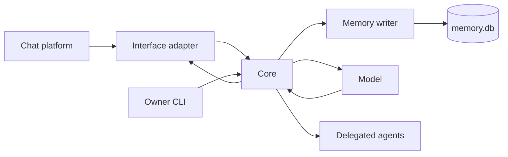

# Core

The core is the process that owns one persona's turns, memory and work. Interfaces translate platform activity into its protocol, and a platform's own words stop there: a core function takes a `placeId`, never a server beside it, and the core serves whatever roots its interfaces say hello with, or none. The owner CLI and agent clients connect to the same Unix socket with separate authenticated identities.

## A turn

The interface supplies a message and its chat, author and audience. The event door validates the event and rejects duplicates. The pipeline decides whether it calls for a reply and collects nearby messages, relevant memory and available abilities.

A bot or a webhook is an author like a person. `createHandleMessage` in `src/pipeline/handle-message.ts` stores its line, a bot that names her or replies to her starts her turn as a member would, and the edits, the private gate, the analyzers, the counters of memory and the transcript read its lines as anyone's. Her own lines are told apart by her account id (`selfId`), never by the event's `author.bot`, which memory keeps as the account's kind. The global request cap `llm.maxRequestsPerDay` bounds every turn alike. The one message the pipeline drops is a system message, which no author writes (`message.system`, step 1 of `handleMessage`).

The request builder combines that context with the persona's prompts. The model can call tools before answering. Tool results return to the same turn; final output tags describe messages, reactions or silence. The interface executes supported actions and reports what happened.

`runSteps` in `src/turn/tool-round.ts` runs the steps of a turn. The calls of one answer run first, in her order. Her speech in that answer goes out after them when every call worked and its result is an effect or an accepted errand, and otherwise it is held and the next request tells her so. One more request follows a step that left her something to read: a read's data, a call that did not work, or a note on a post. A quiet call that worked, such as a post, an edit, a deletion, a reaction, a picture or an accepted errand, is something to read only in a turn that answers someone, one whose trigger is a message that is not overheard. That request shows her the outcome, and she answers in words, calls again or stays silent. An inner turn, a heartbeat, a selfreflection post, an errand's result turn, an overheard line and a spontaneous turn end with the quiet call. A wake's deciding call and a call refused because `features.tools` is off end the turn too. `tools.loop.maxSteps`, default `100`, counts the requests of a turn, and the last one allowed cannot call. `tools.loop.maxCallsPerStep`, default `8`, bounds the calls of one answer that run, and every call past it gets a `loop-cap` result. An inner turn takes its bound from `wakes.loop.maxSteps`, default `4`, and a selfreflection post from `selfreflection.loop.maxSteps`, default `2`.

A long lookup gets a reminder. From the request that follows her answer with calls number `tools.loop.remindAfterSteps`, default `2`, every request of an ordinary turn that may still call ends its note with the line `labels.task.step.long`, with the count of answers with calls so far. The request stays a normal one, and her calls in the answer to it run. The final request, the rescue request, an inner turn and a selfreflection post carry no reminder, and `0` turns it off. `runSteps` counts the answers and `stepNote` in `src/behavior/tool-step.ts` adds the line.

A call's data reaches the next request cut at `tools.resultMaxChars`, default `8000` characters, or at `recall.quoteMaxChars` for `memory.search` and `conversation.read`, as `resultCharsFor` in `src/turn/settings.ts` reads them. `toolResultText` in `src/tools/tool-calls.ts` ends a cut result with the line `labels.task.step.cut`, which tells her that a narrower call reads the rest.

When the next request would pass `llm.maxRequestTokens`, default `100000`, the results of earlier steps of the turn give way first. `giveWay` in `src/behavior/tool-step.ts` replaces them oldest first, each by the line `labels.task.step.dropped` with the tool's name, and stops at the first replacement that makes the request fit. The turn's first request and the results of the step just run stay as they are, and the request may still call. The provider's cache of the turn holds up to the first replaced result. The archive keeps each request as it was sent, and the journal keeps every call's result whole.

A request becomes the last one when the steps run out, when `tools.loop.timeBudgetMs`, default `150000`, is spent, or when it fits under the cap only after every earlier result gave way and the newest results are cut. It keeps the tools array, so the cached prefix holds, and goes with the tool choice `none` on the native transport. An inner turn's last request keeps the choice `auto`, because its one post or intention change still runs. A last answer that carries calls anyway, as on the text transport, is her reply: its speech goes out, and every call gets a `loop-cap` result that only the journal keeps. A selfreflection post holds that speech.

The steps can also end with no last answer, when the next request does not fit even with its results cut or when it fails. In a turn that answers someone and has sent nothing, `runSteps` then makes one rescue request: the turn's first messages and one note, `labels.task.step.rescue`, with the tool choice `none`. Its speech goes out, and its `<skip/>` ends the turn with the outcome `skip` and the reason `silence`. A failed rescue request ends the turn with nothing sent. `rescueRequest` in `src/behavior/tool-step.ts` builds it.

Each attempt of a turn runs in `runAttempt` in `src/turn/phases/attempt.ts`. It creates the attempt's draft, runs the phases of `src/turn/phases/` in order (the preflight, the request, the response, the act, the tool round and the outcome) and closes the attempt whatever it returned. Every phase, and every step of the request phase, adds its own fields to one flat record of what the attempt has made and names the fields it reads as a `Pick` of that record. The draft in `src/turn/draft.ts` holds what the attempt notes for its journal record and its turn's end, and each topic module of `src/turn/` declares the draft fields it reads in its own draft type.

A line of the owner's CLI reaches the door when it arrives, as on any interface, and `src/turn/control.ts` tracks only what its client shows. The runner reads a cancel signal only for such a line (`cancelOf`, `src/behavior/turn.ts`), and it ends `cancelled` with nothing out. [CLI](cli.md#turns-the-queue-and-cancelling) explains the queue.

An answer whose `<think>` is broken is never sent: the same request runs once more, and a second such answer ends the turn with the outcome `skip` and the reason `think-leaked`. [The prompt contract](prompt-contract.md#standards-of-output-and-stored-text) holds the standards of her output and of stored text.

A heartbeat or completed errand can also cause a turn. It uses the same persona and memory rather than a separate conversational agent. [Inner life](inner-life.md) explains those triggers.

## Time in the chat

`<chat>` lists its lines in strict time order. `orderedHistory` in `src/turn/history.ts` sorts the window once, after the reply parents, the deleted placeholders and the lines of a continued turn are in. Each of her call marks stands among the lines as a line of hers at the call's time, after a message of the same instant. A mark takes no number and is dropped when it is older than the window. `formatTranscript` in `src/format.ts` gives each line one clock and no age, opens each new day with a date marker and marks a silence of 20 minutes. The tempo lines close the block. The previous think survives a restart: the journal's `turn` records of yesterday and today seed the store at start, and its 30-minute window stays the rule.

## The turn frame

`buildTurnRequest` in `src/turn/phases/request/build.ts` builds a `Frame` with `frameOf` in `src/turn/request/frame.ts` before any block of the request, and `buildRequest` reads the turn's kind, her place and her counterpart from it. A request built without a frame, as a replay builds one, reads the kind off `mode`, `triggerKind` and `wakeKind` through `turnKindOf`.

| Field | What it holds |
|---|---|
| `kind` | The `TurnKind`: `reply`, `heartbeat`, `selfimprovement`, `intention`, `feedback`, `errand_result`, `selfreflection_plan` or `selfreflection`. |
| `place` | A `FramePlace` with `id`, `name`, `kind` and `path`, or null when she is nowhere. |
| `root` | The top of the place's tree as a `FramePlace`, null in a one-to-one chat, with no place and for a place with no stored parent. |
| `chain` | The stored chain of the place, the place first, which `<spatial_awareness>` renders link by link. |
| `interface` | The interface's id. |
| `scope` | `group`, `dm` or `internal`, the last when she is nowhere. |
| `counterpart` | The partner of a one-to-one chat, else the author of the trigger, else null. |
| `answers` | The `messageId` and `authorId` of the message the turn answers, or null. |
| `now`, `timezone` | The present moment and the zone it reads in. |
| `awake` | The `AwakeReason`: `message`, `wake`, `errand` or `selfreflection`. |
| `wakeKind` | The wake beside `awake`, null on any other turn. |
| `blocks` | The tags of the kind from `blocksOf`, listed in [the prompt contract](prompt-contract.md#blocks-per-kind). |

`reply` and `interject` make a `reply`, and a trigger of kind `errand` makes an `errand_result`. An inner turn takes its wake's kind, with `intention_due`, `attend` and `errand_deadline` making an `intention` and a `feedback` wake a `feedback`. A `heartbeat`, a `selfimprovement` and both `selfreflection` kinds are nowhere, and so is a turn the drain runs with `chat: null`. The path of a place runs from the interface down by names, and a one-to-one chat's path is the interface, the interface's word for the chat and the partner's native id, with no name. `frameOf` throws `FrameError` with the code `PLACE_REQUIRED` for a `reply` with no place.

## The request on the frame

A `reply` and an `errand_result` are built on the frame by `framedBuild` in `src/turn/request/framed.ts`, which hands the rendered parts to `readerRequest` in `src/turn/request/reader.ts`. The other kinds keep the older emission of `assembleUser` in `src/turn/request/tail.ts`. Each block of the frame has one producer.

| Block | Producer | What it reads |
|---|---|---|
| `<surroundings>` | `surroundingsOf` in `src/turn/request/surroundings.ts` | The frame's place and root, their stored fields and the interface's name and nouns (`placeFieldsOf` and `interfaceNamesOf` in `src/memory/db/frame-reads.ts`) |
| `<memory>` | `memoryItemsOf`, `printOrder` and `renderMemory` in `src/turn/request/memory-block.ts` | What `mindOf` in `src/memory/db/mind-read.ts` raises from the window, the counterpart, the place and the prefetch's finds |
| `<found>` | `memoryItemsOf`, `factItemsOf` and `subtagBody` in `src/turn/request/memory-block.ts` | The graph reader's excerpts (`mind.found`) and the stored facts the prefetch found |
| `<recall>` | `recallBlockOf` in `src/turn/request/recall-block.ts` | The ring of her lookups, `createLookupRing` in `src/turn/calls.ts` |
| `<inner>` | `innerBlockOf` in `src/turn/request/inner-block.ts` | Her day, intentions, errands, untold facts and previous think |
| `<meanwhile>` | `meanwhileWindows` and `meanwhileText` in `src/turn/request/meanwhile.ts` | Her last lines in other places and the lines around them (`ownLinesOf` and `linesAroundOf`), each line with its media, a picture posted alone included, each place's path from its row's `iface` and a DM's from its partner account's native id |

`buildTurnRequest` reads all of it under the turn's memory context, so a group turn reads no private chat. The budget fits the blocks in this order: the fixed part, the person she answers, the shares of `<memory>` under `context.memory.budgetTokens` with an unused share lent to a full one, `<recall>`, `<chat>`, `<meanwhile>` and `<inner>`. Handles are given before any block is rendered (`handleBook` in `src/behavior/handles.ts`): a person's is cut from the meta-person, so the same person carries one handle on every interface and for every account, and every block names a line's author by it, a mention in a stored text too. Channel handles go to the current place and to every place the request names, which reads as its handle and path (`places.ref`), and the request's `channelHandles` maps them back for her tools. The request's `handles` hold only the handles that stand in its text, so a person the budget dropped has none a tool would resolve, and its `refs` carry each person's accounts for the rest of the turn: her `@handle` in a post mentions the person's account on the interface the post goes to ([prompt contract](prompt-contract.md#mention-handles)). A line's identity in a stored text renders through `refResolverOf` in `src/turn/request/refs.ts`, its own lines in `<chat>` included. A lookup whose quoted lines are all retired leaves `<recall>`: `sourceRetiredOf` in `src/memory/db/frame-reads.ts` finds each quoted source's message through its row, and a source no row holds, or whose message the turn's context reads as deleted or not at all, counts as retired. The numbers of an extract are given anew in each request. A lookup keeps in process the line each of its `#n` named when it was read (`lines` of `Lookup` in `src/turn/calls.ts`), `numberedLookups` in `src/turn/request/recall-block.ts` numbers those lines from the first number a read of the turn would take, `SEARCH_HANDLE_GAP` (`20`) past the highest number of `<chat>`, and `buildTurnRequest` hands them to the turn's registry (`searchHandles`). A call of the turn resolves them, `media.look` included, and a read of the turn numbers on past them. The journal's closing line keeps the extract without its lines, so after a restart the ring refilled from the journal shows its extracts with no number until she reads again.

The request is laid out for the provider's prompt cache. The tools array comes first and is the same for every kind of turn, her skills included as entries after the tools ([skills](skills.md)). Then come the system message, the stable segment with `<self>` and the surroundings segment with `<surroundings>`, each with its own cache marker, and the tail. The tail opens with what repeats between two turns of one place, `<memory>` and `<meanwhile>`, then `<chat>`, then the turn's own blocks and `<task>` last, in the order of the frame's list (`blocksOf` in `src/turn/request/frame.ts`, [prompt contract](prompt-contract.md#blocks-per-kind)). `<memory>` prints its kept entries by id, whatever the graph reader's rank (`printOrder` in `src/turn/request/memory-block.ts`), and a place's count of her lines rounded down to a step (`ownLinesShown` in `src/memory/db/mind-read.ts`), so a turn that raises the same entries as the turn before sends the same bytes up to `<chat>`. `<self_facts>` and `<surroundings>` are held for one TTL bucket of `llm.cache.ttl`, `<surroundings>` per place and per description version, so a move to another room rewrites only the surroundings segment ([prompt contract](prompt-contract.md#the-frames-blocks)). When `<chat>` does not fit whole, `fitSections` in `src/llm/budget.ts` cuts it to the largest step of `context.chatSteps` (default `[100, 60, 30, 10]`) that fits, so two turns with nothing new between them send the same lines. Below the smallest step it keeps what fits. `scripts/cache-report.ts` prints, for a day range of `model_requests`, the prompt and cached tokens, the share of turns whose first request read nothing from the cache and the median gap between turns of one place.

A call of a read tool is a lookup. `src/turn/skill-calls.ts` keeps it in the ring of the chat it was made in, with the result's text cut to `context.recall.extractChars` (default `1200`) and the source ids of the stored lines the call quoted, and writes it into the operation's closing line in the journal. At start `callMarksOf` in `src/memory/journal.ts` gives the journal's lookups of yesterday and today back to the ring with the call marks. A place keeps at most `context.recall.maxItems` lookups (default `6`), one per tool and arguments. A lookup leaves once none of its anchors, the trigger of its turn and the lines she posted in answer, is in the window, and a line that replies to an anchor becomes an anchor itself.

## The door

`createHandleMessage` in `src/pipeline/handle-message.ts` takes every new line. A DM and the owner's CLI are addressed already, so they go to the private path and never ask a classifier, and the persona's own turn decides whether to speak. Every other line belongs to a group place, which is a channel, a thread or a group that is its own root, on any interface.

The door's screen (`screen` of `createPersonLinks` in `src/interface/person-link.ts`) sees each line first. The answer that holds a waiting link phrase is stored like any line and starts no turn. A line that carries a one-time phrase, hers or anyone's, stays in memory and in the chat a turn reads like any other.

The address classifier in `src/pipeline/address-classifier.ts` decides whether a group line starts a turn. A line with the interface's `addressing.mentioned` or `addressing.replyToSelf` goes to it at once, as a call of kind `mention` or `reply` (`answerFlagged` in `src/pipeline/follow-up.ts`). Any other line goes only while the persona wrote in that place within `address.attentionMinutes`, 15 by default, and only when it mentions no other member (`addressGate` in `src/pipeline/address-attention.ts`), and its turn has the kind `followUp`. A third gate sends a line that names one of those aliases, with no ping and outside attention: `namesAlias` in `src/behavior/mention.ts` compares the line's words with each alias's words by the memory's learned stemmer (`loadStemmer` in `src/memory/db/stems.ts`); the aliases and the stemmer are read at each line, so a declined form matches, and without a stemmer by case-folded whole words, so a short alias never matches inside a longer word. The alias never starts a turn by itself: the classifier decides, the per-author rail applies, and the log line `address: gate` names `gate: 'alias'` with no text. A verdict of `overheard` starts an overheard turn and `no` starts nothing. Her name in a line opens nothing by itself. Her aliases are the names the owner gave her own person record, `person:self`, with `/memory users names add person:self <name>`; the classifier reads them as `<aliases>`, one per line, and a record with no such name adds no block.

The classifier answers the JSON object `{ "answer": ... }` by the strict schema `ADDRESS_FORMAT`. A flagged line the classifier could not judge opens: a failed call, an empty answer, or an answer that is not that object with one of the three words starts the turn, and the line leaves a `gate-failopen` fact for the missed-answer check. A failed call on an unflagged line opens only for the member she is talking with one to one at that moment.

`decideAndLog` in `src/pipeline/answer.ts` holds a rail in front of each turn a verdict asks for. Past `address.maxTurnsPerAuthor` started turns, 50 by default, of one author in one place within `address.attentionMinutes`, the turn is refused and logged as `address: refused` with its counts. `0` in `address.maxTurnsPerAuthor` turns the rail off, and `mention.neverIgnore` lists authors it never refuses. A line caught up after a restart follows the same path when it carries a flag, and is only observed otherwise.

## The settle wait

A turn answering a person waits until that person stops writing before it reads the chat. `settleAuthor` in `src/turn/sends.ts` holds the attention until the author has been quiet for `pace.settleMs` (default `3000`), never longer than `pace.settleMaxMs` (default `8000`) after the calling line. The activity tracker `createActivity` in `src/behavior/activity.ts` says when each person last wrote in each chat. In a DM and the owner's CLI every line is a call, so a line written during the wait lands in the pending queue. The turn reads such lines as part of its call: `settledBurst` in `src/behavior/activity.ts` takes the author's lines after the calling one, each within `pace.settleMs` of the line before and all within `pace.settleMaxMs` of the first. `tellFacts` in `src/turn/phases/request/facts.ts` leaves them out of `labels.task.queued`, so the turn counts them as seen, and the drain drops their calls as already answered. The turn's end names them in `folded`. A line sent after the turn read the chat waits for its own turn.

## Split and the missed-answer check

`split` (`src/behavior/split.ts`) runs for every started turn with a line of a person, on any interface and in a DM: a mention, a reply, a follow-up, an overheard line or a private message. A `missed` turn never runs it. `merge` (`src/pipeline/merge.ts`) works on the pending queue and stays in the pipeline. The splitter, the merge classifier and the missed-answer check answer a JSON object by a strict schema, `SPLIT_FORMAT`, `MERGE_FORMAT` and `MISSED_FORMAT`, and an answer that is not that object counts as one they could not read: one request, a new call, every candidate `uncertain`.

The missed-answer registry in `src/behavior/missed.ts` covers every group place and every DM. `noteFact` takes the line's `iface` and the candidate keeps it, so its sweep reads its chat on that interface and its recovery turn runs there. Each candidate is stored in the unit `missed` of its own place, and `src/core.ts` starts the registry of every place that holds one (`start(placeId)` adds to those already started).

## Places in tool calls

A tool names where it acts by its argument `place`, the same word on every interface and for a service with none. She writes a handle of `<memory>` or `<meanwhile>` or one she carries from an earlier request, a place id of any interface, or a name. A handle of a channel the memory holds on another interface resolves to its place id. A place id names a place when the memory holds its row (`placeRef` of the call view, `placeRefOf` in `src/memory/db/frame-reads.ts`), and the command line's `cli:dm:owner` names his chat before any row holds it. The operation takes the interface and the chat from that row and its partner's account (`postingRef` in `src/tools/operations/shared.ts`), never from the text of the id. `resolveCall` in `src/tools/executors.ts` matches a name among the places of the turn's snapshot first and then in the name index of the memory, read by `placesNamed` in `src/memory/db/names.ts` under the turn's context. A stored name or alias of a place on another interface therefore resolves to its place id.

A handle to read a place and a way to write there are two facts. `conversation.read` of a place outside the turn's snapshot reads the stored lines the turn's context may read and the interface's own history through the router, so a room that is gone keeps its read. The interface and the chat of that history come from the place's row (`placeRefOf` in `src/memory/db/frame-reads.ts`): the chat is the address the place holds, and a direct chat that holds none is opened through `dm.chat` for its partner's account (`chatOfStoredPlace` in `src/interface/place-chat.ts`). Nothing reads the text of the place id, so a place id of any shape is read and a place no row holds is no stored place. A read that gets no line tells her the interface's code (`failedRead` in `src/tools/conversation-read.ts`): `http-404` is `http` with the status `404`, a code of the catalogue such as `unknown-conversation` is itself, and only a code the catalogue lacks is `error`. A read sends nothing, so its status is `failed` for a code whose catalogue status is `unknown`, such as `link-closed` or `adapter-threw`. Each stored line names its author as `readPlace` in `src/turn/in-turn-tools.ts` finds them: her own lines by her name, another author by the first name of the person's profile account, else the account's own first name, else the name of a member the core has been told of (`authorName` of `linesAroundOf` in `src/memory/db/frame-reads.ts`). A stored line goes by the message id its row's message route holds, the id the interface gave (`id` of `FrameLine` in `src/memory/db/frame-reads.ts`), so the interface's copy of the same message stands once in the read and a `#N` of a stored line anchors the interface's history with that id. A stored line with no route keeps its `native_id` as its id, which the interface takes unless it is the uuid a message family writes (`interfaceTakes` in `src/memory/db/message-locator.ts`). A line the core wrote itself holds only such a key, so it has no id the interface takes: a read anchored on it is answered from the stored lines alone (`liveAnchor` in `src/tools/conversation-read.ts`). A read with `since` takes the first stored lines at or after that moment (`linesSinceOf` in `src/memory/db/frame-reads.ts`), and any other read the newest ones. The source line names a stored place by the name its row holds (`placeNameOf`), on any interface. A read whose window ends at the newest stored line of the chat closes with `tools.tools.conversation.newest` and that line's time, and so does a read with `since` or `after` that returned nothing (`newestLine` in `src/tools/conversation-read.ts`). `readPlace` takes that time from the stored lines it has already read under the turn's context, and a read of a chat in the snapshot from the record lines its reads met. The window and the matches of a `find` each open with `transcript.date` and the date of their first line in `bot.timezone`, unless that line already carries its day's mark (`openingDate` in `src/tools/conversation-read.ts`), so a read of a day with no line shows the day of the lines it returned. With `find` the window is followed by `tools.tools.conversation.found` and the matching lines of the same chat, each with its `#N`, or by `tools.tools.conversation.findNone` ([memory](memory.md#learning-and-remembering)). The matches keep to the read's bounds (`findBounds`): with `since` none is older than the moment, with a message-valued `before` none is newer than that line and with `after` none older, while `around` and `last` search the whole chat. A search that did not run leaves the window with the status `partial` and the code of why. A stored line brings its media as `<chat>` renders them, and a line with no words and a linked media item is a line too. A line the interface's history gives shows a picture with the description the memory holds for it (`mediaTextsOf` in `src/memory/db/frame-reads.ts`), read through the stored line of that message under the same context, and a picture with none bare. A write asks the place's interface. `postingRef` in `src/tools/operations/shared.ts` takes the chat of another place the same way, refuses a chat the interface does not know with `unknown-conversation`, a room whose `chatInfo` grants no `send` with `channel-no-permission`, and a post to a direct chat while `dm.enabled` is false with `dm-disabled`, except in the owner's command line, which stays open ([access](cli.md#access)).

## Tool definitions

`src/tools/definitions.ts` holds one row per tool, in the order of the operations registry. A row declares the tool's arguments, the mapping of a call to its operation's arguments in `toArgs`, its effect class in `effects` and its traits in `traits`. The API name of a tool is its name with `_` for each `.`, and `apiNameOf` and `skillNameOfApi` translate between the two. Other modules never list tools by hand. They read a trait through `toolsWith(trait)` or `hasTrait(name, trait)`, and `validateDefinitions` refuses an unknown or repeated trait at start.

| Trait | A tool carries it when | Read by |
|---|---|---|
| `self` | it is her own message, drawing, voice message, intention or skill, run through `runOwnSkillOp` | `src/tools/executors.ts`, `src/admin.ts` |
| `carried` | it stands behind one of her reply tags and runs in the current chat without a grant | `CARRIED_OVER` in `src/tools/access.ts` |
| `ungrantable` | it is irreversible or administrative, so no grant opens it for her | `NOT_GRANTABLE_TO_PERSONA` in `src/tools/access.ts` |
| `posts` | it leaves a line of hers where people read | `src/turn/skill-calls.ts`, `src/behavior/sandbox.ts`, `POSTING_SKILLS`, `DELIVERY_SKILLS` |
| `attaches` | it posts a file, so a wake's envelope checks it as `message.create` too | `NESTED_CAPABILITIES` in `src/tools/access.ts`, `src/turn/skill-calls.ts` |
| `here` | it acts in the turn's own chat when its `place` is left out | `src/turn/skill-calls.ts` |
| `written` | its `text` is her writing, rendered as a `<msg>` of hers | `src/tools/executors.ts`, `WRITTEN_SKILLS` |
| `publishes` | the turn's publication boundary may refuse it | `src/tools/executors.ts` |

A call of hers runs on her grants alone, whoever asked for it: one person, several or nobody. `checkSkill` in `src/tools/gateway.ts` checks her access, the arguments, a destructive tool's cooldown and the budget, and `runOp` in `src/tools/operations/index.ts` runs the call with no check of the person who asked. That person's account still goes with the call, so an errand records its requester and an operation applies its own rules to them. The owner's typed command runs through the same `runOp`, which checks no caller, because only the owner types commands.

The owner's narrow reads of one subject, `memory.profile.read`, `memory.channel.read`, `memory.server.read`, `memory.recent.read`, `lore.list` and `lore.show`, stay registered, grantable operations that run when called, and `REPLACED_BY_MEMORY_READ` in `src/tools/discovery.ts` leaves them out of the list she is offered. Her read of one subject is `memory.read`, which runs only inside a turn (`src/turn/in-turn-tools.ts`). Its operation in `src/tools/operations/search.ts` answers `unsupported` anywhere else. A stored grant or wake envelope under one of the six names opens `memory.read` through `grantNamesFor` in `src/tools/operations/grants.ts`.

`effectsOf(name)` reads a tool's effect class from its row, and the turn's outcome in `src/turn/phases/outcome.ts` counts an executed `read` call as one that changed nothing. A change to a tool's traits changes who may run it, so `src/development/risk.ts` counts `src/tools/definitions.ts` among the `permissions` paths.

## Boundaries

The core writes memory through one writer. Interfaces neither open the database nor decide what the persona remembers. A history line that enters a turn's `<chat>` or that an analyzer reads is stored when memory lacks it ([Lines in her context](memory.md#lines-in-her-context)). Stored recall and fetching live platform history are separate operations with separate access checks.

A chat session of the owner's CLI (`src/chat/`) is a view over stored lines, kept in its own file, and memory never reads it. Selecting one changes what the next turn's history shows, and memory stays continuous. [CLI](cli.md#sessions-and-checkpoints) explains them.

An approval from the owner's CLI goes through the board's own `task.approve` (`src/board/approval-view.ts`), and an agent's mode is set before its run, so no tool call waits on a person. [CLI](cli.md#approvals-and-capability-menus) explains what that panel shows.

The execution context carries trusted access information outside message text. An account claiming to be the owner in a message does not acquire owner CLI access. [Memory](memory.md#who-can-recall-what) explains the audience rules.

Actions interrupted by a restart or lost connection are not automatically sent again. Their records can inform a later turn, where the persona decides whether another action is appropriate. A transport acknowledgment is not proof that a message reached the platform.

The main thread holds no long read or copy, because nothing else in the core moves while one runs. A search of the record runs on a reader thread, every write on the writer thread, and the owner's `/memory inspect export` on a thread of its own. [Memory](memory.md#searches-off-the-main-thread) names the modules. `src/loop-watch.ts` logs `core: event loop stalled` when a tick comes later than `diagnostics.loopStallMs`, default `1000`, with the operations `track` marked around it: `recall.prefetch`, `recall.run` and `memory.inspect.export` among them.

## Where to read the code

| Area | Entry point |
|---|---|
| Composition and lifecycle | [src/core.ts](../src/core.ts) |
| Event admission and client link | [src/interface/](../src/interface/) |
| Context and response decision | [src/pipeline/](../src/pipeline/) |
| Request assembly and tool loop | [src/turn/](../src/turn/) |
| Platform protocol | [src/protocol/](../src/protocol/) |
| Model output | [src/llm/parse.ts](../src/llm/parse.ts) |

## The task board

The [board](board.md) stores delegated work in the same database. Its roles govern task operations independently from conversational memory access.
