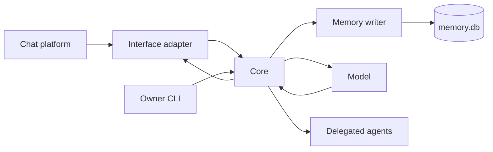

# Core

The core is the process that owns one persona's turns, memory and work. Interfaces translate platform activity into its protocol, and a platform's own words stop there: a core function takes a `placeId`, never a server beside it, and the core serves whatever communities its interfaces say hello with, or none. The owner CLI and agent clients connect to the same Unix socket with separate authenticated identities.

## A turn

The interface supplies a message and its conversation, author and audience. The event door validates the event and rejects duplicates. The pipeline decides whether it calls for a reply and collects nearby messages, relevant memory and available abilities.

The request builder combines that context with the persona's prompts. The model can call tools before answering. Tool results return to the same turn; final output tags describe messages, reactions or silence. The interface executes supported actions and reports what happened.

A heartbeat or completed errand can also cause a turn. It uses the same persona and memory rather than a separate conversational agent. [Inner life](inner-life.md) explains those triggers.

## Boundaries

The core writes memory through one writer. Interfaces neither open the database nor decide what the persona remembers. Stored recall and fetching live platform history are separate operations with separate access checks.

The execution context carries trusted access information outside message text. An account claiming to be the owner in a message does not acquire owner CLI access. [Memory](memory.md#who-can-recall-what) explains the audience rules.

Actions interrupted by a restart or lost connection are not automatically sent again. Their records can inform a later turn, where the persona decides whether another action is appropriate. A transport acknowledgment is not proof that a message reached the platform.

## Where to read the code

| Area | Entry point |
|---|---|
| Composition and lifecycle | [src/core.ts](../src/core.ts) |
| Event admission and client link | [src/interface/](../src/interface/) |
| Context and response decision | [src/pipeline/](../src/pipeline/) |
| Request assembly and tool loop | [src/turn/](../src/turn/) |
| Platform protocol | [src/protocol/](../src/protocol/) |
| Model output | [src/llm/parse.ts](../src/llm/parse.ts) |

## The task board

The [board](board.md) stores delegated work in the same database. Its roles govern task operations independently from conversational memory access. A watcher can file findings without receiving permission to deploy code.
