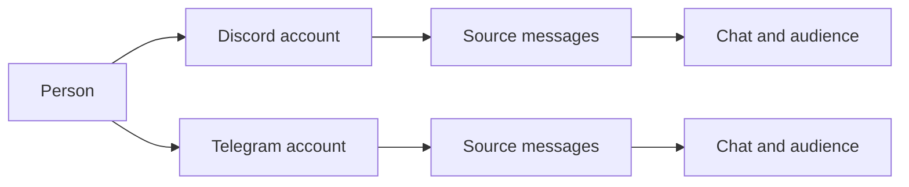

# Memory

Memory belongs to the persona, across all of its interfaces. `data/memory.db` stores people, places, source messages, learned claims, episodes, affinity, intentions and operational records. The core's writer applies changes; readers request an audience-scoped view.

## One person, several accounts

A person and an account are different objects. An account belongs to an interface and has that platform's native ID. A person can have several accounts, including multiple accounts on one interface. The same native ID on two platforms does not identify the same account.



The owner binds an account to a meta-person in the CLI after the persona has encountered the account, naming it by its interface and its platform id:

```text
/memory bind discord ACCOUNT PERSON
/memory users accounts PERSON
```

`bindAccount` in `src/memory/db/person-bind.ts` does the bind, and the target must be a meta-person that stands: marked `meta`, not merged away, not retired. `owner` as the target names the meta-person of `bot.ownerPerson` and `self` names the persona. An account no person holds is attached: a verified link by the owner, its `person_accounts` row under the target, and the target as `sources.author_person` of its lines. An account under another person makes the command ask one question, `Y/n`, naming the person it removes by id and name. A yes merges that person into the target at once, as [Merging people](#merging-people) describes, with the target's data winning. Every account of the person who went moves under the target in `person_accounts`, `author_person` of their lines follows, the target keeps its own affinity score, and the person who went stays as an alias with `meta` 0. Where both hold a current description of one field in one audience, the memory model joins the two texts first on the memory writer's path, the target's text leading (`prompts/description-merge.md`, see [the prompt contract](prompt-contract.md#description-merge)). The joined text becomes the target's current version, and the other description stays with the alias as history. A no changes nothing, and so does a merge asked where no dialog can answer, such as `neptunia -p`. A failed or unreadable model answer fails the bind whole. The owner's own meta-person is never the one that goes, and her own person is never merged in or out.

Accounts are bound and never unbound. Names, model suggestions and statements inside a chat do not create a verified link. Linking accounts changes who they belong to; it does not turn private messages into group messages. [Person links](../src/memory/db/person-links.ts) retains the link history.

Her own accounts need no bind. When she is the author of an observed line, the observation links the account to `person:self` on any interface, by the event's own mark and never by a name (`linkSelfAccount` in `src/memory/db/identity-links.ts`). `personDetail` reads her claims and descriptions of subject kind `self` like anyone's records, and a DM context reads of her only what was said in that DM. The memory session never lists her among the people of a batch and gives her accounts no author handle.

The owner names a person with `/memory users names add PERSON NAME` and `/memory users names remove PERSON NAME`. On a person id the name goes through the writer's `owner-name` op as an `alias` claim with `author` `owner`, in the audience a member's profile gives its aliases: the groups of the person's interface (`ownerNameScope` in `src/memory/db/unit-write.ts`). `ownerNamesOf` in `src/memory/db/people-read.ts` reads those claims back; a person's `names` show them beside the account names. Her own record is `person:self`, and its owner names are her aliases, which the door and the address classifier read at each line. A name her memory session or the analyzer writes about her is a claim with another author, so it never widens the door.

Profile and affinity read through the person. The member unit that owns the person's `people` row holds the character, details, episodes and the one affinity score, and `linkedProfileUnit` in `src/memory/db/person-links.ts` finds that unit for any linked account on any interface. `src/memory/store.ts` asks it at every use, so a new link takes effect at the next read, and a change through any account moves the same score. A decay sweep moves the score of one person once. What belongs to one account stays with it: its native id, its display names, its avatar and how it is addressed. A linked account's own unit writes only those facts (`accountOnly` in `src/memory/db/map/user.ts`), and a `people` row it held before the link rests under its own id. A profile write leaves the account's link columns as the database holds them.

`store.getUser` gives every profile it reads the person behind the account, `personId`, and every account of that person, `accounts`, each with its interface, platform id, handle, display name, avatar and profile text. `profileOfAccount` in `src/memory/db/meta-person.ts` assembles them: the survivor of the account's person with its real name and affinity, and every account `accountsOfPerson` lists with the fields of that account alone. A profile read on any account of the owner, the command line's included, therefore lists his Discord account with its platform id. The graph reader gives each person entry the same accounts as `profileAccounts`, those whose account node the context may see (`personOf` in `src/memory/db/mind-read.ts`). The person's entry in `<memory>` lists them when the person has more than one, so lines from several accounts of one person read as one person writing from each.

The schema also holds a person as a meta-person with its accounts under it. A meta-person is a `people` row with `meta` 1, the top node of one person. `person_accounts` holds one row per account under it, keyed by interface, platform id and generation, with the fields that belong to that account alone: `handle`, `display_name`, `avatar` and `profile_text`. Its `person_id` is required and names a meta-person. The foreign key refuses a person nobody stored, and a trigger refuses a stored person without `meta` with `ACCOUNT_PARENT_NOT_META`. A line names the meta-person of its author in `sources.author_person`, which stays null for a line with no account, such as an anonymous post. An account seen for the first time on any interface gets a meta-person of its own, a `person:<uuid>`, linked by the core (`ensureAccountPerson` in `src/memory/db/person-links.ts`, called by `observe` for a line's author and a DM's partner). Her own account is linked to `person:self` and the owner's command line to his person instead. A profile written for a stored account with no person gets the meta-person before the write, so no writer spells `person:<iface>:<native>`. Every verified link, a merge's included, moves the account's row in `person_accounts` and the `author_person` of the account's lines to the new person (`followAccount` in `src/memory/db/meta-person-write.ts`). A person whose id spells no interface is marked `meta` there, and an account linked to a person of the old shape loses its row, so the adapter reaches that person through the old link. A unit write of an account copies its display name and avatar into its row, and every line written takes `author_person` from its author account's person, null for a line with no account. `/memory bind` fills both too, as the bind above describes. `personOfAccount` and `accountsOfPerson` in `src/memory/db/meta-person.ts` read `person_accounts` first and the verified links of `accounts` after, and a row of `person_accounts` wins over the old link of the same account.

`scripts/meta-person-migrate.ts --db <file> --config <config.json> [--apply]` moves a database onto the meta-person. Run it with the core stopped: it claims the database as a core does and refuses while another core holds it. `migrateMetaPersons` in `src/memory/db/meta-person-migrate.ts` links the command line's accounts to the owner's person first. Her own person and every person whose id spells no interface are marked `meta` where they stand. A person whose id spells an interface gets a new `person:<uuid>` that takes its columns and its profile unit, and the old row stays as an alias merged into it. Every account is linked to the meta-person its person ends in, and an account linked to nobody gets one of its own. Every text column that names an old person id, alone or inside an id built from it, is rewritten to the meta-person, and a row whose new id is taken is dropped. A rewritten graph edge takes the id that its new ends hash to (`edgeIdOf` in `src/memory/db/graph.ts`), and its witnesses in `node_access` follow it. The old `people` rows, the history of links and merges, the legacy keys of `external_keys`, the session cursors, the storage catalog, the request archive and the columns of words keep the old ids. A row that an append-only or sealed guard protects keeps them too, and so does a claim whose version the semantic layer sealed. `person_accounts` gets one row per account with its newest display name and its avatar, and `sources.author_person` is filled for every line whose author account has a person. Without `--apply` it rolls back and prints the same counts. With `--apply` it writes the mapping of old ids to meta-persons into `meta-person-map-<date>.json` beside the database. It prints the `bot.ownerPerson` edit and leaves the config as it is. A second run changes nothing.

## Owner identity

`bot.ownerPerson` names the owner's person. Owner rights require an account whose live row in `account_person_links` is a verified link written by the owner to that person, or to a person merged into it. `createOwnerAccounts` in `src/memory/db/person-links.ts` reads only that row: the `link`, `linked_by` and `linked_at` columns of `accounts` are a copy for the readers that join accounts. Nobody is the owner while `bot.ownerPerson` is unset, except on the command line, and the setting never broadens the audience of a group or DM turn.

Only the owner speaks on the command line (`iface: 'cli'`), so its account belongs to him from its first line. The core hands `bot.ownerPerson` to the observation of each line there. The writer links the account to that person before it resolves the line's place, so the DM and the line both name him (`linkOwnerAccount` in `src/memory/db/identity-links.ts`). A tentative person the memory session proposed for the account merges into the owner, unless that person holds another account or was merged elsewhere. On a raw install the first line mints the person. Once the line is stored, the core writes `bot.ownerPerson` (`src/pipeline/observe.ts`). A memory session's `people` add is refused for the command line's account and for hers, as `known_person`.

The owner's account on another interface joins him by pairing ([Pairing the owner's account](interfaces.md#pairing-the-owners-account)) or by `/memory bind <iface> <account> owner`, which binds that account to the owner's meta-person by the rules of any bind, so a person the account held before merges into the owner after the owner's yes. While `bot.ownerPerson` is empty, the account's own person becomes the owner person and the command writes `bot.ownerPerson`. The command line's rows sit under its native authority `cli/local` (`nativeAuthorityOf` in `src/protocol/identity.ts`), the authority `/memory bind cli owner` looks under. Rows an install stored under `cli/global` move to `cli/local` when the next line arrives.

## Linking accounts by code

Anyone links their own accounts without the owner, through her tool `person.link` (`createPersonLinks` in `src/interface/person-link.ts`, run as an in-turn tool by `src/turn/in-turn-tools.ts`). In a conversation with account A she names the meta-person she believes the person is, by its person id or the member handle of one of its accounts. The tool sends a one-time code, worded by `labels.link.code`, in a direct message to an account B of that meta-person on the first interface that reaches one, and answers her with `labels.tools.tools.link.sent`: the next message from A in that conversation must be the code. Her answer never holds the code.

The door checks the next message from A in that conversation before memory or a turn sees it (`DoorScreen` in `src/pipeline/handle-message.ts`). The right code is dropped, its message id is left out of every chat a turn reads, and the bind of `/memory bind` runs with `by` `code` (`bindAccount` in `src/memory/db/person-bind.ts`): B's meta-person wins and A's merges into it. A merge a code proved joins the private layers as an owner's merge does (`personMembers` in `src/memory/db/person-links.ts`), so what B said to her privately is known in talks with A. Any other message from A there ends the attempt, passes on as an ordinary line and counts as a failure. A message from anyone else, or from A in another chat, leaves the attempt waiting.

The limits are Hermes's, as in [Pairing the owner's account](interfaces.md#pairing-the-owners-account): a code lives one hour, an account asks once per ten minutes (`cooldown`), and five failures lock it for an hour (`cooldown` again). The tool answers `chat-closed` and nothing waits when no account of B takes a direct message, `PERSON_NOT_FOUND` for a person that is no standing meta-person, and `forbidden` for the owner's meta-person on either side and for the command line: the owner's accounts are linked by `/memory bind` and his pairing only. The waiting codes, their hashes and the limits live in the process, and logs never carry a code. There is no unlinking.

## Merging people

`/memory users merge <from> <into> [--reason <text>]` merges one person into another. It goes through the writer as `applyMemoryWrite` kind `person-merge` (`src/memory/db/person-merge.ts`, `MemoryDbService.personMerge`). Only the owner merges, and `person:self` is never merged in or out. Everything stored about the person who goes moves to the survivor at the end of the merge chain. That covers claims and descriptions about them, claims they made, episodes, affinity events, accounts with their links, DM places, focus rows and the `scope_dm` of lines, vectors and the other scoped rows. Their daily relationship counts add to the survivor's. No row changes its `audience_id`, so a fact stays in the chat it was said in. A description of a field the survivor holds in the same audience stays with the person who went, so the survivor never holds two of one field. The survivor keeps its affinity score. The old links stay closed as history, one `people_merges` row records the merge, and the person who went gets `status` `merged_into:<survivor>`. A repeated merge moves what was left behind and writes nothing else. It also finishes a merge that `mergePeople` in `src/memory/db/session-write.ts` recorded without moving any row.

`scripts/memory-repair-identity.ts --db <file> --owner-person <id> [--apply]` repairs a database written before these links. Run it with the core stopped. It moves the command line's rows to `cli/local` and links the command line's accounts to the owner person, merging her proposals for them. It links her accounts to `person:self` and copies the link columns of every account from its live verified link. Without `--apply` it rolls the transaction back and prints the same counts. The output holds counts only, and a second run finds nothing to do.

## Filling the audience of old entries

`/memory selfreflection audience fill [--dry-run]` gives the selfreflection entries written before she could choose an audience the explicit `{ kind: 'unrestricted' }`. It goes through the writer as `applyMemoryWrite` kind `selfreflection-audience-fill` (`src/memory/db/selfreflection-audience-fill.ts`, `MemoryDbService.selfreflectionAudienceFill`), and only the owner runs it (`OWNER_ONLY`). The value is merged into the entry's `extra`, so its other keys and a saved `publicationBoundary` stay. An entry is left alone when it has any audience, is retired, is not a group entry, or has an `extra` that cannot be read as an object. The answer counts the entries written. A second run writes nothing, and `--dry-run` counts the same set without writing. The memory service tells the running store of a fill that wrote (`onSelfreflectionFill`), and the store's unit cache in `src/memory/unit-cache.ts` takes the filled audience into its cached entries, so the write of the next entry keeps it.

## Places and context

Everything she remembers belongs to the persona, an account, a person or a place. A place is a row of `places`: a server, a channel, a thread, a group or a DM, each with its own id and `parent_id`. A Discord server is a place with channel and thread places under it, a Telegram group is a place with none, and a DM is a place with one partner. `store.rootPlaceOf` in `src/memory/store-addresses.ts` walks `parent_id` to the top of a tree, so a DM is its own root. A place the store named from a chat the interface described (`store.placeOfChat`) keeps that chat's top and native id in the process until its row exists, so a quiet channel with no observed message still finds its server. An id named nowhere has no top. `store.chatOfPlace` turns a place back into the native chat a post goes to, and for a DM that is the chat the interface saw with its partner. The way back reads only stored rows and what the store named, never the text of an id. A place with no row answers the chat the store named it from, else the id as given, since a caller that holds a native id passes it on. `store.nativeRootOf` reads `places.native_id` the same way and keeps the native id of a root that `store.placeOfRoot` named before the hello's roots are written. `store.personOfAccount` reads `accounts.person_id` and answers null when no row links a person, and so does `personOfMember` in `src/memory/addresses.ts`. A new profile or channel takes its native id from its row or from the account or chat the store named it from, null with neither.

Every place carries `purpose`, `tone` and `topics` as descriptions: a room, a root, a direct chat and the command line alike. The memory session writes them once a place has lines, through the mapper of `src/memory/db/map/place.ts` for a root and a direct chat and `src/memory/db/map/channel.ts` for a room. A root also keeps `patterns` and `starters`. The three fields of a direct chat say that it is a direct chat with its partner, how the two of them talk and what they talk about, and they are scoped to that chat. A direct chat has no name, and its path ends in the interface's word for a direct chat and the partner's native id.

The session flags a field, and `reviewDescription` in `src/memory/db/describe.ts` writes it. A review of a place field reads the claims about the place and, in `<lines>`, the latest 40 lines of the place and the places under it that the review's context may read. A direct chat holds few claims about itself, so its lines carry most of what the three fields say. `openFlags` in `src/memory/db/writer-switch.ts` reads a flag raised in a direct chat in that chat, which it takes from the audience of the session run that raised the flag, because a partner who is a meta-person spells no place.

A turn gets a bounded selection of relevant information: people nearby, the current place, recent events and recalled passages. The whole database is not inserted into every prompt. Local context helps rank relevant material without restricting all searches to the current place.

## Who can recall what

The observation in `src/memory/db/observe.ts` keeps a chat's containment. A declared parent gets a row in `places` even when no line was seen in it, so a chain of parents holds whatever order the places are seen in. The row gains its chat and title from its first own line. A chat of a root sits under that root's place, directly or through its declared parent. A DM has no parent. Every `hello` the core takes writes the roots it names as server places through the one writer (`noteRoots` in `src/memory/db/roots.ts`): a missing place is created, a retired one revived, a new name renamed, and an empty name keeps the stored one.

A storage unit is named by its subject alone (`src/memory/db/storage-keys.ts`): `accountCollection` for a profile and a private layer, `placeCollection` for a place's notes, lore, emoji rails, media cache, recent lines, participation, record, journal and archive, and `personaKey` for the selfreflection, the intentions, the errands, the inner state and the one GIF library. A direct chat's record, journal and archive are collections of its DM place, and its lines keep their DM audience. `store.accountOf`, `store.placeOfChat` and `store.sharedPlaceOf` turn the native ids an interface gives into these ids, and an empty id is refused with `BAD_COLLECTION_ID`. An operation runs in the place of its call, the `placeId` of its context in `src/tools/types.ts`. One that reads or writes a collection of the whole tree, such as lore, notes or pings, asks `rootPlaceOf` for the top inside (`resolvedPlaceId` in `src/tools/operations/env.ts`), so every channel and thread of a server shares one lorebook.

The notes of a place are scoped together by `toRows` in `src/memory/db/map/place.ts`: its descriptions, in-jokes, self facts and lessons belong to the partner's DM on a DM place and to the groups on any other. `scripts/memory-repair-self-audience.ts --db <file> [--apply]` brings self facts stored under `aud:none` to that scope. Run it with the core stopped. A row whose place cannot be found becomes `aud:internal`, and a row with a live `decisions` row of the action `audience-none-kept` stays. Without `--apply` it prints the counts and writes nothing.

Group recall can search stored group experience across interfaces. It excludes private chats. A DM can retrieve the DM history of every account of the same meta-person, for any person: the owner's command line chat reads his DMs on the other interfaces, and a member bound to two accounts reads the DM of either from the other. Rows keep their original audiences and provenance.

A DM context finds the person's other DMs in stored rows. `linkedDmScopes` in `src/memory/db/person-links.ts` joins the person's verified accounts to the places whose `partner_account` names them, after `personMembers` follows `people_merges`. An outward context follows only a merge whose `by` is `owner`, so a merge written by a memory session never widens it. An account that is unbound or moves to another person leaves the person: the next issued context stops reading its DM, the context already issued keeps what it was given, and the DM's rows keep their audience. The context a recall read issues for a DM names the stored DM place of the partner's account beside the person (`readContextSpec` in `src/memory/db/scope.ts`, `dmPlaceOfMember` in `src/memory/addresses.ts`), and the asker of a group read is named only when a stored row links the asker's account to a person. A partner whose account no row links to a person reads as the interface's group, since no private row can name a person the database does not hold. A description flag raised in a DM is read in the stored place of its run's audience (`flagContext` in `src/memory/db/writer-switch.ts`).

`privateByPerson` and `privateByPlace` in `src/memory/db/private-read.ts`, also on the memory service, read the private memory of one person or one DM place. A record belongs to the DM place its `audience_id` names, whoever it is about, and the view holds the live rows of `claims`, `descriptions`, `episodes` and `affinity_events` as stored. The context filters the places before any record or count is read, so a DM context reads the audiences it was issued and a group context reads none. An internal context also reads every merge and the closed links in `pastLinks`. An unknown id answers `PERSON_NOT_FOUND` or `PLACE_NOT_FOUND`.

A line of a DM keeps its DM's audience whatever it names and whoever writes it. The journal, record and vector mappers (`scopeInto` in `src/memory/db/map/scope-parts.ts`) take the place, the audience and the partner from the unit's stored DM place, never from a place or a person spelled out of the partner's native id. Two partners with one native id under two authorities share nothing, and her own lines in a DM name the person in the place's `partner_person`, the same person as the partner's own lines. A unit that names a member by platform id, such as an old journal line scoped to `{ user }`, a private layer with no DM place unit, an intention or an errand of one member, takes the member's stored DM and its partner through `dmOfMember` in the mapper context (`dmOfPlatformId` in `src/memory/db/meta-person.ts`, through `places.partner_account`). A member no stored DM holds is `internal`: no mapper works out a DM place or a person from a platform id. A stored DM's rows name its partner person: the place's `partner_person`, else the person of its `partner_account` (`partnerPersonOfPlace` in `src/memory/db/meta-person.ts`, which `resolveRow` in `src/memory/db/rows.ts` accepts too), none for a DM nobody linked. Two cases still read the old spelling, because a legacy file is imported before its place exists: a private layer no stored DM holds takes the place and partner its member id spells (`legacyPrivateScope` in `src/memory/db/map/scope-parts.ts`), and a unit of a DM place no row holds names the partner its place id spells. Without a database, the import of the legacy files reads every member and partner from the old spellings. A platform id names the account of the interface's own authority first (`nativeAuthorityOf`), so an account of another authority with the same id never answers for it. The member an attitude is toward and the teacher of a lesson are the stored person of the member's account (`personOfMember`, `personOfPlatformId`), null when no stored account holds the platform id, and the platform id stays in the row's remainder, so the file comes back exact. A `{ user }` scope read back from a DM row takes the partner's platform id from the stored place its audience names (`partnerOfDmAudience` in `src/memory/db/meta-person.ts`, read by `dmUserOf` in `src/memory/db/scope.ts`). The place mapper in `src/memory/db/map/place.ts` scopes a DM place's descriptions, in-jokes and lessons to that DM. `scopeColumns` in `src/memory/db/scope.ts` answers `internal` for a channel or a place that is a stored DM, for a private mark whose place is no stored DM, and for the `unresolved` mark.

A wake holds no partner of its own. Its delivery asks the interface for the chat (`partnerOfDelivery` in `src/behavior/inner/deliveries.ts`), and the said line and the `post` operation go to the partner's DM place through `personaRecord` and `personaJournal` in `src/behavior/inner/persona-sources.ts`. When the interface cannot say and no stored place holds the chat as a channel, a thread or a group DM (`store.holdsSharedChat`), the line is marked `unresolved` under the chat's spelled place. Her `internal` context reads it, and no group, partner or wake view does. Only the persona's journal holds the operations of a real channel.

An archived private item names `{ place, private }` with its DM place, or `{ user, private }` when the member has no DM place yet. `allowScope` in `src/behavior/recall-run.ts` shows it to the private turn that stands in that place or whose partner it names, `memory.archive.read` lists it only in that DM, and `memory.restore` writes its `restored` line under that DM.

A private unit writes its rows under the stored DM place of its account, and `addSessionRows` in `src/memory/db/session-rows.ts` lays her session's rows over the unit by that same audience. A partner with private memory and no public profile keeps that memory in a DM turn, under the name on their message.

The authenticated owner CLI has a separate internal view across stored memory. The owner's ordinary group or DM chat retains that chat's audience rules. Permissions to read stored material do not grant permission to fetch or publish arbitrary live platform content.

[Scope resolution](../src/memory/db/scope.ts) controls visibility. [Recall](../src/memory/db/recall.ts) applies scope and place filters before ranking, limits and surrounding message windows.

## The query and summary builders

A search has two steps with a model around it. The query builder (`createQueryBuilder` and `parseQueryPlan` in `src/behavior/query-builder.ts`, purpose `query-builder`, prompt `prompts/query-builder.md`) plans before the search. It answers the JSON object of `QUERY_PLAN_FORMAT`, `web`, `history`, `who`, `when`, `when_role`, `recent` and `skills`, each null when unused. A live turn has no such step, because the persona's own tools search during her reply, so `src/turn/phases/request/lookup.ts` logs `lookup: skipped` with the reason `core-tools` and adds no helper model. Its callers are `scripts/replay.ts`, `scripts/recall-eval.ts` and `scripts/search-policy-eval.ts`.

The summary builder (`createSummaryBuilder` and `parseSummaryNote` in `src/behavior/summary-builder.ts`) condenses what a search found into a note bounded by `maxChars`. Chat evidence reads `prompts/recall-summary.md` under the purpose `recall-summary` on the analyzer, and web evidence reads `prompts/search-summary.md` under the purpose `search-summary` on the `search` role with `web.quickSearch.model`. The single word `none` is no note. `src/behavior/recall-run.ts` and `src/web/lookup.ts` both go through it.

## Searches and backups off the main thread

`searchRecord` in `src/memory/db/service.ts` runs a search of the record on the reader thread (`src/memory/db/reader-worker.ts`) and answers what `search` in `src/memory/db/recall.ts` answers over the same rows. The thread holds one read-only connection, takes no lock and refuses every message but `open`, `places`, `search` and `close`. The caller's callbacks stay on the main thread: `allowPlace` judges the list `visiblePlaces` gives before the search, and `nameOf` and `channelNameOf` fill in the names `searchMarked` marked once the answer is back. A service without a worker searches on its own connection.

Searches wait in `src/memory/db/reader-client.ts`, and one runs at a time. An aborted signal rejects a search with `SEARCH_ABANDONED`. When the abandoned search is the one running, its thread is terminated and a new one opens, so the searches behind it are still answered. A thread that dies rejects its search with `WORKER_EXIT` and logs `memory db: reader exited`, and the next search starts a new thread. A closed database rejects with `DB_CLOSED`. The core opens the reader with the database and closes it before the writer, because a read-only connection that closes last leaves the WAL behind.

The memory prefetch searches under `recall.prefetch.deadlineMs` and the persona's own search under `recall.timeoutMs`. Each aborts its signal at that deadline and goes on with what it has. A failure logs `recall: prefetch failed` or `recall: failed` with its `code`. A memory that offers only `database()` is searched synchronously.

The daily backup runs on the writer thread, and `pruneBackups` in `src/memory/db/backup.ts` deletes old backups through the asynchronous `fs`. The owner's `/memory backup` runs `backupInWorker`, which opens a read-only connection on a thread of its own (`src/memory/db/backup-worker.ts`).

## The store's cache of units

`createStore` in `src/memory/store.ts` takes the memory database as `memoryDb`, and a store cannot be built without it: every memory unit lives in the database, her state among them, and only the operational files stay files under `data/`. The store reads and changes memory units through one cache, `createUnitCache` in `src/memory/unit-cache.ts`. The cache loads a unit from the database on its first read, and the store marks a changed value dirty. A flush hands the whole value to the unit outbox in `src/memory/db/unit-outbox.ts`. The cached value stays the truth until the outbox no longer holds the unit, and a failed write waits there for the next flush. A list of the units of one kind, such as `listPrivate`, names those the database holds and those only cached. `/nep pause` drops every cached unit except her state and those the outbox still holds.

The database has two other writers of the same units, and the cache subscribes to both when it is built. After her session moves a person's attitude, the service calls `onAffinityMoves`, and the cache drops every cached profile of that person. A profile with unflushed changes, or one whose write is still under way, is marked stale instead. The cache reads it again once its write has landed, and that write keeps the session's score and reason (`sessionHold` in `src/memory/db/session-rows.ts`). An owner's fill of old selfreflection entries calls `onSelfreflectionFill`. A clean cached selfreflection is dropped. A dirty or pending one copies the filled `plan` and `publicationAudience` from the database into each entry that lacks them, and is written again.

## Pending writes and their quarantine

A unit write the writer cannot take at shutdown is kept by `keepPending` in `src/memory/db/service.ts` as `data/memory-pending/<sha1 of its owner>.json`. Every open replays these files through the writer before anything reads the database and deletes each file once its write is applied. A write whose replay fails moves to `data/memory-pending-quarantine/` (`src/memory/db/pending-quarantine.ts`), and the open goes on with the rest. The folder has mode `0700` and its files `0600`, and `<name>.error.json` beside each write holds the failure `code` and the time `at`. When the folder already holds the name, the moved file gets the time of the move as a suffix, so an earlier failure of the same owner stays. A write that cannot be moved keeps its pending file, the open fails with `PENDING_REPLAY`, and the next tick tries again.

An open that moves files logs the error `memory db: pending quarantined` with the count and the code and no content, and calls `onPendingQuarantined` once. The core turns that into a `pendingQuarantined` fact, worded by `wake.feedback.pendingQuarantined` with the number of writes and the code the last one failed with, which she reads at her next turn. `status().pending` counts the files in the quarantine and names the code of the newest, and the owner's status line shows them through `status.memoryDb.quarantined`. `/memory pending list` names each file with its code and time. Once the cause is fixed, `/memory pending replay` replays them through the writer: a file that applies is deleted with its error file, and one that fails stays with its new code.

## Learning and remembering

Source messages are the evidence. A memory session reads a window and proposes claims, episodes and affinity changes. The writer validates references and applies accepted changes transactionally. A claim records what was learned and the sources supporting it; its versions preserve changes over time.

Recall combines word search, partial word matching, stored vectors and person matches. It ranks hits and returns surrounding chat so a matching phrase keeps its context. Prefetch brings likely relevant material into a turn; `memory.search` lets the persona ask a more specific question.

`src/memory/vectors.ts` keeps one month of vectors per place, with a manifest of its rows, bytes and checksum. `search` skips a month whose rows disagree with its manifest and logs it. `has` answers from the rows themselves, so the catch-up in `src/memory/embedder.ts` never embeds a record again while its month holds it. A vector row stays in the month of its own place: when another place's month holds its chunk key, the writer in `src/memory/db/unit-write.ts` gives the row that key with a `#<n>` suffix. `scripts/memory-repair-dm-vectors.ts` rebuilds a month that disagrees with its manifest while the core is stopped.
When those four streams find nothing and the plan names a channel or a side of a time range, `memory.search` answers from a fifth stream, `time`, in `search` in `src/memory/db/recall.ts`. It cuts the span into as many equal slices as `RECALL_DEFAULTS.maxClusters` (5, in `src/behavior/recall.ts`) allows windows and takes the line nearest the middle of each slice, or every line when the scope holds no more than that. An open side of a range closes at the first or last line the context may see. A hit of this stream has `streams: ['time']`, `stats` counts only the other four, and the result says `sampled: true`, which puts `tools.tools.memory.sampled` under the source line. The stream reads inside the audience, `allowPlace` and the exclusions, and `samplePlaceRule` in `src/behavior/recall-run.ts` also keeps it to the chats the turn's live view lets through `context.pull.sameAudience`, while word and meaning hits stay independent of the live view. The prefetch does not ask for this stream. On the reader thread `reader-client.ts` turns `samplePlace`, a function, into the list `sampledPlaces` on the main thread, the way it turns `allowPlace` into `allowedPlaces`.

The memory objects a search reads as text have vectors of their own, kept by `src/memory/db/object-vectors.ts` in `vectors` beside the months. A live claim other than an alias has one under `claim:<id>:<model>`, and a description of a person, a place, the persona or an entity under `desc:<id>:<model>`. A live episode has one under `episode:<id>:<model>`, made from its `what` with its `quote` on the next line. The names a person or a place has in one audience, one per line and sorted, have one under `names:<node id>:<audience id>:<model>`, so an alias learned in a DM never enters the vector of the group's set. A claim of a semantic version keeps its `semantic:` row instead. Such a row has no `source_rowid` and no `owner_key`, so it belongs to no month and no manifest counts it, and it copies the scope and audience of its object. Its `context` holds the hash of the text it was made from. `pendingObjectEmbeds` lists the live objects with no row of a model, oldest first, and the writer message `object-embedding` writes a vector only while its object still holds the text of that hash. In the writer's transaction `projectRow` in `src/memory/db/graph.ts` calls `touchVectors`, which deletes the rows of an object whose text changed or which retired. `touchNameVectors` does the same for the sets of the nodes `touchNames` rewrote. Until its next embedding such an object is found by its words. Schema 41 indexes `vectors(item_id)` for these lookups.

`embedObjects` in the same module embeds what is pending. The service's `startRetrievalEmbed` runs it at a tick at most once a minute, off the turn path, while `memoryDb.retrieval.embedObjects` is on (default `true`). One run takes the oldest pending objects, at most `memoryDb.retrieval.embedBatch` (default `50`), and stops before the text that would carry the request past `llm.maxRequestTokens`. The rest waits for the next minute, and a text over that cap alone is never sent. The texts go out in one request of purpose `memory-object` through the embedding client on the `embedding` model role, which counts it against `llm.maxRequestsPerDay`, and the vectors come back through one `object-embedding` message. A failed request writes nothing, so its objects stay pending, and a run with nothing pending sends no request.

## Media on stored lines

The table `media` is the only store of media, in `src/memory/db/media-store.ts`. It holds one row per item, whatever the interface. `kind` is one of `image`, `gif`, `video`, `sticker`, `emoji`, `voice`, `audio`, `link`, `text` and `file`. `native_ref` is the interface's reference, opaque to the core, and an item is the same item when its interface and reference are the same. `path` is null or a file under `media/`. `availability` is `present`, `missing`, `unknown` or `unreadable`. `extra` holds what a kind has beside that: `fileName` and `durationSec` of an attachment, `name` of a sticker, an emoji or a library GIF, and `title`, `site` and `url` of a link.

`media_links(owner_kind, owner_id, position, media_id)` ties an item to what shows it, a message (`source`) or a selfreflection entry (`selfreflection`), at its position there. Audience comes only from a link: an item is read through an owner the reader may open, and a file shown by a message and an entry is one row with two links. A `sources` row holds no kinds, no ids and no link cards, and its `text` and `stems` stay what was written.

An item's text form is its `description`, with its origin in `extra.textOrigin`: `retelling`, `frame`, `transcript`, `voiced`, `embed`, `preview` or `page`. `tellMedia` is the one write of a text form. A text form that ranks higher stays over one that ranks lower, so what she voiced is never replaced and a watched summary replaces a still frame. A file no model can read is `unreadable` and renders the standard mark with its name, which `safeFileName` in `src/media/classify.ts` cuts to 120 characters and rids of anything that opens a tag.

`lineMedia` is the one read: a turn's recall, a window, the prefetch, the memory session's batch, a task's and a chat's lines and the owner's browser all go through it, and no line read touches a description anywhere else. The describer's cache is the same rows, written by `writeMediaCache`. Its cap of `MEDIA_CACHE_ENTRIES` retires only rows nothing links.

A platform can send an embed in a later update of a message, as when an address posted as text is unfurled after the message is created. `onMessageUpdate` in `src/pipeline/edits.ts` hands the items the earlier message lacked to the describer. When the update keeps the text and brings such an item, `recordEdit` observes it as an edit. That observation lands on the line's current revision, so no revision is added and the record gets no line. Its replay writes the line's links to the items of the update, and a row the describer already holds under an item's reference becomes that item with its description. An update with the same text and the same items writes nothing.

A text form is stemmed and embedded once on its row. `media_fts` and `media_tri` index it, and `embedMedia` keeps one vector for it, whose `chunk_key` names the row, once a minute a page at a time. A message's own vector covers its text and its neighbours, so a line that holds only media has no vector. `search` in `src/memory/db/recall.ts` answers such a find as `mediaHits`: one hit per item, or per set of equal bytes by `sha1`, with its use count, its latest use and at most 20 of its messages, each only through a message the reader may see. The latest use also joins the windows, and one answer tells an item once, so an item posted ten thousand times shows as one line among the rest.

## Moving old media to the store

`migrateMediaStore` is one forward schema step. It turns `sources.media`, `extra.links` and `extra.extra.attachmentIds` into items and links and removes them, maps the old cache rows to items, takes a description the cap had trimmed from the durable versions, and links a line stored without ids through the GIF library or selfreflection row that names its message. A line that still has no reference gets a placeholder with no reference. A second run changes nothing.

`neptunia memory backfill-media [--dry-run|status]` runs `backfillMedia` in `src/memory/db/media-backfill.ts`, for the owner only. It reads each line's message through the interface's history, one read a second, and writes its items through the one writer. A line's message id is `messageId` of `extra.$messageLocator`, else `native_id`, because `native_id` on a line observed through the family catalog is a key of the catalog that no platform knows. The run keeps a valid locator as it found it. Items without a text form go through the describer, so no model call is made for a text form already held. Its report counts `linked`, `gone` when the platform no longer returns the message, and `bare` when the line names no chat to read, with the reason per class in `classes`. `--dry-run` counts the lines to read in `classes.toRead` and the lines waiting on a chat in `classes.toOpen`. `BACKFILL_FIELDS` names every field a new line carries and how an old line comes to hold it.

The run also lists a line that misses an item of its message. `unlinkedLineItems` in `src/memory/db/media-store.ts` finds these: a live row that no owner links, whose `native_ref` is `<message id>#<item>` for the line's message and interface, while the line links no item of that reference. Such a row is the describer's, written for an embed that came after the line was stored. Once the message is read, the writer links the held row as the item with its description, and the report counts the line in `linked` with the class `embed-picture`. A line of this kind whose message is gone stays listed, so every run reads it again.

A DM line that stored no chat is read through `dmChatOf`, the interface read that opens the private chat with the place's partner and sends no message. The place keeps the answer in `extra.dmConversation`, so a later run asks nothing. A partner the platform refuses counts as `gone` with the class `partner-refused`. A place with no known partner, or an interface that does not offer the read, leaves the line `bare`.

A place whose read fails gets one more read in the run. A read the platform refuses, by a status other than `failed` or a failure it marks not retryable, gets none. A place given up on adds one to `failedPlaces` and its lines to `linesLeft`, and `classes` counts it as `read-failed` or `read-refused`, once more with the code after a colon, as in `read-refused:http-403`. Those lines wait for the next run.

A run that stops is taken up by the next one, because a finished line holds its references or the state `missing`. The next run also lists a line with a voice message or an audio file that has a reference, no text form and a cached `download` miss, and hands it to the describer with `retryMisses`, which tries the download at once. A cached `size` miss stays out.

`neptunia memory backfill-english [--dry-run|status]` runs `bringMediaToEnglish` in `src/memory/db/media-english.ts`, for the owner only. It brings the stored media descriptions to [the English standard](prompt-contract.md#standards-of-output-and-stored-text). A current description that `isOffScript` finds mostly in another script is described again when its item can still be read. The run reads the message of a line that links the item through the interface's history, as `backfill-media` does, and finds the item there by its cache key. The describer then describes it on the role of its kind, `vision` for a picture and `video` for a GIF or a video. An item no message holds any more is translated from its stored text on the same role, through the prompt `describe-translate`. A history read that fails and may work later counts the item as `failed`, and the next run tries it again.

The new text is a new `media` version of the same description, written through the one writer as a `media-english` update. It becomes current and the item's `description`, and the item's vector goes, so the embedding run reads the new text. A new text still off script, or no text at all, writes nothing. Older versions stay as they are. Transcripts, text files and the answers of a second look are quoted speech or answers, outside the standard. The report counts `toFix`, `redescribed`, `translated`, `unchanged`, `failed`, `superseded` for the older versions off script and `quoted` for the items left out. `--dry-run` gives the same counts with no read, no model call and no write. A second run finds nothing to fix.

`memoryDb.session.mediaPass` lets the memory session read the media-only lines its cursor passed before they had a text form, oldest first, with a cursor of their own. The pass runs only in a scope with too few new lines to sweep, so new lines always go first. `dueScopes` in `src/memory/db/writer-switch.ts` lists such a scope as due while the pass has lines left, at most `memoryDb.session.mediaPassPerDay` passes a scope and UTC day (default `24`), and `everyMinutes` after the scope's last sweep of any kind. A media pass is never `full`, so it never skips that wait. Its runs carry the sweep id with `:media-pass` appended and do not count toward `sweepsPerScopePerDay`, the cap of ordinary sweeps. A scope left out at either cap is logged `memory session: capped` once per scope, cap and day, with the scope key, the cap's name and the count. `scripts/memory-audit.ts` counts what does not agree: a line without its place, a scope that disagrees with its audience, a link to a row that is gone.

An old source does not become unreachable merely because it is outside the recent-context window. Prompt budgets bound what is shown, not the age of everything stored. Review the relevant `memoryDb`, `recall` and `context` settings in [configuration](configuration.md).

The media cache of a place keeps `MEDIA_CACHE_ENTRIES`, 5000, of the rows nothing links. `trimCache` in `src/web/cache.ts` leaves a row alone when a live line or a live selfreflection picture links its attachment, as `linkedAttachmentIds` in `src/memory/db/media-store.ts` lists them, so a place with many linked rows stays over the cap. A line stored before `extra.attachmentIds` links nothing by that list until its echo brings the ids.

## How a turn remembers

`mindOf` in `src/memory/db/mind-read.ts` is the graph reader. From the lines of a turn it walks the memory graph under the turn's context. It returns the people, places, interfaces, lore, episodes and stored lines that come to her mind, cut to a budget in tokens, and no model takes part. Its settings are the map `context.memory` in `config/config.json`, and each key named below is one of it.

Names are looked up in the name index of `src/memory/db/names.ts`, the table `names` with its trigram table `names_tri`. It holds one row per name, per graph node, per audience and per stored row the name came from. The names are a place's name, an account's display names, a person's real name, a membership's nick, a live alias claim about a person or a place, and an interface's name and nouns. The memory session writes an alias of a place as it writes one of a person, a claim of kind `alias` on the place's handle, and every place of a batch has a handle, a direct chat included (`buildSessionRequest` in `src/memory/db/session.ts`). An account's names point at its person while the link is verified. A name keeps the audience of its row, so an alias learned in a direct chat is found only in that chat and in the chats of the partner's linked accounts. `projectRow` in `src/memory/db/graph.ts` writes the rows of a stored row again whenever it projects one (`touchNames`), so a retired claim or a revoked link takes exactly its own rows with it. `rebuildNames` writes every row again from the stored rows. A word is matched by its folded exact form, then by the stems of the learned stemmer, then by trigrams, and a weaker way is tried only when the stronger found nothing.

The seeds of a walk come from the last `windowMessages` lines (default `100`), in evidence classes from strongest to weakest:

| Class | What raises an entry |
|---|---|
| `native` | A native mention in the trigger |
| `reply` | The author of the trigger's reply parent |
| `counterpart` | The person she answers |
| `author` | An author of a line of the window |
| `place` | The current place, a place of the window and their parents |
| `edge` | A path from another entry, a mention or a reply elsewhere in the window, a seed of the earlier turns of the chat, a find of the helpers, a place she wrote in lately |
| `word` | A word or a phrase of up to three words of the window that matches a name |
| `prose` | A name inside a claim of an entry rendered whole |

A word that names more than `commonWordEntries` entries (default `3`) raises none. Several are first narrowed to the people present and the places under the current root, and what stays ambiguous, or matched by stem or trigram only, is raised as a candidate, at most `candidatesMax` of them (default `3`). An interface's noun for a kind of place, such as "server", raises the places of that kind on that interface.

The walk follows listed paths only. Each is one query that orders before it limits. It follows live edges whose audience the context reads to nodes it may see in `node_access`, so a node hidden in the middle of a path stops the path. A place is seen by its own audience. The paths and their limits:

| Path | Limit |
|---|---|
| An account to its person, and the person to the other accounts | `fanOut.accounts`, default `10` |
| A person's accounts to the places of their memberships, newest first | `fanOut.memberships`, `20` |
| A place up to its parent | none |
| A root named by the trigger or the window down to its rooms, by her own line count | `fanOut.rooms`, `10` |
| The same root down to its members, by her affinity | `fanOut.members`, `8` |
| An interface down to its top places | none |
| The trigger along `replies_to` to its parent and to the lines that answer it | `fanOut.replies`, `5` |
| A person or a place back along `about` to its claims and episodes, newest first | `fanOut.about`, `30` |

A step through an account or up to a parent costs nothing. Any other step counts against `maxHops` (default `2`), and the walk stops expanding after `maxNodesRead` rows (default `2000`).

Every entry carries its graph node, its strongest evidence, its newest anchor line, whether it is a candidate, and the stored rows behind it with the description version it renders. Its detail is `whole` for the classes `native`, `reply` and `counterpart`, `name` for a candidate and for `prose`, and `compact` otherwise. A person entry holds the person's names, the accounts she knows them through, the `relationship`, `character` and `style` descriptions the context reads, and the claims about them, those sharing a word with the trigger first. A place entry holds its path by names from the interface down, its three fields, and how many lines she wrote there and when last.

The budget is `budgetTokens` (default `10000`), split by `shares` among `people` (`0.5`), `places` (`0.15`), `lore` (`0.15`), `recent` (`0.1`) and `found` (`0.1`), and a share its entries leave unused is lent to a full one. Inside a share the entries go by evidence, hops, the newest anchor, her affinity and the id. An entry that does not fit drops to a lower detail, and one that fits at none is left out and counted in `leftOut` of its share. The person she answers may take `counterpartTokens` (default `1500`) whatever the people share holds. The person she answers, the authors of the window, the current place and what the trigger names natively or by an exact name are kept whatever the budget, as a name when nothing else fits. `scripts/mind-report.ts` runs the reader over archived reply turns of a snapshot and prints the entries, the time and the left-out counts per turn.

The people of the lines she reads join her memory the same way. `withReadMemory` in `src/turn/in-turn-tools.ts` seeds the graph reader with the other authors of the lines a `conversation.read` returned (`authors` of `runConversationRead` in `src/tools/conversation-read.ts`) and renders the people it raises as a `<memory>` after the lines, through `peopleMemoryOf` in `src/turn/request/memory-block.ts`. The walk goes on from each author as it does from any seed, and the budget of `context.memory` cuts it, so an author takes a lower detail or only a name when the budget is spent. A person the request's `<memory>` or an earlier read of the turn showed is left out (`memoryPeople` of the turn's draft). A failed read, a read of her own lines only and a closed memory add nothing.

## Finding a place or a person

`placesFound` and `peopleFound` in `src/memory/db/graph-find.ts` find a place or a person for words that name none, such as what a place is for. They read the graph under the turn's context, rank in code and return candidates best first, and no model takes part. A place is read as its name and the names of the index that point at it, its `purpose`, `topics` and `tone`, the names of the people who wrote its last lines and the words of those lines. A person is read as the names of the index that point at them, their descriptions and the live claims about them. A place or a person the context may not see is no candidate, and neither is she.

A word of the request matches a word of a field when their stems under the learned stemmer are equal, or partly when the two share a beginning of at least four characters that misses at most one character of the shorter word. Each field weighs by what it is, the name most, and each word weighs by how few candidates it fits, so a word every candidate holds weighs nothing. A candidate under a fifth of the best one's score is left out. The settings are the map `context.find`: `candidates`, how many come back at most (default `5`), and `lines`, how many of a place's last lines are read (default `100`).

Both finders take the request's embedding and its model as an optional fifth argument. `objectMeaning` in `src/memory/db/object-vectors.ts` then ranks each candidate by its best cosine over its own object vectors, at or above `RECALL_DEFAULTS.db.minMeaning` (`0.35`): a place by its name sets, its descriptions, the claims about it and the episodes with its `place_id`, a person by their name sets, descriptions, claims and episodes with their `subject_id`. Each vector is read under its object's audience, and a name set under its own, so a name learned in a direct chat ranks nobody in a group. The word list and the meaning list fuse by reciprocal rank with `RRF_K` 60, and the floor of a fifth of the best score applies to the fused score. A candidate whose fields hold every word of the request comes first, in the order of the words, whatever the floor, so a request the words answer keeps its answer. Without an embedding, or with one that meets no vector, the result is the words' alone.

A `place` argument that is no handle, no id and no name of a place, in the turn's places or the name index, goes to `placesFound` (`graphFoundOf` in `src/tools/executors.ts`). The call reads nothing, and its result lists the candidates with their handles and their purposes, so she reads the place that was meant or asks which one.

A direct chat has no channel handle, so `conversation.read` names it by its person: the argument `person` takes a member handle or a name. `directChatsOf` in `src/memory/db/direct-chats.ts` finds the person by the handle of one of their accounts or by a name the index holds for them alone under the context, and lists the live direct chats of every account of that person and of everyone merged into them, on any interface, newest line first. `readPerson` in `src/turn/in-turn-tools.ts` reads the newest of them other than the chat she stands in, the newest one the turn's context reads first, the way any stored place is read, so the audience rule of a stored place decides. The owner's command line reads his chats on every interface, and a group turn reads none. Words that name nobody answer `unknown-member` with the people `peopleFound` ranks for them, each with a handle, and a person with no other direct chat answers `PLACE_NOT_FOUND`.

## The memory audit

`auditMemory` in `src/memory/db/audit.ts` counts what breaks the rules of the stored rows, over a read connection, and looks at live rows only. A claim version resolves when its `claim_id` names a row of `claims` or of `episodes`, retired or not, because the archive line of an expired episode is kept as a version beside the episode. `scripts/memory-audit.ts --db <file> [--describe-after-lines <n>]` prints its JSON, reading the threshold of `placeUndescribed` from `config/config.json` unless the flag gives one, `{ findings, checks }`, and is safe on a running core. It exits `0` when clean, `1` with a finding and `2` when the database cannot be read. The output holds counts and no word, id or name of a row. The [watcher](watcher.md#service-runs) reads the same counts.

| Check | What it counts |
|---|---|
| `placeExists` | Rows whose `place_id` is not in `places` |
| `scopeMatchesPlace` | Rows of a DM place not scoped to a DM, and rows of another place scoped to one |
| `audienceDerived` | Rows whose `audience_id` is missing or differs from what `resolveRow` in `src/memory/db/rows.ts` derives |
| `danglingLinks` | Links from a live claim or episode to a missing or retired line, versions of a row that does not exist, and a description's missing current version |
| `unexplainedNone` | Rows under `aud:none` with no live `decisions` row of the action `audience-none-kept` naming them |
| `vectorManifests` | Months whose manifest disagrees with the rows they hold or their vector size, or cannot be read. A month kept raw is left out |
| `linkedMediaKept` | Retired media rows that a live line or a live selfreflection entry links |
| `unlinkedLineMedia` | Live media rows that no owner links, whose `native_ref` `<message id>#<item>` names the message of a live `seen` or `said` line of their interface that links no item of that reference, each row once. `backfill-media` links them |
| `placeUnnamed` | Live rooms and roots with no name. A direct chat has none by design |
| `placeUndescribed` | Live places with `memory.describeAfterLines` live lines or more (default `20`) that lack one of `purpose`, `tone` and `topics` |
| `interfaceUnnamed` | Interfaces with a live place and no name |
| `cliLineRetired` | Retired lines of `cli:dm:owner` whose `origin` is not `owner`, the mark of the owner's memory command |

## Entities and assertions

A project, object, concept, organization, event, topic or location is a row of `semantic_entities`: an opaque id, a kind and nothing else. Its names are assertions, so each name has its own evidence and audience, and an entity with no assertion a context may read does not exist for that context. Equal names never merge entities. `INITIAL_ENTITY_KINDS` and `INITIAL_PREDICATES` in `src/memory/db/semantic-registry.ts` are what schema migration `migrateSemanticMemory` seeded, and a new definition is a new version through `registerPredicate`.

An assertion is a claim and a claim version like any other, with its text exactly as she wrote it, its evidence in `claim_version_sources` and a `semantic` subject kind that keeps it out of the profile and place readers. `semantic_assertion_versions` holds its immutable snapshot: kind, predicate, truth state, how it is known, polarity, validity and audience. `semantic_arguments` holds its roles, each a typed reference or a literal, and `semantic_dependencies` its premise versions. Every other claim version her session writes gets a `text` snapshot with polarity `unknown`, so a historical reader never takes these from the parent claim.

The writer seals a version by inserting its snapshot last, in one transaction with its arguments and premises. Triggers from `src/memory/db/semantic-schema.ts` refuse every later change, so a changed fact appends a successor, and a sealed version retires only through a successor with state `retired`. A unit flush leaves a sealed version alone, because the session's rows have no `owner_key`, and `retireAbsent` in `src/memory/db/upsert.ts` still retires the unsealed rows a unit owns.

`validateSemanticCandidate` in `src/memory/db/semantic-write.ts` checks a candidate against the registry, the typed homes of its references, the issued context and what the run was shown, and refuses it with a stable code. `writeSessionEntity` and `writeSessionAssertion` validate and write in the session write's transaction, so the compare-and-set is checked on the writer connection itself. The audience is the meet of the context, the evidence, the premises and the endpoints on audience ids (`narrowestAudience` in `src/memory/db/scope.ts`). A write narrower than its base claim forks a new claim that names the base in `extra.derivedFrom`, and the base stays as it was. An entity known only in a DM narrows every fact that names it, so a public fact about it needs a separate entity and an equivalence.

`src/memory/db/semantic-read.ts` reads names and identity. Of each claim a context sees, it selects the newest version the context may read at the cutoff, and a fork stands in for its base only in a context that reads the fork. `resolveLabel` answers `none`, `unique` or `ambiguous` with every candidate in id order and never chooses by popularity. `canonicalEntity` follows the equivalences in force for that context and answers null for an entity with no witness there, and the stored arguments keep their original ids. `semantic_labels` and `semantic_entity_merges` are rebuildable projections: a read checks a label row against its version's arguments, `semanticProjectionMismatches` lists the versions that disagree and `rebuildSemanticProjections` derives both tables again. `entityDescriptions` reads the `descriptions` rows with subject kind `entity`, one per audience. `assertionsAwaitingReview` lists the newest versions that rest on a premise with a newer version, each with its exact path, and changes nothing.

`src/memory/db/semantic-search.ts` gives each sealed structured version one row of `semantic_search_documents`, her text and its text literals, written in the same transaction by the writer. `searchSemantic` reads those rows through the audience of the issued context. FTS says only which rows hold a word: the rank is BM25 computed in code from the documents this context may read, so a private row moves nothing in a public answer, and `visibleTotal` counts only those documents. A vector lives in `vectors` under the chunk key `semantic:<document key>:<model>`, written by the `semantic-embedding` writer message, and a successor with unchanged words takes over its base's rows. The service's `startRetrievalEmbed` embeds a bounded batch of `pendingSemanticEmbeddings` once a minute while `memoryDb.retrieval.embedDocuments` is on, and a document stays findable by its words until then. A plain source search (`recall.ts#search`) keeps its global BM25 statistics, so the guarantee above covers semantic documents only.

The graph projects these records in `src/memory/db/graph.ts`. An entity is a `semantic_entity` node with no witness of its own, so only the assertions that name it reveal it. A claim's unit projects a `has_role` edge from each sealed version to each reference, with role and position in `projection_key`, and a binary relation also gets a shortcut, `asserts` when positive and `denies` when negative, in the order of its predicate's roles. Every such edge carries the version's audience and names the version in `evidence_id`, so two audiences or two conflicting claims between the same nodes stay separate witnesses. An n-ary event keeps its version as the hub and has no pairwise shortcut. A successor retires the edges of the version before it, a version with state `retired` witnesses nothing, and both version nodes stay readable. `rebuildGraph` derives the same edges from the typed rows.

An edge's id is a hash of its predicate, its ends, its evidence and its qualifier (`edgeIdOf`), and its `projection_key` spells the same parts and is unique. When `projectRow` writes an edge whose key another edge holds under a different id, live or retired, it deletes that edge and the witnesses in `node_access` that name it, then writes the edge under its own id. An edge whose ends were rewritten as text therefore takes its proper id at the next projection of its unit.

A memory session finds a DM through the audience of its lines (`scopesOf` in `src/memory/db/session-scopes.ts`), and its run writes under that audience. Two DMs of one person are two scopes. One DM is one scope, whatever `scope_dm` its lines carry, with one key that comes from the place alone (`dmScopeKey`), so its cursor outlives a link. A DM whose partner account nobody linked has no partner person: its lines and what the session learns from them carry a null `scope_dm` under the DM's audience. When the place takes its partner person, at the owner's link or at the next line after any link, every row of its audience takes that person in `scope_dm` and keeps its audience (`rescopeDmPlace` in `src/memory/db/dm-rescope.ts`).

`scripts/memory-repair-audit.ts --db <file> [--apply]` clears what `scripts/memory-audit.ts` found on a database written before these rules. Run it with the core stopped. It sets `scope_dm` to `places.partner_person` on every row of a DM's audience, moves the session's cursors and held batches to the key of the scope, the furthest cursor winning, and gives an owner's name or a group media row stored without an audience the one its writer gives it. It retires a claim version of event `expired` by `store` and a description version of origin `legacy` whose owner is gone, with their bytes kept; any other version without an owner stays a finding. Without `--apply` it writes nothing and prints the same counts. The output holds counts only, and a second run finds nothing.

## Retrieval

`retrieveMemory` in `src/memory/db/retrieve.ts` is the one read of memory context. `src/memory/retrieval-input.ts` turns what a consumer holds into its query (`memoryQueryFor`) and reads the budget at the moment of use (`retrievalBounds`), and no model takes part beyond the query's one embedding. A page holds versioned assertions with their evidence and premises, source ids, association paths, the names that fit several entities (`ambiguous`), separate `signals` for hops, an anchor and similarity, a `next` cursor and a `partialReason`.

The read has four streams. Explicit anchors and the entity names a query says in full are seeds; an entity with no witness in the context does not exist for it, and a shared name offers every entity and chooses none. The walk follows `semantic_arguments` from each seed in layers, each node giving one assertion in turn, so a hub cannot spend the share of what a person named. Words find semantic documents directly. A learned claim with no structured form is found by its words in a scan over the claims the context may read, and its polarity and state stay `unknown` when its version never held them. Its claim vector finds it too: `objectMeaning` in `src/memory/db/object-vectors.ts` ranks the claim vectors the context reads against the page's one query embedding, each read under its claim's own audience, and keeps those at or above `minSimilarity`, which is `recall.db.minMeaning` (default `0.35`). The word list and the meaning list fuse by reciprocal rank with `RRF_K` 60, the word list first on a tie, and plain claims keep their share of a quarter of the assertion bound. A page whose query has no vector, or meets no claim vector, is the word list alone. Plain sources come from `search` in `recall.ts` and take none of the assertion budget, so semantic additions cannot hide an older line.

Every read filters by the context's audience before any limit, and a version's state comes from its own snapshot. Ordinary pages select the newest version of each claim at the cutoff and leave out `retired` and `historical` ones. `includeHistorical` returns every version, `recordedBefore` reads what was known then, and `validAt` keeps what was true then. A dependent of a changed premise keeps its state with `needsReview` set. A cursor is bound to the audience, the query and the revision of what the context can see: another context or query gets `CURSOR_INVALID`, and a new visible assertion or changed account link gets `CURSOR_EXPIRED`.

| Consumer | Module | Seeds | Context | Read through |
|---|---|---|---|---|
| Prefetch | `src/behavior/recall-run.ts`, `src/behavior/recall-facts.ts` | The message, its people, its place | The turn's | Structured facts after the source windows, sharing `recall.prefetch.deadlineMs` and `recall.prefetch.maxTokens` |
| `memory.search` | `src/behavior/recall-facts.ts`, `src/tools/tools.ts` | The question and `entity`, `predicate`, `as_of`, `historical` | The turn's | Facts after the quotes |
| Attention | `src/intentions/model.ts#attentionRetrieval`, `src/turn/lookup.ts` | The intention's purpose, people and place | The wake's | The prefetch's excerpts |
| Selfreflection plan | `src/turn/selfreflection.ts` | Known people up to the post's moment | `groupsContext` | `<stored_facts>` in the plan request |
| Memory session | `src/memory/db/session-retrieved.ts` | The batch's words, people and places | The scope's | `<retrieved>`, as of the batch's newest line |
| Errand | `src/errands/service.ts`, `src/core.ts` | The goal | A group context; a `dm` errand reads nothing | `context.memory` |
| Watcher | `src/watcher/install.ts#watcherMemory` | Failure words | `groupsContext`, because a report can reach a public filing | `<memory>` in the brief |

Retrieval never yields a destination: a query names none, and a page's fields hold no target. A failed read leaves the consumer what else it has. A heartbeat keeps intention-or-skip, a selfimprovement wake keeps task-or-skip and its outbox rows, and a read consumes no receipt.

A memory session may name `xN` from `<retrieved>` as a `ref` or a description's `subject`, `vN` as a premise and its older `#n` lines as sources. `reviewDescription` in `src/memory/db/describe.ts` takes an `entity` subject and reads the assertions that name it under the review's own context. `<retrieved>` gives way when a request would pass the request cap, and the batch stays.

## Her own lines

A message she sends reaches the writer twice. The interface echoes it as a `message.received` event, which `observeMessage` stores, and the turn appends its `said` line to the record with `turn_id` and `op_id`. Both land on one `sources` row, whichever comes first. `saidReference` in `src/memory/db/unit-write.ts` reads the line's address from the unit's interface, `scope.channel` and `messageId`, and resolves it in `message_families`. When the echo came first, the line adopts its row and adds the turn, the operation and any media kinds. When the line comes first, it reserves the family, and the echo replays onto that row and adds her account. A retried record line is a duplicate.

`native_id` holds the family's key in both orders, so a reader that holds a protocol id goes through `message_families`. `linkVectors` in `src/memory/db/upsert.ts` does it for the `record:<message id>:<revision>` key of a vector, narrowing by the vector's channel and interface when chats reuse an id. A publication's receipts in `src/memory/db/graph.ts` and `recordNewestRevision` do it for theirs. A write by a legacy owner is the importer's and keeps the keys of the rows it brings.

## Reading all of it as the owner

Everything stored stays reachable for the owner, whether or not a turn would ever read it. `src/memory/db/people-read.ts`, `places-read.ts`, `entities-read.ts`, `graph-read.ts` and `domain-read.ts` read people, places, semantic entities, the graph and each memory family under a context, which decides before anything is counted. `entities-read.ts` knows an entity only through a version the context may read that names it, recorded strictly before the cutoff. It takes names and equivalences from the label and same-as versions in force there and reads each one's own arguments, so `semantic_labels` only narrows which versions it opens. A relation is a version that names the entity in a reference argument. Label versions are its names and stay out of its relations. The records of a person or a place include the versions that name them in a role, each under its own audience, and a semantic claim version opens with its sealed rows, its premise versions and the versions that rest on it. `src/memory/db/inspection.ts` lists the tables the connection holds rather than a list of its own, and reads any row of any of them: retired, internal, unowned, keyless and derived rows alike, with integers, JSON text and blobs exact. Its classes in `src/memory/db/inspection-classes.ts` sort a table into `domain`, `operational`, `derived` or `metadata`, and a table added since reads like any other and reports as `unclassified`.

`src/memory/db/inspection-snapshots.ts` holds one moment still on a read-only connection of its own, so pages, large values and a whole export agree while the writer goes on. None of these reads writes a row. [The memory browser](cli.md#the-memory-browser) lists the commands.

## Raw archive and media

The journal preserves recorded activity, while learned memory interprets selected evidence. `model_requests` also stores text requests, their system text, responses, tool calls and parsed think text. Repeated system text is retained per request. These records are not automatically mixed into conversational recall.

Each row also names its `service`, its `backend` and its `run_id`, and carries an `outcome`, the JSON of what the request led to. Schema version 28 added these columns and the index on `finished_at`, and an older row holds `NULL` in them. The memory session's write sets `outcome` in its own transaction, by the row `sessionRequestId` names, to `confirmed` when applied, `shadow` in shadow mode and `failed` otherwise. A turn sets it on its last request through `turnOutcome`, from whether anything reached the chat, and a skip is an outcome of its own. A request with no receipt keeps it empty, which the watcher reads as `unlinked`.

The [archive wrapper](../src/llm/archive.ts) awaits writes around model calls. If an archive write fails, it logs the failure, allows the call to continue and notes the request's id in `data/agents/watcher/archive-gaps.jsonl`, so the archive can have a gap and the [watcher](watcher.md) can name it. An answer's own `model`, `backend` and `source` correct the row at its end, so a memory session through a subharness names that backend. A failed request's `error_code` names its cause: a string code the error carries, such as `keys-exhausted`, then `http_<status>`, `timeout`, `aborted` or `network`, and `error` for anything else. Embedded image bytes become markers; preserved originals and descriptions use the media storage paths. Do not treat the request archive as a byte-for-byte backup of every external media file.

Recall diagnostics also stay in the database, with a bounded recent history.

Successful media descriptions persist across cache eviction and restart. [Media](media.md) explains reuse and rewatching; [selfreflection](selfreflection.md) explains the originals kept under `data/media/`. Back up the whole persona using [persona migration](persona-migration.md#backup-and-restore).

The journal keeps its process marker in `data/run/journal.running`. A leftover marker records an unclean stop; a clean shutdown removes it. It holds no chat history.
