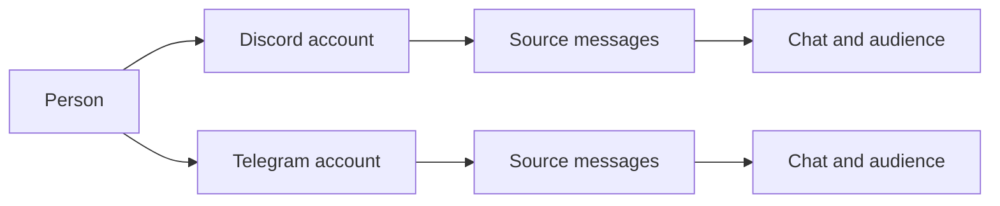

# Memory

Memory belongs to the persona, across all of its interfaces. `data/memory.db` stores people, places, source messages, learned claims, episodes, affinity, intentions and operational records. The core's writer applies changes; readers request an audience-scoped view.

## The schema

`openMemoryDb` in `src/memory/db/open.ts` creates a new `memory.db` from the baseline in `src/memory/db/schema-baseline.ts`, which holds the tables, indexes, triggers and seed rows of schema version 56 and records that one version in `schema_version`. The seed rows are the interfaces `discord`, `cli` and `core` with their authorities, her own person `person:self` with its key, the audiences `aud:none` and `aud:internal`, their graph nodes, and the first semantic entity kinds and predicates. The task board's tables are part of the baseline, and `board_schema_version` holds their version `3`, which `BOARD_VERSION` in `src/board/schema.ts` names and the board checks before it answers. Every change to the schema after the baseline is a new entry of `MIGRATIONS` in `src/memory/db/schema.ts`, version 57 first, and an open applies the entries above the database's version in one transaction. Version 57 adds the columns that hold what a row's key spelled, so no reader finds a row by the text of its key: `affinity_events.decision_id`, `session_runs.page` and `parts`, and `vectors.kind`, each filled once from the keys of the rows already stored, with a lorebook entry's id put into its claim's `extra`. `tests/memory-db-row-links.test.ts` reads a database taken back to 56 after the step. A database below version 56 is refused with `schema-below-baseline` and left as it was, and an engine from before the baseline brings it to 56 first. `tests/memory-db-baseline.test.ts` checks the new database, the reopen and the refusal.

## One person, several accounts

A person and an account are different objects. An account belongs to an interface and has that platform's native ID. A person can have several accounts, including multiple accounts on one interface. The same native ID on two platforms does not identify the same account.



The owner binds an account to a meta-person in the CLI after the persona has encountered the account, naming it by its interface and its platform id:

```text
/memory bind discord ACCOUNT PERSON
/memory users accounts PERSON
```

`bindAccount` in `src/memory/db/person-bind.ts` does the bind, and the target must be a meta-person that stands: marked `meta`, not merged away, not retired. `owner` as the target names the meta-person of `bot.ownerPerson` and `self` names the persona. An account no person holds is attached: a verified link by the owner, its `person_accounts` row under the target, and the target as `sources.author_person` of its lines. An account under another person makes the command ask one question, `Y/n`, naming the person it removes by id and name. A yes merges that person into the target at once, as [Merging people](#merging-people) describes, with the target's data winning. Every account of the person who went moves under the target in `person_accounts`, `author_person` of their lines follows, the target keeps its own affinity score, and the person who went stays as an alias with `meta` 0. Where both hold a current description of one field in one audience, the memory model joins the two texts first on the memory writer's path, the target's text leading (`prompts/description-merge.md`, see [the prompt contract](prompt-contract.md#description-merge)). The joined text becomes the target's current version, and the other description stays with the alias as history. A no changes nothing, and so does a merge asked where no dialog can answer, such as `neptunia -p`. A failed or unreadable model answer fails the bind whole. The owner's own meta-person is never the one that goes, and her own person is never merged in or out.

Accounts are bound and never unbound. Names, model suggestions and statements inside a chat do not create a verified link. Linking accounts changes who they belong to; it does not turn private messages into group messages. [Person links](../src/memory/db/person-links.ts) retains the link history.

Her own accounts need no bind. When she is the author of an observed line, the observation links the account to `person:self` on any interface, by the event's own mark and never by a name (`linkSelfAccount` in `src/memory/db/identity-links.ts`). `personDetail` reads her claims and descriptions of subject kind `self` like anyone's records, and a DM context reads of her only what was said in that DM. The memory session never lists her among the people of a batch and gives her accounts no author handle.

The owner names a person with `/memory users names add PERSON NAME` and `/memory users names remove PERSON NAME`. On a person id the name goes through the write kind `owner-name` (`memoryDb.writeOwnerName` on the service) as an `alias` claim with `author` `owner`, in the audience a member's profile gives its aliases: the groups of the person's interface (`ownerNameScope` in `src/memory/db/owner-names.ts`). `ownerNamesOf` in `src/memory/db/people-read.ts` reads those claims back; a person's `names` show them beside the account names. Her own record is `person:self`, and its owner names are her aliases, which the door and the address classifier read at each line. A name her memory session or the analyzer writes about her is a claim with another author, so it never widens the door.

Profile and affinity read through the person. The member unit that owns the person's `people` row holds the character, details, episodes and the one affinity score, and `linkedProfileUnit` in `src/memory/db/person-links.ts` finds that unit for any linked account on any interface. `src/memory/store.ts` asks it at every use, so a new link takes effect at the next read, and a change through any account moves the same score. A decay sweep moves the score of one person once. What belongs to one account stays with it: its native id, its display names, its avatar and how it is addressed. A linked account's own unit writes only those facts (`accountOnly` in `src/memory/db/account-profile.ts`), and a `people` row it held before the link rests under its own id. A profile write leaves the account's link columns as the database holds them.

The store writes a profile whole through the write kind `account-profile` (`writeAccountProfile` in `src/memory/db/account-profile.ts`, `memoryDb.writeAccountProfile` on the service) into the account's `user` unit: the member's `people` row, its `accounts` and `memberships` rows, and its claims, descriptions, episodes and attitude history. The rows the profile no longer holds are retired, and what her session wrote last stays as she wrote it. `accountProfileValue` reads the profile back with her session's rows about the person in its scope. The previous texts of a profile, a channel, a place's notes or a lorebook entry go the same way through the write kind `prose-versions` (`src/memory/db/prose-versions.ts`), one `description_versions` row per text in the unit of their owner. A private layer, what she learned about a member in their direct chat, goes the same way through the write kind `private-layer` (`src/memory/db/private-layer.ts`) into the account's `private` unit: its claims, descriptions, episodes and attitude history scoped to the account's stored DM place, and one `operational` row with the rest. `privateLayerValue` reads it back with her session's rows about the person in that direct chat.

Each of these rows names its owner itself, in `writer` and `holder_id` (`src/memory/db/profile-owner.ts`). An account's profile is `profile` and a private layer `private`, both held by the account, and a history of prose is `versions`, held by `<subject>/<versionKind>/<itemId>`. The readers, the retirement of what a value no longer holds (`retireProfileAbsent`), the person a profile holds (`linkedProfileUnit` and the author names of `src/memory/db/frame-reads.ts`) and the describer's versions run on these columns, with the index `<table>_holder` (writer, holder) on each profile table. A row her memory session writes, a claim it takes over, the owner's names and every older row no unit owns in `claims`, `episodes` and `affinity_events` are `session`, and `addSessionRows` and `sessionHold` in `src/memory/db/session-rows.ts` read her session's rows and last attitude move by that writer. An attitude move her memory session wrote comes back in a profile with its row id as `itemId`, and a profile write keeps that row when the stored row's `writer` is `session` (`sessionMoveOf` in `src/memory/db/profile-lists.ts`).

The notes of a root or a direct chat go through the write kind `place-notes` (`writePlaceNotes` in `src/memory/db/place-notes.ts`, `memoryDb.writePlaceNotes` on the service) into the place's `place` unit: the place row while no other row holds it, the five prose fields as descriptions, the in-jokes, self facts and lessons as claims, and one `operational` row with the rest. A channel's entry of the server map goes through the write kind `channel-entry` (`src/memory/db/channel-entry.ts`) into the place's `channel` unit: the place row with the parent and kind the interface reported, three descriptions and one `operational` row. Their rows name their owner in `writer` (`place` or `channel`) and `holder_id` (the place), stamped by the writers and read by `placeNotesValue` and `channelEntryValue` (`src/memory/db/place-owner.ts`). A row the notes of two places map, such as a self fact two roots both hold, stays the first place's, and `co_owners` lists the second place by the same two columns: its notes read the row, its write leaves the row as it is, and when the first place's notes drop the row it goes to the second instead of being retired (`retirePlaceAbsent`). `writeRow` in `src/memory/db/upsert.ts` leaves alone a row with no owner, which is a row the database or her session wrote.

A place's lorebook, the stretches of its chats she took part in and the lines she said lately in it go the same way. The write kind `place-lore` (`src/memory/db/place-lore.ts`) stores one `lore` claim per entry, the entry's own id in the claim's `extra` with its title, keys and always flag, `participation-episodes` (`src/memory/db/participation-episodes.ts`) one `participation` episode per stretch with a link in `episode_sources` per message, and `recent-lines` (`src/memory/db/recent-lines.ts`) one `recent_line` claim per line. The participation and the recent lines keep the rest of their value in one `operational` row. Their rows carry the writer `lore`, `participation` or `recent` and the place as holder, and an episode's links carry the columns of their episode, so a dropped episode or message retires its links. A lorebook with no entry holds no row and reads as not found, which the store reads as the empty lorebook.

Her selfreflection goes through the write kind `selfreflection-entries` (`src/memory/db/selfreflection-entries.ts`, `memoryDb.writeSelfreflection` on the service), the whole value or one appended post that keeps the newest `max`. Each post is a `selfreflection` row, a post with message ids also a `selfreflection_mirrors` row, and the rest of the value one `operational` row. Each mirror derives its publication (`deriveMirrorPublication` in `src/memory/db/publish.ts`). These rows and the publications carry the writer `selfreflection` with `persona:local` as holder, so a dropped post retires its mirror and the mirror's publication, and a write that names a destination gives that channel only to her own publications with none. No place shares her rows.

`store.getUser` gives every profile it reads the person behind the account, `personId`, and every account of that person, `accounts`, each with its interface, platform id, handle, display name, avatar and profile text. `profileOfAccount` in `src/memory/db/meta-person.ts` assembles them: the survivor of the account's person with its real name and affinity, and every account `accountsOfPerson` lists with the fields of that account alone. A profile read on any account of the owner, the command line's included, therefore lists his Discord account with its platform id. The graph reader gives each person entry the same accounts as `profileAccounts`, those whose account node the context may see (`personOf` in `src/memory/db/mind-read.ts`). The person's entry in `<memory>` lists them when the person has more than one, so lines from several accounts of one person read as one person writing from each.

The schema also holds a person as a meta-person with its accounts under it. A meta-person is a `people` row with `meta` 1, the top node of one person. `person_accounts` holds one row per account under it, keyed by interface, platform id and generation, with the fields that belong to that account alone: `handle`, `display_name`, `avatar` and `profile_text`. Its `person_id` is required and names a meta-person. The foreign key refuses a person nobody stored, and a trigger refuses a stored person without `meta` with `ACCOUNT_PARENT_NOT_META`. A line names the meta-person of its author in `sources.author_person`, which stays null for a line with no account, such as an anonymous post. An account seen for the first time on any interface gets a meta-person of its own, a `person:<uuid>`, linked by the core (`ensureAccountPerson` in `src/memory/db/person-links.ts`, called by `observe` for a line's author and a DM's partner). Her own account is linked to `person:self` and the owner's command line to his person instead. A profile or a private layer written for a stored account with no person gets the meta-person before the write, and one written for an account no row holds gets a new meta-person, so no writer spells `person:<iface>:<native>`. Every verified link, a merge's included, moves the account's row in `person_accounts` and the `author_person` of the account's lines to the new person (`followAccount` in `src/memory/db/meta-person-write.ts`). A person nobody merged away is marked `meta` there, whatever its id, so an account linked to it keeps its row. A profile write of an account copies its display name and avatar into its row, and every line written takes `author_person` from its author account's person, null for a line with no account. `/memory bind` fills both too, as the bind above describes. `personOfAccount` and `accountsOfPerson` in `src/memory/db/meta-person.ts` read `person_accounts` first and the verified links of `accounts` after, and a row of `person_accounts` wins over the old link of the same account.

## Owner identity

`bot.ownerPerson` names the owner's person. Owner rights require an account whose live row in `account_person_links` is a verified link written by the owner to that person, or to a person merged into it. `createOwnerAccounts` in `src/memory/db/person-links.ts` reads only that row: the `link`, `linked_by` and `linked_at` columns of `accounts` are a copy for the readers that join accounts. Nobody is the owner while `bot.ownerPerson` is unset, except on the command line, and the setting never broadens the audience of a group or DM turn.

Only the owner speaks on the command line (`iface: 'cli'`), so its account belongs to him from its first line. The core hands `bot.ownerPerson` to the observation of each line there. The writer links the account to that person before it resolves the line's place, so the DM and the line both name him (`linkOwnerAccount` in `src/memory/db/identity-links.ts`). A tentative person the memory session proposed for the account merges into the owner, unless that person holds another account or was merged elsewhere. On a raw install the first line mints the person. Once the line is stored, the core writes `bot.ownerPerson` (`src/pipeline/observe.ts`). A memory session's `people` add is refused for the command line's account and for hers, as `known_person`.

The owner's account on another interface joins him by `/memory bind <iface> <account> owner`, which binds that account to the owner's meta-person by the rules of any bind, so a person the account held before merges into the owner after the owner's yes. While `bot.ownerPerson` is empty, the account's own person becomes the owner person and the command writes `bot.ownerPerson`. The command line's rows sit under its native authority `cli/local` (`nativeAuthorityOf` in `src/protocol/identity.ts`), the authority `/memory bind cli owner` looks under. Rows an install stored under `cli/global`, her recorded lines and their message families among them, move to `cli/local` when the next line arrives: `adoptNativeAuthority` in `src/memory/db/identity-links.ts` runs in `observeMessage` before the line's family is resolved, and again in every observation. With nothing to move it costs one statement whose branches each read an index on `authority_id`, such as `accounts_native` and `sources_native_tuple`. A row whose key `cli/local` already holds stays under `cli/global`, and a message family that stays keeps its lines beside it, so a line and its family never sit under two authorities. An interface whose native authority is `<iface>/global` keeps its rows there. A second account bound on the same interface becomes one more child of his meta-person and his account there, the one whose owner link came last (`ownerAccountOf` in `src/memory/db/person-links.ts`), and the earlier account stays his. A command line turn reads a root's channels as the owner's account on that root's interface.

## Linking accounts by code

Anyone links their own accounts without the owner, through her tool `person.link` (`createPersonLinks` in `src/interface/person-link.ts`, run as an in-turn tool by `src/turn/in-turn-tools.ts`). In a conversation with account A she names the meta-person she believes the person is, by its person id or its handle, which is cut from the meta-person's id. The tool sends a one-time phrase of six words ([Phrase codes](interfaces.md#phrase-codes)) in a direct message to an account B of that meta-person on the first interface that reaches one. `labels.link.code` words it: A's handle on A's interface says it is this person, and if so, B sends the six words from A. Her answer is `labels.tools.tools.link.sent`: the next message from A in that conversation must hold the six words. Her answer never holds the phrase.

The door checks the next message from A in that conversation before a turn sees it (`DoorScreen` in `src/pipeline/handle-message.ts`). A message that holds the six words in any order and any form is stored like any line and starts no turn, it stays in every chat a turn reads, and the bind of `/memory bind` runs with `by` `code` (`bindAccount` in `src/memory/db/person-bind.ts`): B's meta-person wins and A's merges into it. A merge a phrase proved joins the private layers as an owner's merge does (`personMembers` in `src/memory/db/person-links.ts`), so what B said to her privately is known in talks with A. Any other message from A there ends the attempt, passes on as an ordinary line and counts as a failure. A message from anyone else, or from A in another chat, leaves the attempt waiting.

The limits are Hermes's (`gateway/pairing.py`), kept in `src/interface/pairing.ts`: a phrase lives one hour, an account asks once per ten minutes (`cooldown`), and five failures lock it for an hour (`cooldown` again). The tool answers `chat-closed` and nothing waits when no account of B takes a direct message, `PERSON_NOT_FOUND` for a person that is no standing meta-person, and `forbidden` for the owner's meta-person on either side and for the command line: the owner's accounts are linked by `/memory bind` only. The seals of the waiting phrases and the limits are written to `link-codes.json` in the data directory, so a restart neither drops a waiting phrase nor reopens an ended attempt or a lock. Logs never carry a phrase. There is no unlinking.

## Merging people

`/memory users merge <from> <into> [--reason <text>]` merges one person into another. It goes through the writer as `applyMemoryWrite` kind `person-merge` (`src/memory/db/person-merge.ts`, `MemoryDbService.personMerge`). Only the owner merges, and `person:self` is never merged in or out. Everything stored about the person who goes moves to the survivor at the end of the merge chain. That covers claims and descriptions about them, claims they made, episodes, affinity events, accounts with their links, DM places, focus rows and the `scope_dm` of lines, vectors and the other scoped rows. Their daily relationship counts add to the survivor's. No row changes its `audience_id`, so a fact stays in the chat it was said in. A description of a field the survivor holds in the same audience stays with the person who went, so the survivor never holds two of one field. The survivor keeps its affinity score. The old links stay closed as history, one `people_merges` row records the merge, and the person who went gets `status` `merged_into:<survivor>`. A repeated merge moves what was left behind and writes nothing else. It also finishes a merge that `mergePeople` in `src/memory/db/session-write.ts` recorded without moving any row.

## Places and context

Everything she remembers belongs to the persona, an account, a person or a place. A place is a row of `places`: a server, a channel, a thread, a group or a DM, each with its own id and `parent_id`. A Discord server is a place with channel and thread places under it, a Telegram group is a place with none, and a DM is a place with one partner. `store.rootPlaceOf` in `src/memory/store-addresses.ts` walks `parent_id` to the top of a tree, so a DM is its own root. A place the store named from a chat the interface described (`store.placeOfChat`) keeps that chat's top and native id in the process until its row exists, so a quiet channel with no observed message still finds its server. An id named nowhere has no top. Every place stores the chat id its interface gave in a message as `places.native_id`, its address, for a DM as for a channel: `observe` in `src/memory/db/observe.ts` takes it from the envelope's `place.address` and hands it back as it is. `store.chatOfPlace` turns a place back into the native chat a post goes to by reading that address. `chatOfStoredPlace` in `src/interface/place-chat.ts` answers the chat of a stored place for `conversation.read` and for a post to another place. A DM whose place holds no address yet is opened once through the interface's `dm.chat` read for the partner's account, and the answer is stored on the place through the writer kind `place-address` (`applyPlaceAddress` in `src/memory/db/observe.ts`). The way back reads only stored rows and what the store named, never the text of an id. A place with no row answers the chat the store named it from, else the id as given, since a caller that holds a native id passes it on. `store.nativeRootOf` reads `places.native_id` the same way and keeps the native id of a root that `store.placeOfRoot` named before the hello's roots are written. `store.personOfAccount` reads `accounts.person_id` and answers null when no row links a person, and so does `personOfMember` in `src/memory/addresses.ts`. A new profile or channel takes its native id from its row or from the account or chat the store named it from, null with neither.

Every place carries `purpose`, `tone` and `topics` as descriptions: a room, a root, a direct chat and the command line alike. The memory session writes them once a place has lines, through the notes of a place (`src/memory/db/place-notes.ts`) for a root and a direct chat and the channel's entry (`src/memory/db/channel-entry.ts`) for a room. A root also keeps `patterns` and `starters`. The three fields of a direct chat say that it is a direct chat with its partner, how the two of them talk and what they talk about, and they are scoped to that chat. A direct chat has no name, and its path ends in the interface's word for a direct chat and the partner's native id.

The session flags a field, and `reviewDescription` in `src/memory/db/describe.ts` writes it. A review of a place field reads the claims about the place and, in `<lines>`, the latest 40 lines of the place and the places under it that the review's context may read. A direct chat holds few claims about itself, so its lines carry most of what the three fields say. `openFlags` in `src/memory/db/writer-switch.ts` reads a flag raised in a direct chat in that chat, which it takes from the audience of the session run that raised the flag, because a partner who is a meta-person spells no place.

A turn gets a bounded selection of relevant information: people nearby, the current place, recent events and recalled passages. The whole database is not inserted into every prompt. Local context helps rank relevant material without restricting all searches to the current place.

## Who can recall what

The observation in `src/memory/db/observe.ts` keeps a chat's containment. A declared parent gets a row in `places` even when no line was seen in it, so a chain of parents holds whatever order the places are seen in. The row gains its chat and title from its first own line. A chat of a root sits under that root's place, directly or through its declared parent. A DM has no parent. Every `hello` the core takes writes the roots it names as server places through the one writer (`noteRoots` in `src/memory/db/roots.ts`): a missing place is created, a retired one revived, a new name renamed, and an empty name keeps the stored one. A root the hello or a `root.changed` event gives a `joinedAt` keeps that moment in the place's `extra`, a later one with none leaves it, and the chain read (`placeChainInDb`) and the graph reader's place entry (`joinedAt`) give it back.

A value of the store is named by its subject alone (`src/memory/db/unit-keys.ts`, the persona's id `PERSONA_ID` in `src/memory/db/ids.ts`): `accountCollection` for a profile and a private layer, `placeCollection` for a place's notes, lore, emoji rails, recent lines, participation, record, journal and archive, and `personaKey` for the selfreflection, the intentions and the inner state. A key is an address only: no table registers it, and each writer stamps the owner columns of its rows instead (`writeMapping` in `src/memory/db/upsert.ts`). Of the unit columns only `graph_edges.owner_key` stays, the key of the row that projected an edge. `co_owners` holds four columns, the table, the row's key and the sharing writer and holder, one row per sharing place. A lookup by key names the authority of the interface that sent the event. A direct chat's record, journal and archive are collections of its DM place, and its lines keep their DM audience. `store.accountOf`, `store.placeOfChat` and `store.sharedPlaceOf` turn the native ids an interface gives into these ids, and an empty id is refused with `BAD_COLLECTION_ID`. An operation runs in the place of its call, the `placeId` of its context in `src/tools/types.ts`. One that reads or writes a collection of the whole tree, such as lore, notes or pings, asks `rootPlaceOf` for the top inside (`resolvedPlaceId` in `src/tools/operations/env.ts`), so every channel and thread of a server shares one lorebook.

The notes of a place are scoped together by `placeNotesRows` in `src/memory/db/place-notes.ts`: its descriptions, in-jokes, self facts and lessons belong to the partner's DM on a DM place and to the groups on any other.

Group recall can search stored group experience across interfaces. It excludes private chats. A DM can retrieve the DM history of every account of the same meta-person, for any person: the owner's command line chat reads his DMs on the other interfaces, and a member bound to two accounts reads the DM of either from the other. Rows keep their original audiences and provenance.

A DM context finds the person's other DMs in stored rows. `linkedDmScopes` in `src/memory/db/person-links.ts` joins the person's verified accounts to the places whose `partner_account` names them, after `personMembers` follows `people_merges`, and leaves out the place the context was issued in. A DM context names its DM place as the caller found it in `places` (`dmContext` in `src/memory/db/scope.ts`) and reads no DM worked out from the partner's person id. A DM nobody linked gives a context with a place and no person, and a person no stored DM place holds gives one with a person and no place, which reads the groups and the linked DMs only. Schema 42 indexes `places(partner_account)` and `places(partner_person)` for these lookups. An outward context follows only a merge whose `by` is `owner`, so a merge written by a memory session never widens it. An account that is unbound or moves to another person leaves the person: the next issued context stops reading its DM, the context already issued keeps what it was given, and the DM's rows keep their audience. The context a recall read issues for a DM names the stored DM place of the partner's account beside the person (`readContextSpec` in `src/memory/db/scope.ts`, `dmPlaceOfMember` in `src/memory/addresses.ts`). A group context names the place `placeOfChat` in `src/memory/addresses.ts` reads from `places` by the chat's native key, for a recall read and for a turn's own context (`turnContextOf` in `src/turn/inputs.ts`) alike, and the asker of a group read is named only when a stored row links the asker's account to a person. A partner whose account no row links to a person reads as the interface's group, since no private row can name a person the database does not hold. A description flag raised in a DM is read in the stored place of its run's audience (`flagContext` in `src/memory/db/writer-switch.ts`).

`privateByPerson` and `privateByPlace` in `src/memory/db/private-read.ts`, also on the memory service, read the private memory of one person or one DM place. A record belongs to the DM place its `audience_id` names, whoever it is about, and the view holds the live rows of `claims`, `descriptions`, `episodes` and `affinity_events` as stored. The context filters the places before any record or count is read, so a DM context reads the audiences it was issued and a group context reads none. An internal context also reads every merge and the closed links in `pastLinks`. An unknown id answers `PERSON_NOT_FOUND` or `PLACE_NOT_FOUND`.

A line of a DM keeps its DM's audience whatever it names and whoever writes it. The journal, record and vector writers (`scopeInto` in `src/memory/db/scope-parts.ts`) take the place, the audience and the partner from the unit's stored DM place, never from a place or a person spelled out of the partner's native id. Two partners with one native id under two authorities share nothing, and her own lines in a DM name the person in the place's `partner_person`, the same person as the partner's own lines. A unit that names a member by platform id, such as an old journal line scoped to `{ user }` or a private layer with no DM place unit, takes the member's stored DM and its partner through `dmOfMember` in the writer's context (`dmOfPlatformId` in `src/memory/db/meta-person.ts`, through `places.partner_account`). A member no stored DM holds is `internal`: no writer works out a DM place or a person from a platform id. A stored DM's rows name its partner person: the place's `partner_person`, else the person of its `partner_account` (`partnerPersonOfPlace` in `src/memory/db/meta-person.ts`, which `resolveRow` in `src/memory/db/rows.ts` accepts too), none for a DM nobody linked. A private layer no stored DM holds is `internal` and names no place. The writer's context (`storageContext` in `src/memory/db/storage-context.ts`) reads a subject's interface, native id, person and DM partner from its row only, and a subject no row holds takes the interface of the write. A write that names no interface and finds no subject row names none, and its group scope resolves to the internal audience (`audienceOf` in `src/memory/db/scope.ts`), so such a row is never shown outward. A stored DM place is a DM whether or not its partner account holds a native id, so its notes, archived items and lines keep its audience, and the line vectors of a place no row holds are `internal`. A line that names a channel by its platform id is stored on the channel's place, found by its native key under the interface's own authority (`placeOfChannel` in `src/memory/db/native-rows.ts`), and reads the channel back from that place's `native_id` (`channelOfPlace`). A record line's author is the account found the same way (`accountOfMember`), read back from the account's `native_id` (`memberOfAccount`). A participation episode and a recent line name their channel through the same readers (`channelColumn`), and so does an archived item's claim about a chat. A channel or an author no row holds takes the id the observation would mint (`mintedChannel`, `mintedAccount`), and the platform id stays in the row's remainder, so the value comes back exact. A line `record.append` writes to a place no row holds names the place in its scope, so a direct chat's line stays `internal` until its place is stored. A platform id names the account of the interface's own authority first (`nativeAuthorityOf`), so an account of another authority with the same id never answers for it. The member an attitude is toward and the teacher of a lesson are the stored person of the member's account (`personOfMember`, `personOfPlatformId`), null when no stored account holds the platform id, and the platform id stays in the row's remainder, so the file comes back exact. A `{ user }` scope read back from a DM row takes the partner's platform id from the stored place its audience names (`partnerOfDmAudience` in `src/memory/db/meta-person.ts`, read by `dmUserOf` in `src/memory/db/scope.ts`). The notes of a place (`src/memory/db/place-notes.ts`) scope a DM place's descriptions, in-jokes and lessons to that DM. `scopeColumns` in `src/memory/db/scope.ts` answers `internal` for a channel or a place that is a stored DM or has the spelling of one, for a member or a private mark no stored DM holds, and for the `unresolved` mark. Without its readers nothing is stored, so a member and a private mark are `internal` too.

A wake holds no partner of its own. Its delivery asks the interface for the chat (`partnerOfDelivery` in `src/behavior/inner/deliveries.ts`), and the said line and the `post` operation go to the partner's DM place through `personaRecord` and `personaJournal` in `src/behavior/inner/persona-sources.ts`. When the interface cannot say and no stored place holds the chat as a channel, a thread or a group DM (`store.holdsSharedChat`), the line is marked `unresolved` under the chat's spelled place. Her `internal` context reads it, and no group, partner or wake view does. Only the persona's journal holds the operations of a real channel.

An archived private item names `{ place, private }` with its DM place, or `{ user, private }` when the member has no DM place yet. `allowScope` in `src/behavior/recall-run.ts` shows it to the private turn that stands in that place or whose partner it names, `memory.archive.read` lists it only in that DM, and `memory.restore` writes its `restored` line under that DM.

A private unit writes its rows under the stored DM place of its account, and `addSessionRows` in `src/memory/db/session-rows.ts` lays her session's rows over the unit by that same audience. A partner with private memory and no public profile keeps that memory in a DM turn, under the name on their message.

The authenticated owner CLI has a separate internal view across stored memory. The owner's ordinary group or DM chat retains that chat's audience rules. Permissions to read stored material do not grant permission to fetch or publish arbitrary live platform content.

[Scope resolution](../src/memory/db/scope.ts) controls visibility. [Recall](../src/memory/db/recall.ts) applies scope and place filters before ranking, limits and surrounding message windows. A window names its chat by the native id of its place's row, a DM by its partner's account, and each line keeps its stored place, which a prefetch excerpt carries as `place` so a turn finds a hit's stored line in it (`seedsOf` in `src/turn/phases/request/build.ts`).

`search` in `src/memory/db/recall.ts` finds the asker's DMs, a named chat and the interface of a place through their rows in `places`. A group read whose context names an `asker` answers `hidden: true` when a DM of the asker holds a better word match than anything the read may show. The asker's DMs are the DM places on the read's interface whose `partner_person` is the asker, and their audiences are the rows of `audiences` that name those places. Any other line the read may not open gives no hint, and an internal row is one of them. A plan's `placeId` is the native id of a chat: the search keeps to the place on the read's interface whose `native_id` it is, and to nothing when no row holds it. Among hits of equal relevance, one in the read's own place ranks first, then one whose place shares the read's interface in `places.iface`.

## The query and summary builders

A search has two steps with a model around it. The query builder (`parseQueryPlan` in `src/behavior/query-builder.ts`, purpose `query-builder`, prompt `prompts/query-builder.md`) plans before the search. It answers the JSON object of `QUERY_PLAN_FORMAT`, `web`, `history`, `who`, `when`, `when_role`, `recent` and `skills`, each null when unused. A live turn has no such step, because the persona's own tools search during her reply, so `src/turn/phases/request/lookup.ts` logs `lookup: skipped` with the reason `core-tools` and adds no helper model. The parser's callers are `scripts/replay.ts`, `scripts/recall-eval.ts` and `scripts/search-policy-eval.ts`.

The summary builder (`createSummaryBuilder` and `parseSummaryNote` in `src/behavior/summary-builder.ts`) condenses what a search found into a note bounded by `maxChars`. Chat evidence reads `prompts/recall-summary.md` under the purpose `recall-summary` on the analyzer, and web evidence reads `prompts/search-summary.md` under the purpose `search-summary` on the `search` role, on the first route of its chain. The single word `none` is no note. `src/behavior/recall-run.ts` and `src/web/lookup.ts` both go through it.

## Searches off the main thread

`searchRecord` in `src/memory/db/service.ts` runs a search of the record on the reader thread (`src/memory/db/reader-worker.ts`) and answers what `search` in `src/memory/db/recall.ts` answers over the same rows. The thread holds one read-only connection, takes no lock and refuses every message but `open`, `places`, `search` and `close`. The caller's callbacks stay on the main thread: `allowPlace` judges the list `visiblePlaces` gives before the search, and `nameOf` and `channelNameOf` fill in the names `searchMarked` marked once the answer is back. A service without a worker searches on its own connection.

Searches wait in `src/memory/db/reader-client.ts`, and one runs at a time. An aborted signal rejects a search with `SEARCH_ABANDONED`. When the abandoned search is the one running, its thread is terminated and a new one opens, so the searches behind it are still answered. A thread that dies rejects its search with `WORKER_EXIT` and logs `memory db: reader exited`, and the next search starts a new thread. A closed database rejects with `DB_CLOSED`. The core opens the reader with the database and closes it before the writer, because a read-only connection that closes last leaves the WAL behind.

The memory prefetch searches under `recall.prefetch.deadlineMs` and the persona's own search under `recall.timeoutMs`. Each aborts its signal at that deadline and goes on with what it has. A failure logs `recall: prefetch failed` or `recall: failed` with its `code`. A memory that offers only `database()` is searched synchronously.

## How the store reads and writes

`createStore` in `src/memory/store.ts` takes the memory database as `memoryDb`, and a store cannot be built without it: every memory unit lives in the database, her state among them, and only the operational files stay files under `data/`. `createStoreWrites` in `src/memory/store-writes.ts` reads a unit from the database when the store asks for it and keeps the value only while it is in use. A value stays in use for the rest of the tick that read it, so two reads of one unit in one synchronous change share one object. It also stays while it is changed, while the archive holds it back, and while its write is under way, so a read never takes an older value than the store wrote. Her state stays in use for the life of the store, because its callers change the object they were given.

A value nothing changed goes out of use at the end of the tick, and the next read takes what the database holds. That read is answered from the last read of the same unit while no other writer has reached a unit's rows since, because rebuilding a profile from its rows takes about a millisecond and a turn lists every profile several times. `writeGeneration()` on the service counts the other writers' writes once they settled: her session's applies, a description review, a person link, merge or bind, a root's names, a DM's address, a selfreflection mirror or publication, the selfreflection media job (`UNIT_ROW_WRITES` in `src/memory/db/service.ts`), and a write of a value kind the store reads that another writer sends through `memoryWrite` (`STORE_VALUE_KINDS`). A change the store sends becomes the last read of its unit with the count it was read at, so a write of another writer that landed while the value was in use sends the next read to the database.

The store marks a change by setting `dirty`. At the end of that tick the whole value goes straight to the writer through the write kind of its unit's kind (`DIRECT_WRITES` in `src/memory/store-writes.ts`), which every unit the store keeps has; the writer takes no unit write. A selfreflection written with no destination takes the place of the first enabled mirror, as `writeSelfreflection` on the service stamps it. The projection job a migration leaves runs as the write kind `project` (`src/memory/db/projection-job.ts`). at most one write per unit under way, and a change made meanwhile goes once that write settled. Lines of a unit, such as a picture's description or a recall trace, go the same way in their order. A failed write logs `memory db: unit write failed` and leaves the value changed and in use, and the next flush on the store's 30-second timer sends it again. A value changed after it went out of use, by a caller that kept it over an await, comes back into use, so its change is written. A list of the units of one kind, such as `listPrivate`, names those in use and those the database holds, read from the row each such value always writes (`unitSubjects` in `src/memory/db/readers/common.ts`). `/nep pause` takes every value out of use except her state and those whose write is under way.

The intention store (`src/intentions/store.ts`) and the task store (`src/errands/store.ts`) keep their lists in memory and send each change straight to the writer as well. The task store sends the whole errand through the write kind `errand` (`applyErrandWrite` in `src/memory/db/errand-write.ts`, `memoryDb.writeErrand` on the service), which brings the task board to it and, when the errand reaches its end, writes its closing `action` line to the journal of the persona in the same transaction. `createWritesUnderWay` in `src/memory/db/writes-under-way.ts` follows those writes, and a failed one goes again at the next change or flush.

At shutdown the core calls `flushSettled({ final: true, timeoutMs })` and the final `flush` of the intention and task stores with the same bound, `memoryDb.closeTimeoutMs` (default `10000`). Each waits for its writes under way. When the bound runs out first, the store logs the error `store: writes still under way at shutdown` and the other stores `memory db: writes still under way at shutdown`, each with the count. A write that still fails logs the error `memory db: units lost` with the count and the last code, and nothing of it is kept outside the database.

## Learning and remembering

Source messages are the evidence. A memory session reads a window and proposes claims, episodes and affinity changes. The writer validates references and applies accepted changes transactionally. A claim records what was learned and the sources supporting it; its versions preserve changes over time.

Recall combines word search, partial word matching, stored vectors and person matches. It ranks hits and returns surrounding chat so a matching phrase keeps its context. Prefetch brings likely relevant material into a turn; `memory.search` lets the persona ask a more specific question.

`runDbQuotes` in `src/behavior/recall-run.ts` runs her `memory.search` over the memory database. It embeds her `question`, or her `terms` when she gave no question, in one request of purpose `recall-query` through the same embedding client. An embedding that fails leaves the words alone and adds `tools.tools.memory.degraded`, and one that returns no vector leaves the words alone with no note. A call with `anchor`, or with only `when`, `place` or `people`, embeds nothing. The terms' vector meets the vectors of lines and of media descriptions, so a word of one language finds a picture whose description is written in another. Stored facts and episodes are met by the question's vector only. A media item found by meaning alone must clear the prefetch's bar, `PREFETCH_DEFAULTS.minMeaningScore` (`0.35`) in `src/behavior/recall.ts`, and `strongMeaningScore` (`0.55`) when its description holds none of the words. It shows as the line it belongs to. `place` narrows the search through `chatNamed` in `src/memory/db/recall.ts`, which takes a stored place id of any interface as it is and otherwise reads the id as a native id of the turn's interface. The audience of the turn's context and the caller's allowed places still filter every stream, so a place the context may not read gives nothing. A call that gave `question` or `terms` and found nothing answers `tools.tools.memory.none`.

A search can find lines and still find nothing close. `isClose` in `src/memory/db/recall.ts` calls a hit close when the word, letter or people stream found it, when it holds a term of the plan, or when its cosine reaches the prefetch's `strongMeaningScore` (`0.55`), the bar a hit by meaning alone must clear. When no hit is close, no media item cleared its bar and the lines are no sample, `nearOnly` marks the result `far`. Its windows then hold the three best hits alone, with no stretch around them, and `runMemorySearch` in `src/tools/tools.ts` opens the result with `tools.tools.memory.far`, which tells her these are only the nearest lines. The bar is the one the prefetch reads from `recall.prefetch`, so no setting of its own changes it.

`mine: true` keeps a `memory.search` to her own lines. The plan carries `mine` to `filters` in `src/memory/db/recall.ts`, which adds `kind = 'said'` beside the audience clause of `scopeWhere` in every stream, so it narrows what the context may read and never widens it. The stretch around a hit keeps her lines alone. With `mine` and `when` and no words the time stream samples her lines of that span, and the windows come back newest first.

`conversation.read` with `find` runs the same search for one chat. `runChatFind` in `src/tools/tools.ts` plans her words as the `question` of a `memory.search` and calls `recall.run` with `quotes`, the plan's `place` set to the stored place of the chat, which `scopeOfPlan` in `src/memory/db/recall.ts` takes as it is, a DM's included. It runs under the turn's memory context, after the read has passed the audience rule, with one embedding through the same client and words alone when it fails. The lines of the read's window go in as the run's history, so `historyExclusions` in `src/behavior/recall-reads.ts` leaves them out of the hits. `search` hands back as `lines` at most `CHAT_FIND_MAX` (`8`) close hits, best fused score first, and none when the result is `far`. A run for lines searches no stored fact and no episode.

`src/memory/vectors.ts` keeps the vectors of a place's lines as `vectors` rows of that place, written by the write kind `line-vectors` (`writeLineVectors` in `src/memory/db/line-vectors.ts`, `memoryDb.writeLineVectors` on the service). A row names its index's place in `place_id`, a root or a DM place, and falls in the month of its `occurred_at`. `search` reads a month once into memory and keeps it while the month's stamp of row count, newest row, total scale and evicted count is unchanged, and `has` answers from the rows, so the catch-up in `src/memory/embedder.ts` never embeds a record again while its month holds it. A vector row stays in the month of its own place: when another place's month holds its chunk key, the writer gives the row that key with a `#<n>` suffix. Every vector row names its kind in `kind`, `record` or `archive` for a line and `claim`, `desc`, `episode`, `names`, `gif`, `media` or `semantic` for the other writers, and the readers of one kind, the object search, the GIF and media searches and the eviction plan, find their rows by that column and the index `vectors_kind`. The chunk key stays each writer's own key, compared whole.
When those four streams find nothing, the call gave no `question` and no `terms`, and the plan names a channel or a side of a time range, `memory.search` answers from a fifth stream, `time`, in `search` in `src/memory/db/recall.ts`. It cuts the span into as many equal slices as `RECALL_DEFAULTS.maxClusters` (5, in `src/behavior/recall.ts`) allows windows and takes the line nearest the middle of each slice, or every line when the scope holds no more than that. An open side of a range closes at the first or last line the context may see. A hit of this stream has `streams: ['time']`, `stats` counts only the other four, and the result says `sampled: true`, which puts `tools.tools.memory.sampled` under the source line. The stream reads inside the audience, `allowPlace` and the exclusions, and `samplePlaceRule` in `src/behavior/recall-run.ts` also keeps it to the chats the turn's live view lets through `context.pull.sameAudience`, finding a place's chat in the view by its row's `native_id`, while word and meaning hits stay independent of the live view. The prefetch does not ask for this stream. On the reader thread `reader-client.ts` turns `samplePlace`, a function, into the list `sampledPlaces` on the main thread, the way it turns `allowPlace` into `allowedPlaces`.

The memory objects a search reads as text have vectors of their own, kept by `src/memory/db/object-vectors.ts` in `vectors` beside the months. A live claim other than an alias has one under `claim:<id>:<model>`, and a description of a person, a place, the persona or an entity under `desc:<id>:<model>`. A live episode has one under `episode:<id>:<model>`, made from its `what` with its `quote` on the next line. The names a person or a place has in one audience, one per line and sorted, have one under `names:<node id>:<audience id>:<model>`, so an alias learned in a DM never enters the vector of the group's set. A claim of a semantic version keeps its `semantic:` row instead. Such a row has no `source_rowid` and no `owner_key`, so it belongs to no month and no manifest counts it, and it copies the scope and audience of its object. Its `context` holds the hash of the text it was made from. `pendingObjectEmbeds` lists the live objects with no row of a model, oldest first, and the writer message `object-embedding` writes a vector only while its object still holds the text of that hash. In the writer's transaction `projectRow` in `src/memory/db/graph.ts` calls `touchVectors`, which deletes the rows of an object whose text changed or which retired. `touchNameVectors` does the same for the sets of the nodes `touchNames` rewrote. Until its next embedding such an object is found by its words. Schema 41 indexes `vectors(item_id)` for these lookups.

`embedObjects` in the same module embeds what is pending. The service's `startRetrievalEmbed` runs it at a tick at most once a minute, off the turn path, while `memoryDb.retrieval.embedObjects` is on (default `true`). One run takes the oldest pending objects, at most `memoryDb.retrieval.embedBatch` (default `50`), and stops before the text that would carry the request past `llm.maxRequestTokens`. The rest waits for the next minute, and a text over that cap alone is never sent. The texts go out in one request of purpose `memory-object` through the embedding client on the `embedding` model role, which counts it against `llm.maxRequestsPerDay`, and the vectors come back through one `object-embedding` message. A failed request writes nothing, so its objects stay pending, and a run with nothing pending sends no request.

## Media on stored lines

The table `media` is the only store of media, in `src/memory/db/media-store.ts`. It holds one row per item, whatever the interface. `kind` is one of `image`, `gif`, `video`, `sticker`, `emoji`, `voice`, `audio`, `link`, `text` and `file`. `native_ref` is the interface's reference, opaque to the core, and an item is the same item when its interface and reference are the same. `path` is null or a file under `media/`. `availability` is `present`, `missing`, `unknown` or `unreadable`. `extra` holds what a kind has beside that: `fileName` and `durationSec` of an attachment, `name` of a sticker, an emoji or a library GIF, and `title`, `site` and `url` of a link.

`media_links(owner_kind, owner_id, position, media_id)` ties an item to what shows it, a message (`source`) or a selfreflection entry (`selfreflection`), at its position there. Audience comes only from a link: an item is read through an owner the reader may open, and a file shown by a message and an entry is one row with two links. A `sources` row holds no kinds, no ids and no link cards, and its `text` and `stems` stay what was written.

An item's text form is its `description`, with its origin in `extra.textOrigin`: `retelling`, `frame`, `transcript`, `voiced`, `embed`, `preview` or `page`. `tellMedia` is the one write of a text form. A text form that ranks higher stays over one that ranks lower, so what she voiced is never replaced and a watched summary replaces a still frame. A file no model can read is `unreadable` and renders the standard mark with its name, which `safeFileName` in `src/media/classify.ts` cuts to 120 characters and rids of anything that opens a tag.

`lineMedia` is the one read: a turn's recall, a window, the prefetch, the memory session's batch, a task's and a chat's lines and the owner's browser all go through it, and no line read touches a description anywhere else. The describer's cache is the same rows, written by `writeMediaCache`. Its cap of `MEDIA_CACHE_ENTRIES` retires only rows nothing links.

A platform can send an embed in a later update of a message, as when an address posted as text is unfurled after the message is created. `onMessageUpdate` in `src/pipeline/edits.ts` hands the items the earlier message lacked to the describer. When the update keeps the text and brings such an item, `recordEdit` observes it as an edit. That observation lands on the line's current revision, so no revision is added and the record gets no line. Its replay writes the line's links to the items of the update, and a row the describer already holds under an item's reference becomes that item with its description. An update with the same text and the same items writes nothing.

A text form is stemmed and embedded once on its row. `media_fts` and `media_tri` index it, and `embedMedia` keeps one vector for it, whose `chunk_key` names the row, once a minute a page at a time. A message's own vector covers its text and its neighbours, so a line that holds only media has no vector. `search` in `src/memory/db/recall.ts` answers such a find as `mediaHits`: one hit per item, or per set of equal bytes by `sha1`, with its use count, its latest use and at most 20 of its messages, each only through a message the reader may see. The latest use also joins the windows, and one answer tells an item once, so an item posted ten thousand times shows as one line among the rest.

## Older media and the cache

`memoryDb.session.mediaPass` lets the memory session read the media-only lines its cursor passed before they had a text form, oldest first, with a cursor of their own. The pass runs only in a scope with too few new lines to sweep, so new lines always go first. `dueScopes` in `src/memory/db/writer-switch.ts` lists such a scope as due while the pass has lines left, at most `memoryDb.session.mediaPassPerDay` passes a scope and UTC day (default `24`), and `everyMinutes` after the scope's last sweep of any kind. A media pass is never `full`, so it never skips that wait. Its runs carry the sweep id with `:media-pass` appended and do not count toward `sweepsPerScopePerDay`, the cap of ordinary sweeps. A scope left out at either cap is logged `memory session: capped` once per scope, cap and day, with the scope key, the cap's name and the count. `scripts/memory-audit.ts` counts what does not agree: a line without its place, a scope that disagrees with its audience, a link to a row that is gone.

One request of a memory session takes at most `memoryDb.session.maxPageTokens` estimated tokens (default `60000`) and never more than 0.85 of `llm.maxRequestTokens`, the page budget of `pageBudgetOf` in `src/memory/db/session.ts`. The request cap is the provider's limit, and the page budget is the size the memory model answers within `memoryDb.session.timeoutMs`. A batch holds up to `maxPeople` people to a page and sends one request per page. `fitBatch` cuts a batch whose largest page passes the budget to its first lines by arrival, halving until it fits, and the lines after the cut wait for the next batch. A batch with one page applied keeps its lines on the next try, so a page of it that passes the budget goes out in parts instead: `partsOf` finds the fewest near-equal shares of the page's people whose requests all fit, and each part has the batch key of its page with `|<part>/<parts>` appended. A page sent in parts keeps that split on later tries, read back from the `page` and `parts` an applied run of the same batch stores (`splitBefore` in `src/memory/db/session-size.ts`), so an applied part is never sent again. The cursor moves with the write of the last part of the last page, when every page and part before it was written.

An old source does not become unreachable merely because it is outside the recent-context window. Prompt budgets bound what is shown, not the age of everything stored. Review the relevant `memoryDb`, `recall` and `context` settings in [configuration](configuration.md).

The describer's cache keeps each entry on the row of the item its key names, in `extra.cache`, and nowhere else: a caption with its stamps, a miss, a link's read or a search's answer. `createStoreMedia` in `src/memory/store-media.ts` gives the store `mediaEntry`, `mediaEntries`, `putMediaEntry`, `dropMediaEntry` and `getMediaDescription`. A read takes one query by the key's references on the place's interface (`mediaCacheEntry` in `src/memory/db/media-store.ts`), and a write is one row through the write kind `media-entry` (`writeMediaEntry`, `memoryDb.writeMediaEntry` on the service). The store keeps only the writes under way, so a read in the tick of a write answers it, and a failed write is sent again by the next flush. A write stamps the row with `writer` `media`, the place as `holder_id` and the moment as `used_at`, gives the row its graph node, and makes the entry's text the row's text form when nothing better is held. A row the GIF library holds keeps `writer` `gifs`. Every place of an interface reads the same rows.

The GIF library of `src/memory/gifs.ts` is one row of `media` per entry, `media:gif:<key>` of kind `gif`, with `writer` `gifs` and `persona:local` as `holder_id`, and one `operational` row of kind `gifs` owned by `persona:local` with its `nextId` and backfill stamps (`src/memory/db/gif-library.ts`). An entry's cached file is the row's `path` and its item id the `native_ref`, and its other fields sit in `extra` beside the item's own text form and cache entries, which a write of the library keeps. `createStoreGifs` in `src/memory/store-gifs.ts` reads the library once with `gifLibraryValue`, in the order its rows were made, and keeps it for the life of the store. At the end of the tick of a change it sends the entries the change put, the keys it dropped and the rest when that changed, through the write kind `gif-library` (`memoryDb.writeGifLibrary`), never the whole library. A put revives its row, gives it its graph node and takes over a row an observation made for the same item (`adoptSameItem` in `src/memory/db/media-store.ts`), and a drop retires its row unless a line links it. The caption's vector goes through the write kind `gif-vector` (`memoryDb.writeGifVector`).

The rows a place holds are capped at `MEDIA_CACHE_ENTRIES`, 5000. A write that adds or revives a row retires the least recently used rows past the cap, by `used_at`, and leaves a row alone while a line or a selfreflection entry links it in `media_links`, so a place with many linked rows stays over the cap. A retired row keeps its entries: `getMediaDescription` answers its successful description, and the describer writes it back instead of describing the item again.

## How a turn remembers

`mindOf` in `src/memory/db/mind-read.ts` is the graph reader. From the lines of a turn it walks the memory graph under the turn's context. It returns the people, places, interfaces, lore, episodes and stored lines that come to her mind, cut to a budget in tokens, and no model takes part. Its settings are the map `context.memory` in `config/config.json`, and each key named below is one of it.

Names are looked up in the name index of `src/memory/db/names.ts`, the table `names` with its trigram table `names_tri`. It holds one row per name, per graph node, per audience and per stored row the name came from. The names are a place's name, an account's display names, a person's real name, a membership's nick, a live alias claim about a person or a place, and an interface's name and nouns. The memory session writes an alias of a place as it writes one of a person, a claim of kind `alias` on the place's handle, and every place of a batch has a handle, a direct chat included (`buildSessionRequest` in `src/memory/db/session.ts`). An account's names point at its person while the link is verified. A name keeps the audience of its row, so an alias learned in a direct chat is found only in that chat and in the chats of the partner's linked accounts. `projectRow` in `src/memory/db/graph.ts` writes the rows of a stored row again whenever it projects one (`touchNames`), so a retired claim or a revoked link takes exactly its own rows with it. `rebuildNames` writes every row again from the stored rows. A word is matched by its folded exact form, then by the stems of the learned stemmer, then by trigrams, and a weaker way is tried only when the stronger found nothing. A hit carries the kind and row id its node has in `graph_nodes`. The graph reader, `directChatsOf` and `placesNamed` take the person, the place or the interface from there, never from the text of the node id.

The seeds of a walk come from the last `windowMessages` lines (default `100`), in evidence classes from strongest to weakest. A reply adds the lines it shows beyond its chat (`seen` of the seeds): the lines of its `<meanwhile>` windows and the lines her lookups in `<recall>` quote, by their stored sources (`framedInputsOf` in `src/turn/phases/request/build.ts`). Such a line raises its author as `author` and its place as `place`, neither kept whatever the budget, and its words raise nothing. A reply also passes what the last `SEED_RING_TURNS` turns of its place raised (`3`, `createSeedRing` in `src/turn/seed-ring.ts`) as `previous`: their people and places that a line raised, with no candidate and nothing that came along an edge. The ring lives in the turn runner and holds at most `SEED_RING_PLACES` places (`100`). Each turn's `turn` record in the journal keeps what it raised as `seeds`, the ring's `placeId` and its `refs` as `{ kind, rowId }` pairs (`journalTurnRecord` in `src/turn/journal.ts`). At start the turn runner reads the `turn` records of yesterday and today with her thinks and refills the ring from them (`seedsOfRecords` in `src/memory/journal.ts`).

| Class | What raises an entry |
|---|---|
| `native` | A native mention in the trigger |
| `reply` | The author of the trigger's reply parent |
| `counterpart` | The person she answers |
| `author` | An author of a line of the window |
| `place` | The current place, a place of the window and their parents |
| `edge` | A path from another entry, a mention or a reply elsewhere in the window, a seed of the earlier turns of the chat, a find of the helpers, a place she wrote in lately |
| `word` | A word or a phrase of up to three words of the window that matches a name |
| `prose` | A name inside a claim of an entry rendered whole |

A word that names more than `commonWordEntries` entries (default `3`) raises none. Several are first narrowed to the people present and the places under the current root. One entry matched exactly, or one matched by stem among the people present and the places under the current root, is the entry the word names. What stays ambiguous, or is matched by trigram only, or by stem outside those, is raised as a candidate, at most `candidatesMax` of them (default `3`). An interface's noun for a kind of place, such as "server", raises the places of that kind on that interface.

The walk follows listed paths only. Each is one query that orders before it limits, and a node it reaches comes with its kind and row id from `graph_nodes`. A caller hands a find or an earlier seed over by its kind and row id (`Seeds.candidates` and `Seeds.previous` in `src/memory/db/mind-read.ts`), so no node id is cut apart to learn either. It follows live edges whose audience the context reads to nodes it may see in `node_access`, so a node hidden in the middle of a path stops the path. A place is seen by its own audience. The paths and their limits:

| Path | Limit |
|---|---|
| An account to its person, and the person to the other accounts | `fanOut.accounts`, default `10` |
| A person's accounts to the places of their memberships, newest first | `fanOut.memberships`, `20` |
| A place up to its parent | none |
| A root named by the trigger or the window down to its rooms, by her own line count | `fanOut.rooms`, `10` |
| The same root down to its members, by her affinity | `fanOut.members`, `8` |
| An interface down to its top places | none |
| The trigger along `replies_to` to its parent and to the lines that answer it | `fanOut.replies`, `5` |
| A person or a place back along `about` to its claims and episodes, newest first | `fanOut.about`, `30` |

A step through an account or up to a parent costs nothing. Any other step counts against `maxHops` (default `2`), and the walk stops expanding after `maxNodesRead` rows (default `2000`).

Every entry carries its graph node, its strongest evidence, its newest anchor line, whether it is a candidate, and the stored rows behind it with the description version it renders. Its detail is `whole` for the classes `native`, `reply` and `counterpart`, `name` for a candidate and for `prose`, and `compact` otherwise. A person entry holds the person's names, the accounts she knows them through, the `relationship`, `character` and `style` descriptions the context reads, and the claims about them, those sharing a word with the trigger first. A place entry holds its path by names from the interface down, its three fields, and how many lines she wrote there and when last. A request shows that count rounded down to the largest of 1, 2, 5, 10, 20, 50 and so on that is not above it (`ownLinesShown` in `src/memory/db/mind-read.ts`), so the entry of a place she talks in keeps its bytes while she writes there.

The budget is `budgetTokens` (default `10000`). When `budgetShare` (default `0.1`, a share of `llm.maxRequestTokens` above 0 and up to 1) is set, the total is the smaller of `budgetTokens` and `floor(budgetShare * llm.maxRequestTokens)`. A missing `budgetShare` counts as `0.1`, and any other value, `null` included, counts as unset. `mindSettingsOf` resolves the total once, so the graph reader and the request's second cut take the same one. The total is split by `shares` among `people` (`0.4`), `places` (`0.3`), `lore` (`0.15`), `recent` (`0.1`) and `found` (`0.05`). `allowances` in `src/memory/db/mind-read.ts` lends what `people`, `places`, `lore` and `recent` leave unused to a full one among those four, in that order. The `found` share holds what the turn itself finds, so it lends nothing, and it is filled last from what the four leave. The detail of a stable entry therefore stays the same whatever `<found>` holds, and the tokens `found` leaves unused stay unused. Inside a share the entries go by evidence, hops, the newest anchor, her affinity and the id. An entry that does not fit drops to a lower detail, and one that fits at none is left out and counted in `leftOut` of its share. The person she answers may take `counterpartTokens` (default `1500`) whatever the people share holds. The person she answers, the authors of the window, the current place and what the trigger names natively or by a word that names one entry are kept whatever the budget, as a name when nothing else fits. The request cuts the rendered entries again by the same rule at its own price of a text (`memoryCut` in `src/turn/request/reader.ts`): one total of `budgetTokens`, the shares lent through `allowances`, the person she answers always shown and counted in the people share. In each subtag it takes first the entries the reader kept, and in `<places>` any place whose stored name stands whole among the words of the line she answers, then the rest by rank. An entry steps down to a lower detail or its name when it does not fit, and an entry the reader kept is shown as its name when nothing else fits, so the second cut never leaves it out. The request prints the kept entries in a fixed order, by person id, place id and claim id, the person she answers first, and a person's claims by claim id (`printOrder` in `src/turn/request/memory-block.ts`), so the rank decides what is kept and the ids decide where it stands. `scripts/mind-report.ts` runs the reader over archived reply turns of a snapshot and prints the entries, the time and the left-out counts per turn.

The people of the lines she reads join her memory the same way. `withReadMemory` in `src/turn/in-turn-tools.ts` seeds the graph reader with the other authors of the lines a `conversation.read` returned (`authors` of `runConversationRead` in `src/tools/conversation-read.ts`) and renders the people it raises as a `<memory>` after the lines, through `peopleMemoryOf` in `src/turn/request/memory-block.ts`. The walk goes on from each author as it does from any seed, and the budget of `context.memory` cuts it, so an author takes a lower detail or only a name when the budget is spent. A person the request's `<memory>` or an earlier read of the turn showed is left out (`memoryPeople` of the turn's draft). A failed read, a read of her own lines only and a closed memory add nothing.

`memory.read` is her read of what memory holds about one subject. `runMemoryRead` in `src/turn/memory-read.ts` resolves the words of `subject` with `subjectOf` (below) and hands a person or a place to the graph reader as its one seed, read alone (`alone` of the seeds in `src/memory/db/mind-read.ts`): no place she wrote in, no walk and no name from a claim joins it. A person goes in as the counterpart, so their entry comes at whole detail with the claims and the episodes about them. A place brings its lore and its episodes, and a lore entry comes back as its claim. `subjectMemoryOf` in `src/turn/request/memory-block.ts`, the renderer of `<memory>`, renders the answer. Section `episodes` keeps the episodes, and section `changes` gives a person's heading with her attitude changes toward them, newest first, which `affinityChangesOf` in `src/memory/affinity-changes.ts` reads under the turn's context. `limit` caps the claims, episodes and changes, default `25`, at most `100`. Every row passes the audience filter of the turn's context (`audienceWhere` in `src/memory/db/scope.ts`), so a group turn reads nothing a direct chat holds about the subject, and the direct chat with the subject reads it.

## Finding a place or a person

`placesFound` and `peopleFound` in `src/memory/db/graph-find.ts` find a place or a person for words that name none, such as what a place is for. They read the graph under the turn's context, rank in code and return candidates best first, and no model takes part. A place is read as its name and the names of the index that point at it, its `purpose`, `topics` and `tone`, the names of the people who wrote its last lines and the words of those lines. A person is read as the names of the index that point at them, their descriptions and the live claims about them. The people come from the person nodes of `graph_nodes` that a name points at, and a name set's vector is told a person's or a place's by its node's kind there. A place or a person the context may not see is no candidate, and neither is she.

A word of the request matches a word of a field when their stems under the learned stemmer are equal, or partly when the two share a beginning of at least four characters that misses at most one character of the shorter word. Each field weighs by what it is, the name most, and each word weighs by how few candidates it fits, so a word every candidate holds weighs nothing. A candidate under a fifth of the best one's score is left out. The settings are the map `context.find`: `candidates`, how many come back at most (default `5`), and `lines`, how many of a place's last lines are read (default `100`).

Both finders take the request's embedding and its model as an optional fifth argument. `objectMeaning` in `src/memory/db/object-vectors.ts` then ranks each candidate by its best cosine over its own object vectors, at or above `RECALL_DEFAULTS.db.minMeaning` (`0.35`): a place by its name sets, its descriptions, the claims about it and the episodes with its `place_id`, a person by their name sets, descriptions, claims and episodes with their `subject_id`. Each vector is read under its object's audience, and a name set under its own, so a name learned in a direct chat ranks nobody in a group. The word list and the meaning list fuse by reciprocal rank with `RRF_K` 60, and the floor of a fifth of the best score applies to the fused score. A candidate whose fields hold every word of the request comes first, in the order of the words, whatever the floor, so a request the words answer keeps its answer. Without an embedding, or with one that meets no vector, the result is the words' alone.

A `place` argument that is no handle, no id and no name of a place, in the turn's places or the name index, goes to `placesFound` (`graphFoundOf` in `src/tools/executors.ts`). The call reads nothing, and its result lists the candidates with their handles and their purposes, so she reads the place that was meant or asks which one.

A turn hands the finders an embedding only when the words fall short. `resolveCallWithMeaning` in `src/tools/executors.ts` resolves a call by words first, and only when no candidate holds every word of the request does it ask `view.findMeaning` for the words' embedding. `createFindMeaning` in `src/memory/db/graph-find.ts` keeps one memo per attempt's draft (`findMeaningFor` in `src/behavior/turn.ts`), keyed by the exact text, so the turn embeds a text once with purpose `recall-query`. A call waits for it at most `context.find.deadlineMs` (default `1000`) and on a timeout or a failure answers with the words alone. `readPerson` in `src/turn/in-turn-tools.ts` follows the same rule for the person of `conversation.read`, and `mediaFind` in `src/tools/tools.ts` for `media.find`, where the captions' `gif:` vectors of the same model fuse with the words by rank and a GIF that holds every word of the query comes first.

A direct chat has a channel handle like any chat, and `conversation.read` also names it by its person: the argument `person` takes a person's handle or a name. `directChatsOf` in `src/memory/db/direct-chats.ts` finds the person by their handle (`peopleOfHandle`, over the live people by the hash of their id) or by a name the index holds for them alone under the context, and lists the live direct chats of every account of that person and of everyone merged into them, on any interface, newest line first. `readPerson` in `src/turn/in-turn-tools.ts` reads the newest of them other than the chat she stands in, the newest one the turn's context reads first, the way any stored place is read, so the audience rule of a stored place decides. The owner's command line reads his chats on every interface, and a group turn reads none. Words that name nobody answer `unknown-member` with the people `peopleFound` ranks for them, each with a handle, and a person with no other direct chat answers `PLACE_NOT_FOUND`.

`subjectOf` in `src/memory/db/subject.ts` resolves the `subject` of `memory.read` under the turn's context. A `@u` handle names a person on every interface, a `#c` handle a chat the context reads (a channel, a thread or a direct chat), and the word `community` the root of the place she stands in. Other words are tried as the title of a lore entry, then as a name the index holds exactly for a person, then as a name or its stems for a place the context reads, and the first kind that matches decides. Several matches of that kind answer `target-ambiguous` with the name and handle of each, a person's `@` handle, a place's `#` handle and a direct chat by its partner's `@` handle, and no match answers `not-found`. No finder ranks a guess here, because the read takes one thing by its name.

## The memory audit

`auditMemory` in `src/memory/db/audit.ts` counts what breaks the rules of the stored rows, over a read connection, and looks at live rows only. A claim version resolves when its `claim_id` names a row of `claims` or of `episodes`, retired or not, because the archive line of an expired episode is kept as a version beside the episode. `scripts/memory-audit.ts --db <file> [--describe-after-lines <n>]` prints its JSON, reading the threshold of `placeUndescribed` from `config/config.json` unless the flag gives one, `{ findings, checks }`, and is safe on a running core. It exits `0` when clean, `1` with a finding and `2` when the database cannot be read. The output holds counts and no word, id or name of a row. The [watcher](watcher.md#service-runs) reads the same counts.

| Check | What it counts |
|---|---|
| `placeExists` | Rows whose `place_id` is not in `places` |
| `scopeMatchesPlace` | Rows of a DM place not scoped to a DM, and rows of another place scoped to one |
| `audienceDerived` | Rows whose `audience_id` is missing or differs from what `resolveRow` in `src/memory/db/rows.ts` derives |
| `danglingLinks` | Links from a live claim or episode to a missing or retired line, versions of a row that does not exist, and a description's missing current version |
| `unexplainedNone` | Rows under `aud:none` with no live `decisions` row of the action `audience-none-kept` naming them |
| `vectorManifests` | Months whose manifest disagrees with the rows they hold or their vector size, or cannot be read. A month kept raw is left out |
| `linkedMediaKept` | Retired media rows that a live line or a live selfreflection entry links |
| `unlinkedLineMedia` | Live media rows that no owner links, whose `native_ref` `<message id>#<item>` names the message of a live `seen` or `said` line of their interface that links no item of that reference, each row once. `backfill-media` links them |
| `placeUnnamed` | Live rooms and roots with no name. A direct chat has none by design |
| `placeUndescribed` | Live places with `memory.describeAfterLines` live lines or more (default `20`) that lack one of `purpose`, `tone` and `topics` |
| `interfaceUnnamed` | Interfaces with a live place and no name |
| `cliLineRetired` | Retired lines of the command line's DM place, found by its row's `iface` and `chat`, whose `origin` is not `owner`, the mark of the owner's memory command |

## Entities and assertions

A project, object, concept, organization, event, topic or location is a row of `semantic_entities`: an opaque id, a kind and nothing else. Its names are assertions, so each name has its own evidence and audience, and an entity with no assertion a context may read does not exist for that context. Equal names never merge entities. `INITIAL_ENTITY_KINDS` and `INITIAL_PREDICATES` in `src/memory/db/semantic-registry.ts` are what the baseline seeds (`src/memory/db/schema-baseline.ts`), and a new definition is a new version through `registerPredicate`.

An assertion is a claim and a claim version like any other, with its text exactly as she wrote it, its evidence in `claim_version_sources` and a `semantic` subject kind that keeps it out of the profile and place readers. `semantic_assertion_versions` holds its immutable snapshot: kind, predicate, truth state, how it is known, polarity, validity and audience. `semantic_arguments` holds its roles, each a typed reference or a literal, and `semantic_dependencies` its premise versions. Every other claim version her session writes gets a `text` snapshot with polarity `unknown`, so a historical reader never takes these from the parent claim.

The writer seals a version by inserting its snapshot last, in one transaction with its arguments and premises. Triggers of the baseline in `src/memory/db/schema-baseline.ts` refuse every later change, so a changed fact appends a successor, and a sealed version retires only through a successor with state `retired`. A unit flush leaves a sealed version alone, because the session's rows have no `owner_key`, and `retireAbsent` in `src/memory/db/upsert.ts` still retires the unsealed rows a unit owns.

`validateSemanticCandidate` in `src/memory/db/semantic-write.ts` checks a candidate against the registry, the typed homes of its references, the issued context and what the run was shown, and refuses it with a stable code. `writeSessionEntity` and `writeSessionAssertion` validate and write in the session write's transaction, so the compare-and-set is checked on the writer connection itself. The audience is the meet of the context, the evidence, the premises and the endpoints on audience ids (`narrowestAudience` in `src/memory/db/scope.ts`). A write narrower than its base claim forks a new claim that names the base in `extra.derivedFrom`, and the base stays as it was. An entity known only in a DM narrows every fact that names it, so a public fact about it needs a separate entity and an equivalence.

`src/memory/db/semantic-read.ts` reads names and identity. Of each claim a context sees, it selects the newest version the context may read at the cutoff, and a fork stands in for its base only in a context that reads the fork. `resolveLabel` answers `none`, `unique` or `ambiguous` with every candidate in id order and never chooses by popularity. `semantic_labels` and `semantic_entity_merges` are rebuildable projections: a read checks a label row against its version's arguments. `entityDescriptions` reads the `descriptions` rows with subject kind `entity`, one per audience.

`src/memory/db/semantic-search.ts` gives each sealed structured version one row of `semantic_search_documents`, her text and its text literals, written in the same transaction by the writer. `searchSemantic` reads those rows through the audience of the issued context. FTS says only which rows hold a word: the rank is BM25 computed in code from the documents this context may read, so a private row moves nothing in a public answer, and `visibleTotal` counts only those documents. A vector lives in `vectors` under the chunk key `semantic:<document key>:<model>`, written by the `semantic-embedding` writer message, and a successor with unchanged words takes over its base's rows. The service's `startRetrievalEmbed` embeds a bounded batch of `pendingSemanticEmbeddings` once a minute while `memoryDb.retrieval.embedDocuments` is on, and a document stays findable by its words until then. A plain source search (`recall.ts#search`) keeps its global BM25 statistics, so the guarantee above covers semantic documents only.

The graph projects these records in `src/memory/db/graph.ts`. An entity is a `semantic_entity` node with no witness of its own, so only the assertions that name it reveal it. A claim's unit projects a `has_role` edge from each sealed version to each reference, with role and position in `projection_key`, and a binary relation also gets a shortcut, `asserts` when positive and `denies` when negative, in the order of its predicate's roles. Every such edge carries the version's audience and names the version in `evidence_id`, so two audiences or two conflicting claims between the same nodes stay separate witnesses. An n-ary event keeps its version as the hub and has no pairwise shortcut. A successor retires the edges of the version before it, a version with state `retired` witnesses nothing, and both version nodes stay readable. `rebuildGraph` derives the same edges from the typed rows.

An edge's id is a hash of its predicate, its ends, its evidence and its qualifier (`edgeIdOf`), and its `projection_key` spells the same parts and is unique. When `projectRow` writes an edge whose key another edge holds under a different id, live or retired, it deletes that edge and the witnesses in `node_access` that name it, then writes the edge under its own id. An edge whose ends were rewritten as text therefore takes its proper id at the next projection of its unit.

Every writer fills a row's `audience_id` through `deriveRow` in `src/memory/db/rows.ts`. A DM row keeps a given DM audience whose stored place names its partner on its interface, and a DM row with no audience takes the one stored DM place whose `partner_person` is its partner on that interface (`resolveRow`). A partner with no stored DM place, or with several on one interface, gives `internal`. `audienceOf` in `src/memory/db/scope.ts` names a DM's chat only through the place its writer passes, and `audienceParts` and `scopeOfAudience` read a DM audience's interface and partner from its place row. No place, interface or partner is worked out from the text of a person, place or audience id. `ensureAudience` refuses a DM audience whose place no row holds, so a DM place comes only from an observation or a stored unit. A DM place with no native id of its own takes its native key from its partner account's `native_id` (`placeColumns`).

A memory session finds a DM through the audience of its lines (`scopesOf` in `src/memory/db/session-scopes.ts`), and its run writes under that audience. Two DMs of one person are two scopes. One DM is one scope, whatever `scope_dm` its lines carry, with one key, `dm:<iface>:<place id>`, that comes from the place alone (`dmScopeKey`), so its cursor outlives a link. Each run the sweep returns names its scope's kind, its interface and, for a DM, its place. A failed run is told to her once per scope (`sessionFailed` in `src/memory/db/service.ts`), and the core finds the DM chat of the fact through that place (`chatOfPlace` in `src/memory/addresses.ts`), never from the text of the scope's key. A line whose audience names no stored DM place is no scope of the sweep. A run that holds no audience writes under the one stored DM place of its partner on its interface (`places.partner_person`). A DM whose partner account nobody linked has no partner person: its lines and what the session learns from them carry a null `scope_dm` under the DM's audience. When the place takes its partner person, at the owner's link or at the next line after any link, every row of its audience takes that person in `scope_dm` and keeps its audience (`rescopeDmPlace` in `src/memory/db/dm-rescope.ts`).

## Retrieval

`retrieveMemory` in `src/memory/db/retrieve.ts` is the one read of memory context. `src/memory/retrieval-input.ts` turns what a consumer holds into its query (`memoryQueryFor`) and reads the budget at the moment of use (`retrievalBounds`), and no model takes part beyond the query's one embedding. A page holds versioned assertions with their evidence and premises, source ids, association paths, the names that fit several entities (`ambiguous`), separate `signals` for hops, an anchor and similarity, a `next` cursor and a `partialReason`.

The read has four streams. Explicit anchors and the entity names a query says in full are seeds; an entity with no witness in the context does not exist for it, and a shared name offers every entity and chooses none. The walk follows `semantic_arguments` from each seed in layers, each node giving one assertion in turn, so a hub cannot spend the share of what a person named. Words find semantic documents directly. A learned claim with no structured form is found by its words in a scan over the claims the context may read, and its polarity and state stay `unknown` when its version never held them. Its claim vector finds it too: `objectMeaning` in `src/memory/db/object-vectors.ts` ranks the claim vectors the context reads against the page's one query embedding, each read under its claim's own audience, and keeps those at or above `minSimilarity`, which is `recall.db.minMeaning` (default `0.35`). The word list and the meaning list fuse by reciprocal rank with `RRF_K` 60, the word list first on a tie, and plain claims keep their share of a quarter of the assertion bound. A page whose query has no vector, or meets no claim vector, is the word list alone. Plain sources come from `search` in `recall.ts` and take none of the assertion budget, so semantic additions cannot hide an older line. A `memory.search` also lists the episodes its query meets by meaning: `searchEpisodes` in `src/behavior/recall-facts.ts` ranks the episode vectors the context reads with `objectMeaning`, each under its episode's audience, at or above `recall.db.minMeaning`, and keeps at most `memoryDb.retrieval.episodes` (default `3`, `0` for none). A search with no query vector lists none.

Every read filters by the context's audience before any limit, and a version's state comes from its own snapshot. Ordinary pages select the newest version of each claim at the cutoff and leave out `retired` and `historical` ones. `includeHistorical` returns every version, `recordedBefore` reads what was known then, and `validAt` keeps what was true then. A dependent of a changed premise keeps its state with `needsReview` set. A cursor is bound to the audience, the query and the revision of what the context can see: another context or query gets `CURSOR_INVALID`, and a new visible assertion or changed account link gets `CURSOR_EXPIRED`.

| Consumer | Module | Seeds | Context | Read through |
|---|---|---|---|---|
| Prefetch | `src/behavior/recall-run.ts`, `src/behavior/recall-facts.ts` | The message, its people, its place | The turn's | Structured facts after the source windows, sharing `recall.prefetch.deadlineMs` and `recall.prefetch.maxTokens` |
| `memory.search` | `src/behavior/recall-facts.ts`, `src/tools/tools.ts` | The question and `entity`, `predicate`, `as_of`, `historical` | The turn's | Facts after the quotes |
| Attention | `src/intentions/model.ts#attentionRetrieval`, `src/turn/lookup.ts` | The intention's purpose, people and place | The wake's | The prefetch's excerpts |
| Selfreflection plan | `src/turn/selfreflection.ts` | Known people up to the post's moment | `groupsContext` | `<stored_facts>` in the plan request |
| Memory session | `src/memory/db/session-retrieved.ts` | The batch's words, people and places, and one embedding of its query (purpose `recall-query`) | The scope's | `<retrieved>`, as of the batch's newest line |
| Errand | `src/errands/service.ts`, `src/core.ts` | The goal | A group context; a `dm` errand reads nothing | `context.memory` |
| Watcher | `src/watcher/install.ts#watcherMemory` | Failure words | `groupsContext`, because a report is read outside her private chats | `<memory>` in the brief |

Retrieval never yields a destination: a query names none, and a page's fields hold no target. A failed read leaves the consumer what else it has. A heartbeat keeps intention-or-skip, a selfimprovement wake keeps task-or-skip and its outbox rows, and a read consumes no receipt.

A memory session may name `xN` from `<retrieved>` as a `ref` or a description's `subject`, `vN` as a premise and its older `#n` lines as sources. `reviewDescription` in `src/memory/db/describe.ts` takes an `entity` subject and reads the assertions that name it under the review's own context. `<retrieved>` gives way when a request would pass the page budget, and the batch stays.

## Her own lines

`src/memory/record.ts` appends the lines of the record through the write kind `record-lines` (`writeRecordLines` in `src/memory/db/record-lines.ts`, `memoryDb.writeRecordLines` on the service). The writer stores each line as one `sources` row in the unit of its place's day, the UTC day of its `occurredAt`, the same unit the live observation writes its lines into, and the readers in the same module read a day back in the order it was written.

`src/memory/journal.ts` appends its lines the same way through the write kind `journal-lines` (`writeJournalLines` in `src/memory/db/journal-lines.ts`, `memoryDb.writeJournalLines` on the service), each in the unit of its place's day. A turn is a `day` row with her answer as a `sources` row of kind `answer`, a memory line a `decisions` row with one `affinity_events` row per attitude entry, each naming that decision in `decision_id`, and every other line a `day` row. An errand's closing line comes with its board move in one write of the kind `errand`, and the writer stores it through the same journal writer.

`src/memory/archive.ts` writes the entries of one month of a place's archive the same way through the write kind `archive-lines` (`writeArchiveLines` in `src/memory/db/archive-lines.ts`, `memoryDb.writeArchiveLines` on the service), each a `claim_versions` row in the unit of that month. An entry whose item hot memory does not hold also brings a retired claim of that item with truth `historical`, and a claim of the item already stored stays as it is.

Each row of the record, the journal and the archive names its owner itself, in `writer` (`record`, `journal` or `archive`), `holder_id` (the place that holds it, or `persona:local` for hers) and `period` (its UTC day, or an archive entry's month), defined in `src/memory/db/line-owner.ts`. The readers of a day or a month, the lists of days, months and holders and the next position of a day run on these columns, with the index `<table>_line` (writer, holder, period, position) on each of `sources`, `day`, `decisions`, `affinity_events` and `claim_versions`. An archive entry's retired claim carries `writer` alone.

A message she sends reaches the writer twice. The interface echoes it as a `message.received` event, which `observeMessage` stores, and the turn appends its `said` line to the record with `turn_id` and `op_id`. Both land on one `sources` row, whichever comes first. `saidReference` in `src/memory/db/record-lines.ts` reads the line's address from the unit's interface, `scope.channel` and `messageId`, and resolves it in `message_families`. When the echo came first, the line adopts its row and adds the turn, the operation and any media kinds. When the line comes first, it reserves the family under the interface's native authority (`nativeAuthorityOf`, `cli/local` for the command line), the authority her account sits under, and the echo replays onto that row and adds her account. A retried record line is a duplicate.

`native_id` holds the family's key in both orders, so a reader that holds a protocol id goes through `message_families`. `linkVectors` in `src/memory/db/upsert.ts` does it for a record vector from the line it was made from, its message id in `item_id` and its revision in `context`, never from the chunk key, narrowing by the vector's channel and interface when chats reuse an id. Schema step 58 links the record vectors stored before with the same lookup, and a vector whose message no `sources` row holds stays unlinked. A publication's receipts in `src/memory/db/graph.ts` and `recordNewestRevision` do it for theirs. A reader that hands a stored line to a chat reads the protocol id from the row's message route, `extra.$messageLocator.messageId` (`routeMessageSql` in `src/memory/db/message-locator.ts`), and falls back to `native_id` for a row without one: `linesAroundOf` and `ownLinesOf` in `src/memory/db/frame-reads.ts` give a line that id, and `chatLines` in `src/memory/db/chat-lines.ts` gives it as `nativeId`, with the parent's id from `extra.$messageReply` as `replyToId`. A write by a legacy owner is the importer's and keeps the keys of the rows it brings.

## Lines in her context

Every line of a chat that enters her context is stored, whether or not the core heard it live. `createKeepLines` in `src/pipeline/keep-lines.ts` takes the events of three history reads: the window of a turn's `<chat>` (`readHistory` in `src/turn/tool-round.ts`, the first read and the delta of each later step), the lines the address classifier reads before it decides whether she speaks (`buildClassifierRequest` in `src/pipeline/classifier-request.ts`) and the lines of a missed-answer sweep (`sweep` in `src/behavior/missed.ts`). `<meanwhile>` reads stored lines only (`src/turn/request/meanwhile.ts`), so its lines are stored already. The interface's history that `conversation.read` returns is never kept, and neither is a line no request read.

Each line goes through the live observation (`observeLine` in `src/pipeline/observe.ts`), so it takes the kind, the columns and the record day a live line takes, its platform id and author, and the platform's send time as its `occurred_at`, `recorded_at` and `seen_at`. The writer dedupes it by its native tuple: a stored line replays and writes nothing, and the keeper skips a line it already handed over in this process, up to 5,000 of them. It hands a line over once even when the write failed or was refused, since the writer retries a failed write itself and would refuse the line again. A line the platform marks edited is observed as an edit, so a text memory lacks becomes the next revision of the stored line, and an edited line memory never held is stored as revision 2. The writes run beside the read and nothing waits on them, so no turn is delayed and no line starts a turn. The keeper leaves out what the live path leaves out: a system message and her limit notice. Her line that carries a one-time phrase and the message that answered one are stored like any line. The memory session reads the new rows like any other, since its cursor counts `rowid`.

## Reading all of it as the owner

Everything stored stays reachable for the owner, whether or not a turn would ever read it. `src/memory/db/people-read.ts`, `places-read.ts`, `entities-read.ts`, `graph-read.ts` and `domain-read.ts` read people, places, semantic entities, the graph and each memory family under a context, which decides before anything is counted. `entities-read.ts` knows an entity only through a version the context may read that names it, recorded strictly before the cutoff. It takes names and equivalences from the label and same-as versions in force there and reads each one's own arguments, so `semantic_labels` only narrows which versions it opens. A relation is a version that names the entity in a reference argument. Label versions are its names and stay out of its relations. The records of a person or a place include the versions that name them in a role, each under its own audience, and a semantic claim version opens with its sealed rows, its premise versions and the versions that rest on it. `src/memory/db/inspection.ts` lists the tables the connection holds rather than a list of its own, and reads any row of any of them: retired, internal, unowned, keyless and derived rows alike, with integers, JSON text and blobs exact. Its classes in `src/memory/db/inspection-classes.ts` sort a table into `domain`, `operational`, `derived` or `metadata`, and a table added since reads like any other and reports as `unclassified`.

`src/memory/db/inspection-snapshots.ts` holds one moment still on a read-only connection of its own, so pages, large values and a whole export agree while the writer goes on. None of these reads writes a row. [The memory browser](cli.md#the-memory-browser) lists the commands.

## Raw archive and media

The journal preserves recorded activity, while learned memory interprets selected evidence. `model_requests` also stores text requests, their system text, responses, tool calls and parsed think text. Repeated system text is retained per request. These records are not automatically mixed into conversational recall.

Each row also names its `service`, its `backend` and its `run_id`, and carries an `outcome`, the JSON of what the request led to. Schema version 28 added these columns and the index on `finished_at`, and an older row holds `NULL` in them. The memory session's write sets `outcome` in its own transaction, by the row `sessionRequestId` names, to `confirmed` when applied, `shadow` in shadow mode and `failed` otherwise. A turn sets it on its last request through `turnOutcome`, from whether anything reached the chat, and a skip is an outcome of its own. A selfreflection turn sends nothing itself, since the mirrors publish its entry, so one that recorded an entry sets the kind `entry`, `confirmed`, with the entry's id as `ref`. A request with no receipt keeps it empty, which the watcher reads as `unlinked`.

The [archive wrapper](../src/llm/archive.ts) awaits writes around model calls. If an archive write fails, it logs the failure, allows the call to continue and notes the request's id in `data/agents/watcher/archive-gaps.jsonl`, so the archive can have a gap and the [watcher](watcher.md) can name it. An answer's own `model`, `backend` and `source` correct the row at its end, so a memory session through a subharness names that backend. A failed request's `error_code` names its cause: a string code the error carries, such as `routes-exhausted`, then `http_<status>`, `timeout`, `aborted` or `network`, and `error` for anything else. Embedded image bytes become markers; preserved originals and descriptions use the media storage paths. Do not treat the request archive as a byte-for-byte backup of every external media file.

Recall diagnostics also stay in the database, with a bounded recent history.

Successful media descriptions persist across the cache's cap and a restart. [Media](media.md) explains reuse and rewatching; [selfreflection](selfreflection.md) explains the originals kept under `data/media/`. A backup copies the whole `data/` folder, not only `memory.db`.

The journal keeps its process marker in `data/run/journal.running`. A leftover marker records an unclean stop; a clean shutdown removes it. It holds no chat history.
