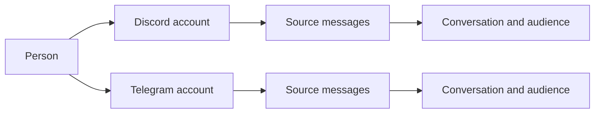

# Memory

Memory belongs to the persona, across all of its interfaces. `data/memory.db` stores people, places, source messages, learned claims, episodes, affinity, intentions and operational records. The core's writer applies changes; readers request an audience-scoped view.

## One person, several accounts

A person and an account are different objects. An account belongs to an interface and has that platform's native ID. A person can have several accounts, including multiple accounts on one interface. The same native ID on two platforms does not identify the same account.



The owner links accounts explicitly in the CLI after the persona has encountered them:

```text
/memory bind discord ACCOUNT_A telegram ACCOUNT_B
/memory accounts discord ACCOUNT_A
/memory unbind discord ACCOUNT_A
```

Names, model suggestions and statements inside a conversation do not create a verified link. `self` as a bind target denotes the persona. Linking accounts changes who they belong to; it does not turn private messages into group messages. [Person links](../src/memory/db/person-links.ts) retains the link history.

Profile and affinity read through the person. The member unit that owns the person's `people` row holds the character, details, episodes and the one affinity score, and `linkedProfileUnit` in `src/memory/db/person-links.ts` finds that unit for any linked account on any interface. `src/memory/store.ts` asks it at every use, so an unlink takes effect at the next read, and a change through any account moves the same score. A decay sweep moves the score of one person once. What belongs to one account stays with it: its native id, its display names, its avatar and how it is addressed. A linked account's own unit writes only those facts (`accountOnly` in `src/memory/db/map/user.ts`), and a `people` row it held before the link rests under its own id until an unlink gives it back. A profile write leaves the account's link columns as the database holds them.

## Owner identity

Use `/memory bind discord ACCOUNT_ID owner` in the owner CLI to designate the owner person. This writes `bot.ownerPerson`. Owner rights then require an account explicitly linked by the owner to that person. `bot.owners` is a legacy fallback while no owner person is designated. It does not broaden the audience of a group or DM turn.

## Places and context

Everything she remembers belongs to the persona, an account, a person or a place. A place is a row of `places`: a server, a category, a channel, a thread, a group or a DM, each with its own id and `parent_id`. A Discord server is a place with channel and thread places under it, a Telegram group is a place with none, and a DM is a place with one partner. `store.rootPlaceOf` in `src/memory/store-addresses.ts` walks `parent_id` to the top of a tree, so a DM is its own root and an unknown id has none.

A turn gets a bounded selection of relevant information: people nearby, the current place, recent events and recalled passages. The whole database is not inserted into every prompt. Local context helps rank relevant material without restricting all searches to the current place.

## Who can recall what

The observation in `src/memory/db/observe.ts` keeps a conversation's containment. A declared parent gets a row in `places` even when no line was seen in it, so a chain of parents holds whatever order the places are seen in. The row gains its conversation and title from its first own line. A conversation of a community sits under that community's place, directly or through its declared parent. A DM has no parent.

A storage unit is named by its subject alone (`src/memory/db/storage-keys.ts`): `accountCollection` for a profile and a private layer, `placeCollection` for a place's notes, lore, GIF library, media cache, recent lines, participation, record, journal and archive, and `personaKey` for the diary, the intentions, the errands and the inner state. A direct chat's record, journal and archive are collections of its DM place, and its lines keep their DM audience. `store.accountOf`, `store.placeOfConversation` and `store.sharedPlaceOf` turn the native ids an interface gives into these ids, and an empty id is refused with `BAD_COLLECTION_ID`.

Group recall can search stored group experience across interfaces. It excludes private conversations. A DM can retrieve the DM history associated with accounts the owner has linked to that person. Rows keep their original audiences and provenance.

A DM context finds the person's other DMs in stored rows. `linkedDmScopes` in `src/memory/db/person-links.ts` joins the person's verified accounts to the places whose `partner_account` names them, after `personMembers` follows `people_merges`. An outward context follows only a merge whose `by` is `owner`, so a merge written by a memory session never widens it. An account that is unbound or moves to another person leaves the person: the next issued context stops reading its DM, the context already issued keeps what it was given, and the DM's rows keep their audience.

`privateByPerson` and `privateByPlace` in `src/memory/db/private-read.ts`, also on the memory service, read the private memory of one person or one DM place. A record belongs to the DM place its `audience_id` names, whoever it is about, and the view holds the live rows of `claims`, `descriptions`, `episodes` and `affinity_events` as stored. The context filters the places before any record or count is read, so a DM context reads the audiences it was issued and a group context reads none. An internal context also reads every merge and the closed links in `pastLinks`. An unknown id answers `PERSON_NOT_FOUND` or `PLACE_NOT_FOUND`.

A line of a DM keeps its DM's audience whatever it names and whoever writes it. The journal, record and vector mappers (`scopeInto` in `src/memory/db/map/scope-parts.ts`) take the place and the audience from the unit's stored DM place, never from a place spelled out of the partner's native id, so two partners with one native id under two authorities share nothing. The place mapper in `src/memory/db/map/place.ts` scopes a DM place's descriptions, in-jokes and lessons to that DM. `scopeColumns` in `src/memory/db/scope.ts` answers `internal` for a channel or a place that names a DM, for a private mark with no partner it can name, and for the `unresolved` mark.

A wake holds no partner of its own. Its delivery asks the interface for the conversation (`partnerOfDelivery` in `src/behavior/inner/deliveries.ts`), and the said line and the `post` operation go to the partner's DM place through `personaRecord` and `personaJournal` in `src/behavior/inner/persona-sources.ts`. When the interface cannot say and no stored place holds the conversation as a channel, a thread or a group DM (`store.holdsSharedConversation`), the line is marked `unresolved` under the conversation's spelled place. Her `internal` context reads it, and no group, partner or wake view does. Only the persona's journal holds the operations of a real channel.

An archived private item names `{ place, private }` with its DM place, or `{ user, private }` when the member has no DM place yet. `allowScope` in `src/behavior/recall-run.ts` shows it to the private turn that stands in that place or whose partner it names, `memory.archive.read` lists it only in that DM, and `memory.restore` writes its `restored` line under that DM.

A private unit writes its rows under the stored DM place of its account, and `addSessionRows` in `src/memory/db/session-rows.ts` lays her session's rows over the unit by that same audience. A partner with private memory and no public profile keeps that memory in a DM turn, under the name on their message.

The authenticated owner CLI has a separate internal view across stored memory. The owner's ordinary group or DM conversation retains that conversation's audience rules. Permissions to read stored material do not grant permission to fetch or publish arbitrary live platform content.

[Scope resolution](../src/memory/db/scope.ts) controls visibility. [Recall](../src/memory/db/recall.ts) applies scope and place filters before ranking, limits and surrounding message windows.

## Learning and remembering

Source messages are the evidence. A memory session reads a window and proposes claims, episodes and affinity changes. The writer validates references and applies accepted changes transactionally. A claim records what was learned and the sources supporting it; its versions preserve changes over time.

Recall combines word search, partial word matching, stored vectors and person matches. It ranks hits and returns surrounding conversation so a matching phrase keeps its context. Prefetch brings likely relevant material into a turn; `memory.search` lets the persona ask a more specific question.

An old source does not become unreachable merely because it is outside the recent-context window. Prompt budgets bound what is shown, not the age of everything stored. Review the relevant `memoryDb`, `recall` and `context` settings in [configuration](configuration.md).

## Entities and assertions

A project, object, concept, organization, event, topic or location is a row of `semantic_entities`: an opaque id, a kind and nothing else. Its names are assertions, so each name has its own evidence and audience, and an entity with no assertion a context may read does not exist for that context. Equal names never merge entities. `INITIAL_ENTITY_KINDS` and `INITIAL_PREDICATES` in `src/memory/db/semantic-registry.ts` are what schema migration `migrateSemanticMemory` seeded, and a new definition is a new version through `registerPredicate`.

An assertion is a claim and a claim version like any other, with its text exactly as she wrote it, its evidence in `claim_version_sources` and a `semantic` subject kind that keeps it out of the profile and place readers. `semantic_assertion_versions` holds its immutable snapshot: kind, predicate, truth state, how it is known, polarity, validity and audience. `semantic_arguments` holds its roles, each a typed reference or a literal, and `semantic_dependencies` its premise versions. Every other claim version her session writes gets a `text` snapshot with polarity `unknown`, so a historical reader never takes these from the parent claim.

The writer seals a version by inserting its snapshot last, in one transaction with its arguments and premises. Triggers from `src/memory/db/semantic-schema.ts` refuse every later change, so a changed fact appends a successor, and a sealed version retires only through a successor with state `retired`. A unit flush leaves a sealed version alone, because the session's rows have no `owner_key`, and `retireAbsent` in `src/memory/db/upsert.ts` still retires the unsealed rows a unit owns.

`validateSemanticCandidate` in `src/memory/db/semantic-write.ts` checks a candidate against the registry, the typed homes of its references, the issued context and what the run was shown, and refuses it with a stable code. `applySemanticWrite` writes the result and checks the compare-and-set again on the writer. The audience is the meet of the context, the evidence, the premises and the endpoints on audience ids (`narrowestAudience` in `src/memory/db/scope.ts`). A write narrower than its base claim forks a new claim that names the base in `extra.derivedFrom`, and the base stays as it was. An entity known only in a DM narrows every fact that names it, so a public fact about it needs a separate entity and an equivalence.

`src/memory/db/semantic-read.ts` reads names and identity. Of each claim a context sees, it selects the newest version the context may read at the cutoff, and a fork stands in for its base only in a context that reads the fork. `resolveLabel` answers `none`, `unique` or `ambiguous` with every candidate in id order and never chooses by popularity. `canonicalEntity` follows the equivalences in force for that context and answers null for an entity with no witness there, and the stored arguments keep their original ids. `semantic_labels` and `semantic_entity_merges` are rebuildable projections: a read checks a label row against its version's arguments, `semanticProjectionMismatches` lists the versions that disagree and `rebuildSemanticProjections` derives both tables again. `entityDescriptions` reads the `descriptions` rows with subject kind `entity`, one per audience. `assertionsAwaitingReview` lists the newest versions that rest on a premise with a newer version, each with its exact path, and changes nothing.

`src/memory/db/semantic-search.ts` gives each sealed structured version one row of `semantic_search_documents`, her text and its text literals, written in the same transaction by the writer. `searchSemantic` reads those rows through the audience of the issued context. FTS says only which rows hold a word: the rank is BM25 computed in code from the documents this context may read, so a private row moves nothing in a public answer, and `visibleTotal` counts only those documents. A vector lives in `vectors` under the chunk key `semantic:<document key>:<model>`, written by the `semantic-embedding` writer message, and a successor with unchanged words takes over its base's rows. The service's `startSemanticEmbed` embeds a bounded batch of `pendingSemanticEmbeddings` once a minute while `memoryDb.retrieval.embedDocuments` is on, and a document stays findable by its words until then. A plain source search (`recall.ts#search`) keeps its global BM25 statistics, so the guarantee above covers semantic documents only.

The graph projects these records in `src/memory/db/graph.ts`. An entity is a `semantic_entity` node with no witness of its own, so only the assertions that name it reveal it. A claim's unit projects a `has_role` edge from each sealed version to each reference, with role and position in `projection_key`, and a binary relation also gets a shortcut, `asserts` when positive and `denies` when negative, in the order of its predicate's roles. Every such edge carries the version's audience and names the version in `evidence_id`, so two audiences or two conflicting claims between the same nodes stay separate witnesses. An n-ary event keeps its version as the hub and has no pairwise shortcut. A successor retires the edges of the version before it, a version with state `retired` witnesses nothing, and both version nodes stay readable. `rebuildGraph` derives the same edges from the typed rows.

A memory session finds a DM with an opaque partner through the audience of its lines (`scopesOf` in `src/memory/db/session.ts`), and its run writes under that audience. Two DMs of one person are two scopes.

## Retrieval

`retrieveMemory` in `src/memory/db/retrieve.ts` is the one read of memory context. `src/memory/retrieval-input.ts` turns what a consumer holds into its query (`memoryQueryFor`) and reads the budget at the moment of use (`retrievalBounds`), and no model takes part beyond the query's one embedding. A page holds versioned assertions with their evidence and premises, source ids, association paths, the names that fit several entities (`ambiguous`), separate `signals` for hops, an anchor and similarity, a `next` cursor and a `partialReason`.

The read has four streams. Explicit anchors and the entity names a query says in full are seeds; an entity with no witness in the context does not exist for it, and a shared name offers every entity and chooses none. The walk follows `semantic_arguments` from each seed in layers, each node giving one assertion in turn, so a hub cannot spend the share of what a person named. Words find semantic documents directly. A learned claim with no structured form is found by its words in a scan over the claims the context may read, and its polarity and state stay `unknown` when its version never held them. Plain sources come from `search` in `recall.ts` and take none of the assertion budget, so semantic additions cannot hide an older line.

Every read filters by the context's audience before any limit, and a version's state comes from its own snapshot. Ordinary pages select the newest version of each claim at the cutoff and leave out `retired` and `historical` ones. `includeHistorical` returns every version, `recordedBefore` reads what was known then, and `validAt` keeps what was true then. A dependent of a changed premise keeps its state with `needsReview` set. A cursor is bound to the audience, the query and the revision of what the context can see: another context or query gets `CURSOR_INVALID`, and a new visible assertion or changed account link gets `CURSOR_EXPIRED`. `pageReads` lists what a page shows for `turn_reads`.

| Consumer | Module | Seeds | Context | Read through |
|---|---|---|---|---|
| Prefetch | `src/behavior/recall-run.ts` | The message, its people, its place | The turn's | Structured facts after the source windows, sharing `recall.prefetch.deadlineMs` and `recall.prefetch.maxTokens` |
| `memory.search` | `src/behavior/recall-run.ts`, `src/tools/tools.ts` | The question and `entity`, `predicate`, `as_of`, `historical` | The turn's | Facts after the quotes |
| Heartbeat | `src/behavior/inner/heartbeat.ts`, `src/behavior/heartbeat-view.ts` | Recent previews, open intentions, focus people | Internal | `facts.memory`, in `<wake>` |
| Attention | `src/intentions/model.ts#attentionRetrieval`, `src/turn/lookup.ts` | The intention's purpose, people and place | The wake's | The prefetch's excerpts |
| Selfimprovement | `src/behavior/inner/selfimprovement.ts`, `src/behavior/selfimprovement-view.ts` | The failures the view holds | Internal | `facts.memory`, in `<wake>` |
| Diary plan | `src/turn/diary.ts` | Known people up to the post's moment | `groupsContext` | `<stored_facts>` in the plan request |
| Memory session | `src/memory/db/session.ts` | The batch's words, people and places | The scope's | `<retrieved>`, as of the batch's newest line |
| Errand | `src/errands/service.ts`, `src/core.ts` | The goal | A group context; a `dm` errand reads nothing | `context.memory` |
| Watcher | `src/watcher/install.ts#watcherMemory` | Failure words | `groupsContext`, because a report can reach a public filing | `<memory>` in the brief |

Retrieval never yields a destination: a query names none, and a page's fields hold no target. A failed read leaves the consumer what else it has. A heartbeat keeps intention-or-skip, a selfimprovement wake keeps task-or-skip and its outbox rows, and a read consumes no receipt.

A memory session may name `xN` from `<retrieved>` as a `ref` or a description's `subject`, `vN` as a premise and its older `#n` lines as sources. `reviewDescription` in `src/memory/db/describe.ts` takes an `entity` subject and reads the assertions that name it under the review's own context. `<retrieved>` gives way when a request would pass the request cap, and the batch stays.

## Her own lines

A message she sends reaches the writer twice. The interface echoes it as a `message.received` event, which `observeMessage` stores, and the turn appends its `said` line to the record with `turn_id` and `op_id`. Both land on one `sources` row, whichever comes first. `saidReference` in `src/memory/db/unit-write.ts` reads the line's address from the unit's interface, `scope.channel` and `messageId`, and resolves it in `message_families`. When the echo came first, the line adopts its row and adds the turn, the operation and any media kinds. When the line comes first, it reserves the family, and the echo replays onto that row and adds her account. A retried record line is a duplicate.

`native_id` holds the family's key in both orders, so a reader that holds a protocol id goes through `message_families`. `linkVectors` in `src/memory/db/upsert.ts` does it for the `record:<message id>:<revision>` key of a vector, narrowing by the vector's channel and interface when conversations reuse an id. A publication's receipts in `src/memory/db/graph.ts` and `recordNewestRevision` do it for theirs. A write by a legacy owner is the importer's and keeps the keys of the rows it brings.

## Raw archive and media

The journal preserves recorded activity, while learned memory interprets selected evidence. `model_requests` also stores text requests, their system text, responses, tool calls and parsed think text. Repeated system text is retained per request. These records are not automatically mixed into conversational recall.

Each row also names its `service`, its `backend` and its `run_id`, and carries an `outcome`, the JSON of what the request led to. Schema version 28 added these columns and the index on `finished_at`, and an older row holds `NULL` in them. The memory session's write sets `outcome` in its own transaction, by the row `sessionRequestId` names, to `confirmed` when applied, `shadow` in shadow mode and `failed` otherwise. A turn sets it on its last request through `turnOutcome`, from whether anything reached the chat, and a skip is an outcome of its own. A request with no receipt keeps it empty, which the watcher reads as `unlinked`.

The [archive wrapper](../src/llm/archive.ts) awaits writes around model calls. If an archive write fails, it logs the failure, allows the call to continue and notes the request's id in `data/agents/watcher/archive-gaps.jsonl`, so the archive can have a gap and the [watcher](watcher.md) can name it. An answer's own `model`, `backend` and `source` correct the row at its end, so a memory session through a subharness names that backend. A failed request's `error_code` names its cause: a string code the error carries, such as `keys-exhausted`, then `http_<status>`, `timeout`, `aborted` or `network`, and `error` for anything else. Embedded image bytes become markers; preserved originals and descriptions use the media storage paths. Do not treat the request archive as a byte-for-byte backup of every external media file.

Recall diagnostics also stay in the database, with a bounded recent history.

Successful media descriptions persist across cache eviction and restart. [Media](media.md) explains reuse and rewatching; [diary](diary.md) explains the originals kept under `data/media/`. Back up the whole persona using [persona migration](persona-migration.md#backup-and-restore).

The journal keeps its process marker in `data/run/journal.running`. A leftover marker records an unclean stop; a clean shutdown removes it. It holds no conversation history.
