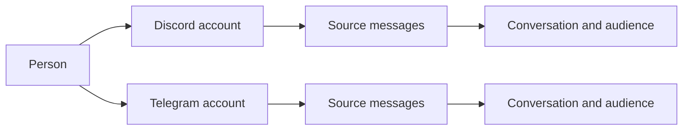

# Memory

Memory belongs to the persona, across all of its interfaces. `data/memory.db` stores people, places, source messages, learned claims, episodes, affinity, intentions and operational records. The core's writer applies changes; readers request an audience-scoped view.

## One person, several accounts

A person and an account are different objects. An account belongs to an interface and has that platform's native ID. A person can have several accounts, including multiple accounts on one interface. The same native ID on two platforms does not identify the same account.



The owner links accounts explicitly in the CLI after the persona has encountered them:

```text
/memory bind discord ACCOUNT_A telegram ACCOUNT_B
/memory users accounts PERSON
/memory users unlink PERSON ACCOUNT
```

Names, model suggestions and statements inside a conversation do not create a verified link. `self` as a bind target denotes the persona. Linking accounts changes who they belong to; it does not turn private messages into group messages. [Person links](../src/memory/db/person-links.ts) retains the link history.

Her own accounts need no bind. When she is the author of an observed line, the observation links the account to `person:self` on any interface, by the event's own mark and never by a name (`linkSelfAccount` in `src/memory/db/identity-links.ts`). `personDetail` reads her claims and descriptions of subject kind `self` like anyone's records, and a DM context reads of her only what was said in that DM. The memory session never lists her among the people of a batch and gives her accounts no author handle.

The owner names a person with `/memory users names add PERSON NAME` and `/memory users names remove PERSON NAME`. On a person id the name goes through the writer's `owner-name` op as an `alias` claim with `author` `owner`, in the audience a member's profile gives its aliases: the groups of the person's interface (`ownerNameScope` in `src/memory/db/unit-write.ts`). `ownerNamesOf` in `src/memory/db/people-read.ts` reads those claims back; a person's `names` show them beside the account names. Her own record is `person:self`, and its owner names are her aliases, which the door and the address classifier read at each line. A name her memory session or the analyzer writes about her is a claim with another author, so it never widens the door.

Profile and affinity read through the person. The member unit that owns the person's `people` row holds the character, details, episodes and the one affinity score, and `linkedProfileUnit` in `src/memory/db/person-links.ts` finds that unit for any linked account on any interface. `src/memory/store.ts` asks it at every use, so an unlink takes effect at the next read, and a change through any account moves the same score. A decay sweep moves the score of one person once. What belongs to one account stays with it: its native id, its display names, its avatar and how it is addressed. A linked account's own unit writes only those facts (`accountOnly` in `src/memory/db/map/user.ts`), and a `people` row it held before the link rests under its own id until an unlink gives it back. A profile write leaves the account's link columns as the database holds them.

## Owner identity

`bot.ownerPerson` names the owner's person. Owner rights require an account whose live row in `account_person_links` is a verified link written by the owner to that person, or to a person merged into it. `createOwnerAccounts` in `src/memory/db/person-links.ts` reads only that row: the `link`, `linked_by` and `linked_at` columns of `accounts` are a copy for the readers that join accounts. `bot.owners` lists native ids of the home interface and counts only while `bot.ownerPerson` is unset. Neither setting broadens the audience of a group or DM turn.

Only the owner speaks on the command line (`iface: 'cli'`), so its account belongs to him from its first line. The core hands `bot.ownerPerson` to the observation of each line there. The writer links the account to that person before it resolves the line's place, so the DM and the line both name him (`linkOwnerAccount` in `src/memory/db/identity-links.ts`). A tentative person the memory session proposed for the account merges into the owner, unless that person holds another account or was merged elsewhere. On a raw install the first line mints the person. The same transaction links the accounts `bot.owners` lists on the home interface, creates any of them she has not met, and merges into the owner the person such an account held before. Once the line is stored, the core writes `bot.ownerPerson` (`src/pipeline/observe.ts`). A memory session's `people` add is refused for the command line's account and for hers, as `known_person`.

`/memory bind <iface> <account> owner` makes that account's person the owner: it writes `bot.ownerPerson` and merges the earlier owner person into the new one, so the command line and every other account follow. The command line's rows sit under its native authority `cli/local` (`nativeAuthorityOf` in `src/protocol/identity.ts`), the authority `/memory bind cli owner` looks under. Rows an install stored under `cli/global` move to `cli/local` when the next line arrives.

## Merging people

`/memory users merge <from> <into> [--reason <text>]` merges one person into another. It goes through the writer as `applyMemoryWrite` kind `person-merge` (`src/memory/db/person-merge.ts`, `MemoryDbService.personMerge`). Only the owner merges, and `person:self` is never merged in or out. Everything stored about the person who goes moves to the survivor at the end of the merge chain. That covers claims and descriptions about them, claims they made, episodes, affinity events, accounts with their links, DM places, focus rows and the `scope_dm` of lines, vectors and the other scoped rows. Their daily relationship counts add to the survivor's. No row changes its `audience_id`, so a fact stays in the conversation it was said in. The survivor keeps its affinity score. The old links stay closed as history, one `people_merges` row records the merge, and the person who went gets `status` `merged_into:<survivor>`. A repeated merge moves what was left behind and writes nothing else. It also finishes a merge that `mergePeople` in `src/memory/db/session-write.ts` recorded without moving any row.

`scripts/memory-repair-identity.ts --db <file> --owner-person <id> [--apply]` repairs a database written before these links. Run it with the core stopped. It moves the command line's rows to `cli/local` and links the command line's accounts to the owner person, merging her proposals for them. It links her accounts to `person:self` and copies the link columns of every account from its live verified link. Without `--apply` it rolls the transaction back and prints the same counts. The output holds counts only, and a second run finds nothing to do.

## Places and context

Everything she remembers belongs to the persona, an account, a person or a place. A place is a row of `places`: a server, a category, a channel, a thread, a group or a DM, each with its own id and `parent_id`. A Discord server is a place with channel and thread places under it, a Telegram group is a place with none, and a DM is a place with one partner. `store.rootPlaceOf` in `src/memory/store-addresses.ts` walks `parent_id` to the top of a tree, so a DM is its own root and an unknown id has none.

A turn gets a bounded selection of relevant information: people nearby, the current place, recent events and recalled passages. The whole database is not inserted into every prompt. Local context helps rank relevant material without restricting all searches to the current place.

## Who can recall what

The observation in `src/memory/db/observe.ts` keeps a conversation's containment. A declared parent gets a row in `places` even when no line was seen in it, so a chain of parents holds whatever order the places are seen in. The row gains its conversation and title from its first own line. A conversation of a community sits under that community's place, directly or through its declared parent. A DM has no parent.

A storage unit is named by its subject alone (`src/memory/db/storage-keys.ts`): `accountCollection` for a profile and a private layer, `placeCollection` for a place's notes, lore, emoji rails, media cache, recent lines, participation, record, journal and archive, and `personaKey` for the diary, the intentions, the errands, the inner state and the one GIF library. A direct chat's record, journal and archive are collections of its DM place, and its lines keep their DM audience. `store.accountOf`, `store.placeOfConversation` and `store.sharedPlaceOf` turn the native ids an interface gives into these ids, and an empty id is refused with `BAD_COLLECTION_ID`.

The notes of a place are scoped together by `toRows` in `src/memory/db/map/place.ts`: its descriptions, in-jokes, self facts and lessons belong to the partner's DM on a DM place and to the groups on any other. `scripts/memory-repair-self-audience.ts --db <file> [--apply]` brings self facts stored under `aud:none` to that scope. Run it with the core stopped. A row whose place cannot be found becomes `aud:internal`, and a row with a live `decisions` row of the action `audience-none-kept` stays. Without `--apply` it prints the counts and writes nothing.

Group recall can search stored group experience across interfaces. It excludes private conversations. A DM can retrieve the DM history associated with accounts the owner has linked to that person. Rows keep their original audiences and provenance.

A DM context finds the person's other DMs in stored rows. `linkedDmScopes` in `src/memory/db/person-links.ts` joins the person's verified accounts to the places whose `partner_account` names them, after `personMembers` follows `people_merges`. An outward context follows only a merge whose `by` is `owner`, so a merge written by a memory session never widens it. An account that is unbound or moves to another person leaves the person: the next issued context stops reading its DM, the context already issued keeps what it was given, and the DM's rows keep their audience.

`privateByPerson` and `privateByPlace` in `src/memory/db/private-read.ts`, also on the memory service, read the private memory of one person or one DM place. A record belongs to the DM place its `audience_id` names, whoever it is about, and the view holds the live rows of `claims`, `descriptions`, `episodes` and `affinity_events` as stored. The context filters the places before any record or count is read, so a DM context reads the audiences it was issued and a group context reads none. An internal context also reads every merge and the closed links in `pastLinks`. An unknown id answers `PERSON_NOT_FOUND` or `PLACE_NOT_FOUND`.

A line of a DM keeps its DM's audience whatever it names and whoever writes it. The journal, record and vector mappers (`scopeInto` in `src/memory/db/map/scope-parts.ts`) take the place and the audience from the unit's stored DM place, never from a place spelled out of the partner's native id, so two partners with one native id under two authorities share nothing. The place mapper in `src/memory/db/map/place.ts` scopes a DM place's descriptions, in-jokes and lessons to that DM. `scopeColumns` in `src/memory/db/scope.ts` answers `internal` for a channel or a place that names a DM, for a private mark with no partner it can name, and for the `unresolved` mark.

A wake holds no partner of its own. Its delivery asks the interface for the conversation (`partnerOfDelivery` in `src/behavior/inner/deliveries.ts`), and the said line and the `post` operation go to the partner's DM place through `personaRecord` and `personaJournal` in `src/behavior/inner/persona-sources.ts`. When the interface cannot say and no stored place holds the conversation as a channel, a thread or a group DM (`store.holdsSharedConversation`), the line is marked `unresolved` under the conversation's spelled place. Her `internal` context reads it, and no group, partner or wake view does. Only the persona's journal holds the operations of a real channel.

An archived private item names `{ place, private }` with its DM place, or `{ user, private }` when the member has no DM place yet. `allowScope` in `src/behavior/recall-run.ts` shows it to the private turn that stands in that place or whose partner it names, `memory.archive.read` lists it only in that DM, and `memory.restore` writes its `restored` line under that DM.

A private unit writes its rows under the stored DM place of its account, and `addSessionRows` in `src/memory/db/session-rows.ts` lays her session's rows over the unit by that same audience. A partner with private memory and no public profile keeps that memory in a DM turn, under the name on their message.

The authenticated owner CLI has a separate internal view across stored memory. The owner's ordinary group or DM conversation retains that conversation's audience rules. Permissions to read stored material do not grant permission to fetch or publish arbitrary live platform content.

[Scope resolution](../src/memory/db/scope.ts) controls visibility. [Recall](../src/memory/db/recall.ts) applies scope and place filters before ranking, limits and surrounding message windows.

## The query and summary builders

A search has two steps with a model around it. The query builder (`createQueryBuilder` and `parseQueryPlan` in `src/behavior/query-builder.ts`, purpose `query-builder`, prompt `prompts/query-builder.md`) plans before the search: `web:`, `history:`, `who:`, `when:`, `when-role:` and `recent:`, or `none`. A live turn has no such step, because the persona's own tools search during her reply, so `src/turn/phases/request/lookup.ts` logs `lookup: skipped` with the reason `core-tools` and adds no helper model. Its callers are `scripts/replay.ts`, `scripts/recall-eval.ts` and `scripts/search-policy-eval.ts`.

The summary builder (`createSummaryBuilder` and `parseSummaryNote` in `src/behavior/summary-builder.ts`) condenses what a search found into a note bounded by `maxChars`. Chat evidence reads `prompts/recall-summary.md` under the purpose `recall-summary` on the analyzer, and web evidence reads `prompts/search-summary.md` under the purpose `search-summary` on the `search` role with `web.search.model`. The single word `none` is no note. `src/behavior/recall-run.ts` and `src/web/lookup.ts` both go through it.

## Searches and backups off the main thread

`searchRecord` in `src/memory/db/service.ts` runs a search of the record on the reader thread (`src/memory/db/reader-worker.ts`) and answers what `search` in `src/memory/db/recall.ts` answers over the same rows. The thread holds one read-only connection, takes no lock and refuses every message but `open`, `places`, `search` and `close`. The caller's callbacks stay on the main thread: `allowPlace` judges the list `visiblePlaces` gives before the search, and `nameOf` and `channelNameOf` fill in the names `searchMarked` marked once the answer is back. A service without a worker searches on its own connection.

Searches wait in `src/memory/db/reader-client.ts`, and one runs at a time. An aborted signal rejects a search with `SEARCH_ABANDONED`. When the abandoned search is the one running, its thread is terminated and a new one opens, so the searches behind it are still answered. A thread that dies rejects its search with `WORKER_EXIT` and logs `memory db: reader exited`, and the next search starts a new thread. A closed database rejects with `DB_CLOSED`. The core opens the reader with the database and closes it before the writer, because a read-only connection that closes last leaves the WAL behind.

The memory prefetch searches under `recall.prefetch.deadlineMs` and the persona's own search under `recall.timeoutMs`. Each aborts its signal at that deadline and goes on with what it has. A failure logs `recall: prefetch failed` or `recall: failed` with its `code`. A memory that offers only `database()` is searched synchronously.

The daily backup runs on the writer thread, and `pruneBackups` in `src/memory/db/backup.ts` deletes old backups through the asynchronous `fs`. The owner's `/memory backup` runs `backupInWorker`, which opens a read-only connection on a thread of its own (`src/memory/db/backup-worker.ts`).

## Learning and remembering

Source messages are the evidence. A memory session reads a window and proposes claims, episodes and affinity changes. The writer validates references and applies accepted changes transactionally. A claim records what was learned and the sources supporting it; its versions preserve changes over time.

Recall combines word search, partial word matching, stored vectors and person matches. It ranks hits and returns surrounding conversation so a matching phrase keeps its context. Prefetch brings likely relevant material into a turn; `memory.search` lets the persona ask a more specific question.

`src/memory/vectors.ts` keeps one month of vectors per place, with a manifest of its rows, bytes and checksum. `search` skips a month whose rows disagree with its manifest and logs it. `has` answers from the rows themselves, so the catch-up in `src/memory/embedder.ts` never embeds a record again while its month holds it. A vector row stays in the month of its own place: when another place's month holds its chunk key, the writer in `src/memory/db/unit-write.ts` gives the row that key with a `#<n>` suffix. `scripts/memory-repair-dm-vectors.ts` rebuilds a month that disagrees with its manifest while the core is stopped.
When those four streams find nothing and the plan names a channel or a side of a time range, `memory.search` answers from a fifth stream, `time`, in `search` in `src/memory/db/recall.ts`. It cuts the span into as many equal slices as `recall.maxClusters` allows windows and takes the line nearest the middle of each slice, or every line when the scope holds no more than that. An open side of a range closes at the first or last line the context may see. A hit of this stream has `streams: ['time']`, `stats` counts only the other four, and the result says `sampled: true`, which puts `tools.tools.memory.sampled` under the source line. The stream reads inside the audience, `allowPlace` and the exclusions, and `samplePlaceRule` in `src/behavior/recall-run.ts` also keeps it to the conversations the turn's live view lets through `context.pull.sameAudience`, while word and meaning hits stay independent of the live view. The prefetch does not ask for this stream. On the reader thread `reader-client.ts` turns `samplePlace`, a function, into the list `sampledPlaces` on the main thread, the way it turns `allowPlace` into `allowedPlaces`.

## Media on stored lines

The table `media` is the only store of media, in `src/memory/db/media-store.ts`. It holds one row per item, whatever the interface. `kind` is one of `image`, `gif`, `video`, `sticker`, `emoji`, `voice`, `audio`, `link`, `text` and `file`. `native_ref` is the interface's reference, opaque to the core, and an item is the same item when its interface and reference are the same. `path` is null or a file under `media/`. `availability` is `present`, `missing`, `unknown` or `unreadable`. `extra` holds what a kind has beside that: `fileName` and `durationSec` of an attachment, `name` of a sticker, an emoji or a library GIF, and `title`, `site` and `url` of a link.

`media_links(owner_kind, owner_id, position, media_id)` ties an item to what shows it, a message (`source`) or a diary entry (`diary`), at its position there. Audience comes only from a link: an item is read through an owner the reader may open, and a file shown by a message and an entry is one row with two links. A `sources` row holds no kinds, no ids and no link cards, and its `text` and `stems` stay what was written.

An item's text form is its `description`, with its origin in `extra.textOrigin`: `retelling`, `frame`, `transcript`, `voiced`, `embed`, `preview` or `page`. `tellMedia` is the one write of a text form. A text form that ranks higher stays over one that ranks lower, so what she voiced is never replaced and a watched summary replaces a still frame. A file no model can read is `unreadable` and renders the standard mark with its name, which `safeFileName` in `src/media/classify.ts` cuts to 120 characters and rids of anything that opens a tag.

`lineMedia` is the one read: a turn's recall, a window, the prefetch, the memory session's batch, a task's and a conversation's lines and the owner's browser all go through it, and no line read touches a description anywhere else. The describer's cache is the same rows, written by `writeMediaCache`. Its cap of `MEDIA_CACHE_ENTRIES` retires only rows nothing links.

A text form is stemmed and embedded once on its row. `media_fts` and `media_tri` index it, and `embedMedia` keeps one vector for it, whose `chunk_key` names the row, once a minute a page at a time. A message's own vector covers its text and its neighbours, so a line that holds only media has no vector. `search` in `src/memory/db/recall.ts` answers such a find as `mediaHits`: one hit per item, or per set of equal bytes by `sha1`, with its use count, its latest use and at most 20 of its messages, each only through a message the reader may see. The latest use also joins the windows, and one answer tells an item once, so an item posted ten thousand times shows as one line among the rest.

## Moving old media to the store

`migrateMediaStore` is one forward schema step. It turns `sources.media`, `extra.links` and `extra.extra.attachmentIds` into items and links and removes them, maps the old cache rows to items, takes a description the cap had trimmed from the durable versions, and links a line stored without ids through the GIF library or diary row that names its message. A line that still has no reference gets a placeholder with no reference. A second run changes nothing.

`neptunia memory backfill-media [--dry-run|status]` runs `backfillMedia` in `src/memory/db/media-backfill.ts`, for the owner only. It reads each line's message through the interface's history, one read a second, and writes its items through the one writer. Items without a text form go through the describer, so no model call is made for a text form already held. Its report counts `linked`, `gone` when the platform no longer returns the message, and `bare` when the line names no conversation to read, with the reason per class in `classes`. A run that stops is taken up by the next one, because a finished line holds its references or the state `missing`. `BACKFILL_FIELDS` names every field a new line carries and how an old line comes to hold it.

`memoryDb.session.mediaPass` lets the memory session read the media-only lines its cursor passed before they had a text form, oldest first and under the same daily cap, with a cursor of their own. `scripts/memory-audit.ts` counts what does not agree: a line without its place, a scope that disagrees with its audience, a link to a row that is gone.

An old source does not become unreachable merely because it is outside the recent-context window. Prompt budgets bound what is shown, not the age of everything stored. Review the relevant `memoryDb`, `recall` and `context` settings in [configuration](configuration.md).

The media cache of a place keeps `MEDIA_CACHE_ENTRIES`, 5000, of the rows nothing links. `trimCache` in `src/web/cache.ts` leaves a row alone when a live line or a live diary picture links its attachment, as `linkedAttachmentIds` in `src/memory/db/line-media.ts` lists them, so a place with many linked rows stays over the cap. A line stored before `extra.attachmentIds` links nothing by that list until its echo brings the ids.

## The memory audit

`auditMemory` in `src/memory/db/audit.ts` counts what breaks the rules of the stored rows, over a read connection, and looks at live rows only. `scripts/memory-audit.ts --db <file>` prints its JSON, `{ findings, checks }`, and is safe on a running core. It exits `0` when clean, `1` with a finding and `2` when the database cannot be read. The output holds counts and no word, id or name of a row. The [watcher](watcher.md#service-runs) reads the same counts.

| Check | What it counts |
|---|---|
| `placeExists` | Rows whose `place_id` is not in `places` |
| `scopeMatchesPlace` | Rows of a DM place not scoped to a DM, and rows of another place scoped to one |
| `audienceDerived` | Rows whose `audience_id` is missing or differs from what `resolveRow` in `src/memory/db/rows.ts` derives |
| `danglingLinks` | Links from a live claim or episode to a missing or retired line, versions of a row that does not exist, and a description's missing current version |
| `unexplainedNone` | Rows under `aud:none` with no live `decisions` row of the action `audience-none-kept` naming them |
| `vectorManifests` | Months whose manifest disagrees with the rows they hold or their vector size, or cannot be read. A month kept raw is left out |
| `linkedMediaKept` | Retired media rows that a live line or a live diary entry links |

## Entities and assertions

A project, object, concept, organization, event, topic or location is a row of `semantic_entities`: an opaque id, a kind and nothing else. Its names are assertions, so each name has its own evidence and audience, and an entity with no assertion a context may read does not exist for that context. Equal names never merge entities. `INITIAL_ENTITY_KINDS` and `INITIAL_PREDICATES` in `src/memory/db/semantic-registry.ts` are what schema migration `migrateSemanticMemory` seeded, and a new definition is a new version through `registerPredicate`.

An assertion is a claim and a claim version like any other, with its text exactly as she wrote it, its evidence in `claim_version_sources` and a `semantic` subject kind that keeps it out of the profile and place readers. `semantic_assertion_versions` holds its immutable snapshot: kind, predicate, truth state, how it is known, polarity, validity and audience. `semantic_arguments` holds its roles, each a typed reference or a literal, and `semantic_dependencies` its premise versions. Every other claim version her session writes gets a `text` snapshot with polarity `unknown`, so a historical reader never takes these from the parent claim.

The writer seals a version by inserting its snapshot last, in one transaction with its arguments and premises. Triggers from `src/memory/db/semantic-schema.ts` refuse every later change, so a changed fact appends a successor, and a sealed version retires only through a successor with state `retired`. A unit flush leaves a sealed version alone, because the session's rows have no `owner_key`, and `retireAbsent` in `src/memory/db/upsert.ts` still retires the unsealed rows a unit owns.

`validateSemanticCandidate` in `src/memory/db/semantic-write.ts` checks a candidate against the registry, the typed homes of its references, the issued context and what the run was shown, and refuses it with a stable code. `writeSessionEntity` and `writeSessionAssertion` validate and write in the session write's transaction, so the compare-and-set is checked on the writer connection itself. The audience is the meet of the context, the evidence, the premises and the endpoints on audience ids (`narrowestAudience` in `src/memory/db/scope.ts`). A write narrower than its base claim forks a new claim that names the base in `extra.derivedFrom`, and the base stays as it was. An entity known only in a DM narrows every fact that names it, so a public fact about it needs a separate entity and an equivalence.

`src/memory/db/semantic-read.ts` reads names and identity. Of each claim a context sees, it selects the newest version the context may read at the cutoff, and a fork stands in for its base only in a context that reads the fork. `resolveLabel` answers `none`, `unique` or `ambiguous` with every candidate in id order and never chooses by popularity. `canonicalEntity` follows the equivalences in force for that context and answers null for an entity with no witness there, and the stored arguments keep their original ids. `semantic_labels` and `semantic_entity_merges` are rebuildable projections: a read checks a label row against its version's arguments, `semanticProjectionMismatches` lists the versions that disagree and `rebuildSemanticProjections` derives both tables again. `entityDescriptions` reads the `descriptions` rows with subject kind `entity`, one per audience. `assertionsAwaitingReview` lists the newest versions that rest on a premise with a newer version, each with its exact path, and changes nothing.

`src/memory/db/semantic-search.ts` gives each sealed structured version one row of `semantic_search_documents`, her text and its text literals, written in the same transaction by the writer. `searchSemantic` reads those rows through the audience of the issued context. FTS says only which rows hold a word: the rank is BM25 computed in code from the documents this context may read, so a private row moves nothing in a public answer, and `visibleTotal` counts only those documents. A vector lives in `vectors` under the chunk key `semantic:<document key>:<model>`, written by the `semantic-embedding` writer message, and a successor with unchanged words takes over its base's rows. The service's `startSemanticEmbed` embeds a bounded batch of `pendingSemanticEmbeddings` once a minute while `memoryDb.retrieval.embedDocuments` is on, and a document stays findable by its words until then. A plain source search (`recall.ts#search`) keeps its global BM25 statistics, so the guarantee above covers semantic documents only.

The graph projects these records in `src/memory/db/graph.ts`. An entity is a `semantic_entity` node with no witness of its own, so only the assertions that name it reveal it. A claim's unit projects a `has_role` edge from each sealed version to each reference, with role and position in `projection_key`, and a binary relation also gets a shortcut, `asserts` when positive and `denies` when negative, in the order of its predicate's roles. Every such edge carries the version's audience and names the version in `evidence_id`, so two audiences or two conflicting claims between the same nodes stay separate witnesses. An n-ary event keeps its version as the hub and has no pairwise shortcut. A successor retires the edges of the version before it, a version with state `retired` witnesses nothing, and both version nodes stay readable. `rebuildGraph` derives the same edges from the typed rows.

A memory session finds a DM through the audience of its lines (`scopesOf` in `src/memory/db/session-scopes.ts`), and its run writes under that audience. Two DMs of one person are two scopes. One DM is one scope, whatever `scope_dm` its lines carry, with one key that comes from the place alone (`dmScopeKey`), so its cursor outlives a link. A DM whose partner account nobody linked has no partner person: its lines and what the session learns from them carry a null `scope_dm` under the DM's audience. When the place takes its partner person, at the owner's link or at the next line after any link, every row of its audience takes that person in `scope_dm` and keeps its audience (`rescopeDmPlace` in `src/memory/db/dm-rescope.ts`).

`scripts/memory-repair-audit.ts --db <file> [--apply]` clears what `scripts/memory-audit.ts` found on a database written before these rules. Run it with the core stopped. It sets `scope_dm` to `places.partner_person` on every row of a DM's audience, moves the session's cursors and held batches to the key of the scope, the furthest cursor winning, and gives an owner's name stored without an audience the one the writer gives it. It retires a claim version of event `expired` by `store` and a description version of origin `legacy` whose owner is gone, with their bytes kept; any other version without an owner stays a finding. Without `--apply` it writes nothing and prints the same counts. The output holds counts only, and a second run finds nothing.

## Retrieval

`retrieveMemory` in `src/memory/db/retrieve.ts` is the one read of memory context. `src/memory/retrieval-input.ts` turns what a consumer holds into its query (`memoryQueryFor`) and reads the budget at the moment of use (`retrievalBounds`), and no model takes part beyond the query's one embedding. A page holds versioned assertions with their evidence and premises, source ids, association paths, the names that fit several entities (`ambiguous`), separate `signals` for hops, an anchor and similarity, a `next` cursor and a `partialReason`.

The read has four streams. Explicit anchors and the entity names a query says in full are seeds; an entity with no witness in the context does not exist for it, and a shared name offers every entity and chooses none. The walk follows `semantic_arguments` from each seed in layers, each node giving one assertion in turn, so a hub cannot spend the share of what a person named. Words find semantic documents directly. A learned claim with no structured form is found by its words in a scan over the claims the context may read, and its polarity and state stay `unknown` when its version never held them. Plain sources come from `search` in `recall.ts` and take none of the assertion budget, so semantic additions cannot hide an older line.

Every read filters by the context's audience before any limit, and a version's state comes from its own snapshot. Ordinary pages select the newest version of each claim at the cutoff and leave out `retired` and `historical` ones. `includeHistorical` returns every version, `recordedBefore` reads what was known then, and `validAt` keeps what was true then. A dependent of a changed premise keeps its state with `needsReview` set. A cursor is bound to the audience, the query and the revision of what the context can see: another context or query gets `CURSOR_INVALID`, and a new visible assertion or changed account link gets `CURSOR_EXPIRED`. `pageReads` lists what a page shows for `turn_reads`.

| Consumer | Module | Seeds | Context | Read through |
|---|---|---|---|---|
| Prefetch | `src/behavior/recall-run.ts`, `src/behavior/recall-facts.ts` | The message, its people, its place | The turn's | Structured facts after the source windows, sharing `recall.prefetch.deadlineMs` and `recall.prefetch.maxTokens` |
| `memory.search` | `src/behavior/recall-facts.ts`, `src/tools/tools.ts` | The question and `entity`, `predicate`, `as_of`, `historical` | The turn's | Facts after the quotes |
| Heartbeat | `src/behavior/inner/heartbeat.ts`, `src/behavior/heartbeat-view.ts` | Recent previews, open intentions, focus people | Internal | `facts.memory`, in `<wake>` |
| Attention | `src/intentions/model.ts#attentionRetrieval`, `src/turn/lookup.ts` | The intention's purpose, people and place | The wake's | The prefetch's excerpts |
| Selfimprovement | `src/behavior/inner/selfimprovement.ts`, `src/behavior/selfimprovement-view.ts` | The failures the view holds | Internal | `facts.memory`, in `<wake>` |
| Diary plan | `src/turn/diary.ts` | Known people up to the post's moment | `groupsContext` | `<stored_facts>` in the plan request |
| Memory session | `src/memory/db/session-retrieved.ts` | The batch's words, people and places | The scope's | `<retrieved>`, as of the batch's newest line |
| Errand | `src/errands/service.ts`, `src/core.ts` | The goal | A group context; a `dm` errand reads nothing | `context.memory` |
| Watcher | `src/watcher/install.ts#watcherMemory` | Failure words | `groupsContext`, because a report can reach a public filing | `<memory>` in the brief |

Retrieval never yields a destination: a query names none, and a page's fields hold no target. A failed read leaves the consumer what else it has. A heartbeat keeps intention-or-skip, a selfimprovement wake keeps task-or-skip and its outbox rows, and a read consumes no receipt.

A memory session may name `xN` from `<retrieved>` as a `ref` or a description's `subject`, `vN` as a premise and its older `#n` lines as sources. `reviewDescription` in `src/memory/db/describe.ts` takes an `entity` subject and reads the assertions that name it under the review's own context. `<retrieved>` gives way when a request would pass the request cap, and the batch stays.

## Her own lines

A message she sends reaches the writer twice. The interface echoes it as a `message.received` event, which `observeMessage` stores, and the turn appends its `said` line to the record with `turn_id` and `op_id`. Both land on one `sources` row, whichever comes first. `saidReference` in `src/memory/db/unit-write.ts` reads the line's address from the unit's interface, `scope.channel` and `messageId`, and resolves it in `message_families`. When the echo came first, the line adopts its row and adds the turn, the operation and any media kinds. When the line comes first, it reserves the family, and the echo replays onto that row and adds her account. A retried record line is a duplicate.

`native_id` holds the family's key in both orders, so a reader that holds a protocol id goes through `message_families`. `linkVectors` in `src/memory/db/upsert.ts` does it for the `record:<message id>:<revision>` key of a vector, narrowing by the vector's channel and interface when conversations reuse an id. A publication's receipts in `src/memory/db/graph.ts` and `recordNewestRevision` do it for theirs. A write by a legacy owner is the importer's and keeps the keys of the rows it brings.

## Reading all of it as the owner

Everything stored stays reachable for the owner, whether or not a turn would ever read it. `src/memory/db/people-read.ts`, `places-read.ts`, `graph-read.ts` and `domain-read.ts` read people, places, the graph and each memory family under a context, which decides before anything is counted. `src/memory/db/inspection.ts` lists the tables the connection holds rather than a list of its own, and reads any row of any of them: retired, internal, unowned, keyless and derived rows alike, with integers, JSON text and blobs exact. Its classes in `src/memory/db/inspection-classes.ts` sort a table into `domain`, `operational`, `derived` or `metadata`, and a table added since reads like any other and reports as `unclassified`.

`src/memory/db/inspection-snapshots.ts` holds one moment still on a read-only connection of its own, so pages, large values and a whole export agree while the writer goes on. None of these reads writes a row. [The memory browser](cli.md#the-memory-browser) lists the commands.

## Raw archive and media

The journal preserves recorded activity, while learned memory interprets selected evidence. `model_requests` also stores text requests, their system text, responses, tool calls and parsed think text. Repeated system text is retained per request. These records are not automatically mixed into conversational recall.

Each row also names its `service`, its `backend` and its `run_id`, and carries an `outcome`, the JSON of what the request led to. Schema version 28 added these columns and the index on `finished_at`, and an older row holds `NULL` in them. The memory session's write sets `outcome` in its own transaction, by the row `sessionRequestId` names, to `confirmed` when applied, `shadow` in shadow mode and `failed` otherwise. A turn sets it on its last request through `turnOutcome`, from whether anything reached the chat, and a skip is an outcome of its own. A request with no receipt keeps it empty, which the watcher reads as `unlinked`.

The [archive wrapper](../src/llm/archive.ts) awaits writes around model calls. If an archive write fails, it logs the failure, allows the call to continue and notes the request's id in `data/agents/watcher/archive-gaps.jsonl`, so the archive can have a gap and the [watcher](watcher.md) can name it. An answer's own `model`, `backend` and `source` correct the row at its end, so a memory session through a subharness names that backend. A failed request's `error_code` names its cause: a string code the error carries, such as `keys-exhausted`, then `http_<status>`, `timeout`, `aborted` or `network`, and `error` for anything else. Embedded image bytes become markers; preserved originals and descriptions use the media storage paths. Do not treat the request archive as a byte-for-byte backup of every external media file.

Recall diagnostics also stay in the database, with a bounded recent history.

Successful media descriptions persist across cache eviction and restart. [Media](media.md) explains reuse and rewatching; [diary](diary.md) explains the originals kept under `data/media/`. Back up the whole persona using [persona migration](persona-migration.md#backup-and-restore).

The journal keeps its process marker in `data/run/journal.running`. A leftover marker records an unclean stop; a clean shutdown removes it. It holds no conversation history.
