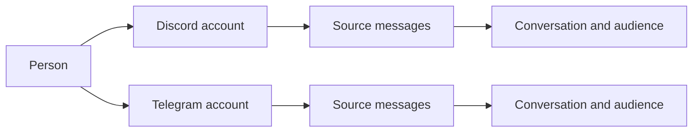

# Memory

Memory belongs to the persona, across all of its interfaces. `data/memory.db` stores people, places, source messages, learned claims, episodes, affinity, intentions and operational records. The core's writer applies changes; readers request an audience-scoped view.

## One person, several accounts

A person and an account are different objects. An account belongs to an interface and has that platform's native ID. A person can have several accounts, including multiple accounts on one interface. The same native ID on two platforms does not identify the same account.



The owner links accounts explicitly in the CLI after the persona has encountered them:

```text
/memory bind discord ACCOUNT_A telegram ACCOUNT_B
/memory accounts discord ACCOUNT_A
/memory unbind discord ACCOUNT_A
```

Names, model suggestions and statements inside a conversation do not create a verified link. `self` as a bind target denotes the persona. Linking accounts changes who they belong to; it does not turn private messages into group messages. [Person links](../src/memory/db/person-links.ts) retains the link history.

Profile and affinity read through the person. The member unit that owns the person's `people` row holds the character, details, episodes and the one affinity score, and `linkedProfileUnit` in `src/memory/db/person-links.ts` finds that unit for any linked account on any interface. `src/memory/store.ts` asks it at every use, so an unlink takes effect at the next read, and a change through any account moves the same score. A decay sweep moves the score of one person once. What belongs to one account stays with it: its native id, its display names, its avatar and how it is addressed. A linked account's own unit writes only those facts (`accountOnly` in `src/memory/db/map/user.ts`), and a `people` row it held before the link rests under its own id until an unlink gives it back. A profile write leaves the account's link columns as the database holds them.

## Owner identity

Use `/memory bind discord ACCOUNT_ID owner` in the owner CLI to designate the owner person. This writes `bot.ownerPerson`. Owner rights then require an account explicitly linked by the owner to that person. `bot.owners` is a legacy fallback while no owner person is designated. It does not broaden the audience of a group or DM turn.

## Places and context

Interfaces contain communities and conversations. A Discord server has channels; a direct conversation has a private audience. The database records these relationships and source locations explicitly. A file path containing a Discord server ID is not the identity of a memory.

A turn gets a bounded selection of relevant information: people nearby, the current place, recent events and recalled passages. The whole database is not inserted into every prompt. Local context helps rank relevant material without restricting all searches to the current server.

## Who can recall what

The observation in `src/memory/db/observe.ts` keeps a conversation's containment. A declared parent gets a row in `places` even when no line was seen in it, so a chain of parents holds whatever order the places are seen in. The row gains its conversation and title from its first own line. A DM has no parent and no community row.

A direct chat with no community is stored under the scope `NO_COMMUNITY` of `src/memory/db/ids.ts`, per interface. It is a storage scope of units only, with no row in `places`, and `src/interface/reads.ts` answers a read under it with null without asking an interface. Its lines keep their DM audience.

Group recall can search stored group experience across interfaces. It excludes private conversations. A DM can retrieve the DM history associated with accounts the owner has linked to that person. Rows keep their original audiences and provenance.

The authenticated owner CLI has a separate internal view across stored memory. The owner's ordinary group or DM conversation retains that conversation's audience rules. Permissions to read stored material do not grant permission to fetch or publish arbitrary live platform content.

[Scope resolution](../src/memory/db/scope.ts) controls visibility. [Recall](../src/memory/db/recall.ts) applies scope and place filters before ranking, limits and surrounding message windows.

## Learning and remembering

Source messages are the evidence. A memory session reads a window and proposes claims, episodes and affinity changes. The writer validates references and applies accepted changes transactionally. A claim records what was learned and the sources supporting it; its versions preserve changes over time.

Recall combines word search, partial word matching, stored vectors and person matches. It ranks hits and returns surrounding conversation so a matching phrase keeps its context. Prefetch brings likely relevant material into a turn; `memory.search` lets the persona ask a more specific question.

An old source does not become unreachable merely because it is outside the recent-context window. Prompt budgets bound what is shown, not the age of everything stored. Review the relevant `memoryDb`, `recall` and `context` settings in [configuration](configuration.md).

## Raw archive and media

The journal preserves recorded activity, while learned memory interprets selected evidence. `model_requests` also stores text requests, their system text, responses, tool calls and parsed think text. Repeated system text is retained per request. These records are not automatically mixed into conversational recall.

The [archive wrapper](../src/llm/archive.ts) awaits writes around model calls. If an archive write fails, it logs the failure and allows the call to continue, so the archive can have a gap. Embedded image bytes become markers; preserved originals and descriptions use the media storage paths. Do not treat the request archive as a byte-for-byte backup of every external media file.

Recall diagnostics also stay in the database, with a bounded recent history.

Successful media descriptions persist across cache eviction and restart. [Media](media.md) explains reuse and rewatching; [diary](diary.md) explains the originals kept under `data/media/`. Back up the whole persona using [persona migration](persona-migration.md#backup-and-restore).

The journal keeps its process marker in `data/run/journal/<interface>/<community>.running`. A leftover marker records an unclean stop; a clean shutdown removes it. It holds no conversation history.
